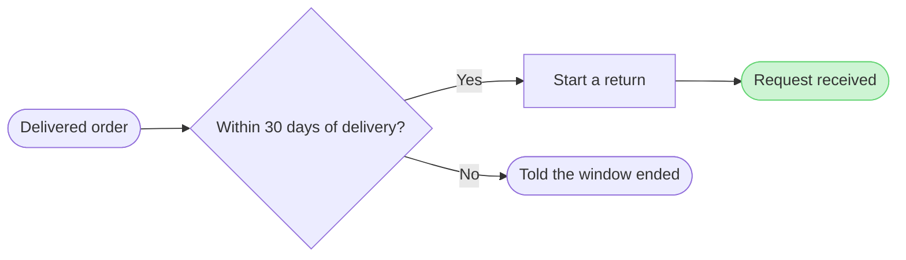

# FJ-037 turn 3 transcript

**User:** Yes, that reading is right.

**Tool call:** `Read` `{"file_path": "/private/var/folders/3c/zfqcqsts0kn19cgblj82gqhm0000gn/T/devin-compare-bench/FJ-037/sk-create-figjam/SKILL.md"}`

**Tool result:** `Read`

```text
"1\t---\n2\tname: sk-create-figjam\n3\tdescription: \"Draws FigJam diagrams, from user flows to sequence, state, ER and gantt, as checked Mermaid models composed into framed boards.\"\n4\tallowed-tools: [Read, Write, Edit, Bash, Glob, Grep, mcp__code_mode__call_tool_chain]\n5\tversion: 1.0.6.0\n6\t---\n7\t\n8\t<!-- Keywords: sk-create-figjam, flow mode, figjam, user flow, process, architecture, sequence diagram, state diagram, er diagram, gantt, flowchart, mermaid, board, $flow, $figjam -->\n9\t\n10\t# FigJam Diagrams\n11\t\n12\tThe Product Owner packet that draws FigJam diagrams. It picks the diagram type the reader's question needs, turns screenshots, a Figma flow, a product doc, a schema or a plan into a Mermaid model of that type with a provenance table, checks the model and, after a yes, composes it into a framed FigJam board with a title, zones, colour by kind and a key. Seven types are drawn: user flow, process, architecture, sequence, state, ER and gantt. The hub [`../SKILL.md`](../SKILL.md) picks this packet, the hub [`../ROUTER.md`](../ROUTER.md) maps a Flow request to its leaves, and Section 2 routes inside it.\n13\t\n14\t---\n15\t\n16\t## 1. WHEN TO USE\n17\t\n18\t- `$flow` or `$figjam`, with no other artifact command\n19\t- FigJam output wording such as \"make a FigJam flow from these screenshots\" or \"a sequence diagram in FigJam\"\n20\t- A request to add notes to or update a FigJam board, including one that carries a `figma.com/board` link\n21\t- A Flow route 
```

**Tool call:** `Read` `{"file_path": "/private/var/folders/3c/zfqcqsts0kn19cgblj82gqhm0000gn/T/devin-compare-bench/FJ-037/sk-create-figjam/references/types/user-flow.md"}`

**Tool result:** `Read`

```text
"1\t---\n2\ttitle: \"FigJam Type - User Flow\"\n3\tdescription: \"A person's path through a product composed as a FigJam board: four shapes, labelled exits, colour by kind, optional zones and a nine-node budget.\"\n4\tcontextType: implementation\n5\timportance_tier: important\n6\ttrigger_phrases:\n7\t  - \"figjam user flow\"\n8\t  - \"user flow rules\"\n9\t  - \"screen flow figjam\"\n10\t  - \"merge dot\"\n11\tversion: 1.0.3.0\n12\t---\n13\t\n14\t# FigJam Type - User Flow\n15\t\n16\tA user flow is the screens and choices one person passes through to reach a goal. It is the default Flow type and the strictest, because it is drawn from screenshots and frames a reader will compare node by node.\n17\t\n18\t**Loading Condition:** CONDITIONAL, when the Flow route draws a user flow\n19\t**Purpose:** The grammar, rules, budget and read-back for a user flow\n20\t**Pairs With:** `assets/flow-templates.md`\n21\t\n22\t---\n23\t\n24\t## 1. WHEN TO USE\n25\t\n26\t**The reader's question:** which screens does a person pass through, and where do they choose?\n27\t\n28\t- A flow drawn from screenshots, from Figma frames or from a product doc that walks one person through the product\n29\t- A platform split, such as desktop and mobile, that rejoins on a later screen\n30\t- A journey, which Flow Mode does not draw as such, redrawn as the screens it visits\n31\t\n32\tUse another type when several people or teams hand work to each other (a process), when the subject is services and stores (an arc
```

**Tool call:** `Read` `{"file_path": "/private/var/folders/3c/zfqcqsts0kn19cgblj82gqhm0000gn/T/devin-compare-bench/FJ-037/sk-create-figjam/assets/flow-templates.md"}`

**Tool result:** `Read`

```text
"1\t---\n2\ttitle: \"Product Owner Flow Templates\"\n3\tdescription: \"User-flow Mermaid patterns, the provenance table and the reply shape for Product Owner Flow Mode, each pattern passing the pre-write check.\"\n4\tcontextType: general\n5\timportance_tier: important\n6\ttrigger_phrases:\n7\t  - \"flow templates\"\n8\t  - \"mermaid flow patterns\"\n9\t  - \"flow provenance table\"\n10\t  - \"flow reply shape\"\n11\tversion: 1.0.2.0\n12\t---\n13\t\n14\t# Product Owner Flow Templates\n15\t\n16\tCopy/apply patterns for Product Owner Flow Mode models.\n17\t\n18\t**Loading Condition:** CONDITIONAL, with `references/flow-mode.md` whenever Flow intent is selected\n19\t**Purpose:** Provides the user-flow patterns, the provenance table every diagram type keeps and the reply shape every type delivers\n20\t**Scope:** Five user-flow patterns, the intake questions, the provenance table and the reply shape. The other types keep their patterns in `assets/templates/`\n21\t**Output Path:** None. The model is working data and the board is the deliverable\n22\t\n23\t---\n24\t\n25\t## 1. OVERVIEW\n26\t\n27\t### Purpose\n28\t\n29\tEvery pattern below passes `scripts/flow_check.py` as a user flow, and `scripts/compose_board.py` composes it into a board. Start from the pattern closest to the flow, rename the nodes after the real screens and triggers, add the board lines below and run the check before the write gate. A process, an architecture, a sequence, a state diagram, an ER diagram or a gantt 
```

**Tool call:** `Read` `{"file_path": "/private/var/folders/3c/zfqcqsts0kn19cgblj82gqhm0000gn/T/devin-compare-bench/FJ-037/sk-create-figjam/references/quality-rubric.md"}`

**Tool result:** `Read`

```text
"1\t---\n2\ttitle: \"FigJam Diagram Quality Rubric\"\n3\tdescription: \"The taste gate a FigJam model passes before the write gate, translated from sk-design-diagram's success criteria: type fit, the remove test, signal, the check, the board, the design rubric that scores a composed board and the reply.\"\n4\tcontextType: implementation\n5\timportance_tier: important\n6\ttrigger_phrases:\n7\t  - \"figjam quality rubric\"\n8\t  - \"diagram taste gate\"\n9\t  - \"remove test\"\n10\t  - \"figjam review checklist\"\n11\t  - \"figjam design rubric\"\n12\tversion: 1.0.3.0\n13\t---\n14\t\n15\t# FigJam Diagram Quality Rubric\n16\t\n17\tThe script checks what a script can see. This rubric is the rest: whether the diagram should exist, whether every node earns its place and whether the reader can trust what lands on the board. Walk it after the check passes and before the write gate.\n18\t\n19\t**Loading Condition:** CONDITIONAL, on every Flow route before the write gate\n20\t**Purpose:** The judgement pass between the pre-write check and the gate\n21\t**Scope:** The model, the provenance table, the planned extensions and, after the write, the board and the reply\n22\t\n23\t---\n24\t\n25\t## 1. TYPE FIT\n26\t\n27\t- [ ] The type answers the reader's question, as `references/flow-mode.md` Section 3 maps it\n28\t- [ ] A table, a list or a paragraph would not do the same job. If it would, say so and offer that instead\n29\t- [ ] The type's reference in `references/types/` was loaded and i
```

**Tool call:** `ToolSearch` `{"query": "select:mcp__figma-remote__create_session,mcp__figma-remote__get_figjam,mcp__figma-remote__whoami,mcp__figma-remote__use_figma", "max_results": 4}`

**Tool result:** `ToolSearch`

```text
[{"type": "tool_reference", "tool_name": "mcp__figma-remote__create_session"}, {"type": "tool_reference", "tool_name": "mcp__figma-remote__get_figjam"}, {"type": "tool_reference", "tool_name": "mcp__figma-remote__whoami"}, {"type": "tool_reference", "tool_name": "mcp__figma-remote__use_figma"}]
```

**Tool call:** `mcp__figma-remote__create_session` `{"fileKey": "<draft-file-key>", "description": "Read the named FigJam file once before the write gate, then compose a Fernhouse self-serve return user flow board into it as a new section if approved"}`

**Tool call:** `Bash` `{"command": "cd /private/var/folders/3c/zfqcqsts0kn19cgblj82gqhm0000gn/T/devin-compare-bench/FJ-037/sk-create-figjam && python3 scripts/flow_check.py --help 2>&1 | head -30; python3 scripts/compose_board.py --help 2>&1 | head -30; mktemp -d", "description": "Show check and composer usage and make a scratch folder"}`

**Tool result:** `mcp__figma-remote__create_session`

```text
"{\"sessionId\":\"767eb205-936c-4482-ad2d-329dd396e6c3\"}"
```

**Tool result:** `Bash`

```text
"mermaid_extract: --help: not a Mermaid file\nUNREADABLE --help: the extractor refused it\n\n  compose_board.py <model.md> [--diagram N] [--out path]  -> 0 the filled code is written, 1 the model fails\n                                                             the check, 2 unreadable or no such diagram\n  compose_board.py <model.md> --model                      -> print the MODEL as JSON instead of the code\n  compose_board.py --template                              -> print the compact code with its MODEL and THEME\n                                                             placeholders, the text the Project's composer\n                                                             Knowledge file carries\n  compose_board.py --design-check                          -> print the design a board is drawn in, what it\n                                                             changes, its measures and the THEME it sends: 0 the\n                                                             design reads with no warning, 1 one or more warnings\n  compose_board.py --self-test                             -> prove every shipped model composes, its counts\n                                                             match the check, the code fits one use_figma call and\n                                                             the board it draws keeps its geometry and its design\n/var/folders/3c/zfqcqsts0kn19cgblj82gqhm0000gn/T/tmp.Z9q43l7Meo"
```

**Tool call:** `Write` `{"file_path": "/var/folders/3c/zfqcqsts0kn19cgblj82gqhm0000gn/T/tmp.Z9q43l7Meo/model.md", "content": "# Model\n\n```mermaid\nflowchart LR\n    %% title: Self-serve return (proposed)\n    %% subtitle: How a Fernhouse customer would start a return from an order, from the delivered order to a received request\n    %% source: Sources: the Story and the Fernhouse company context. No screens supplied. Left out: CS handling, the refund and the warehouse check.\n    orderViewed([Delivered order]) --> window{Within 30 days of delivery?}\n    window -->|Yes| startReturn[Start a return]\n    window -->|N`

**Tool result:** `Write`

```text
"File created successfully at: /var/folders/3c/zfqcqsts0kn19cgblj82gqhm0000gn/T/tmp.Z9q43l7Meo/model.md (file state is current in your context \u2014 no need to Read it back)"
```

**Tool call:** `mcp__figma-remote__get_figjam` `{"fileKey": "<draft-file-key>", "nodeId": "0:1", "sessionId": "767eb205-936c-4482-ad2d-329dd396e6c3"}`

**Tool result:** `mcp__figma-remote__get_figjam`

```text
[{"type": "text", "text": "<canvas id=\"0:1\" name=\"Page 1\" x=\"0\" y=\"0\" width=\"0\" height=\"0\" />"}, {"type": "image", "source": {"type": "base64", "media_type": "image/png", "data": "iVBORw0KGgoAAAANSUhEUgAAAAEAAAABCAYAAAAfFcSJAAAACXBIWXMAAAsTAAALEwEAmpwYAAAAAXNSR0IArs4c6QAAAARnQU1BAACxjwv8YQUAAAAOdEVYdFNvZnR3YXJlAEZpZ21hnrGWYwAAABBJREFUeAEBBQD6/wAAAAAAAAUAAWR4lTgAAAAASUVORK5CYII="}}, {"type": "text", "text": "[Image: source: /Users/michelkerkmeester/.claude/projects/-private-var-folders-3c-zfqcqsts0kn19cgblj82gqhm0000gn-T-devin-compare-bench-FJ-037/34db49d8-1ce8-49f2-8fe9-a2ad472f658d/tool-results/mcp-figma-remote-blob-1793052567344-uedl4k.png]"}]
```

**Tool call:** `Bash` `{"command": "S=/var/folders/3c/zfqcqsts0kn19cgblj82gqhm0000gn/T/tmp.Z9q43l7Meo && python3 scripts/flow_check.py $S/model.md; echo \"exit $?\"; python3 scripts/compose_board.py $S/model.md --diagram 1 --out $S/code.js; echo \"exit $?\"; wc -c $S/code.js", "description": "Run pre-write check and compose the board code into scratch"}`

**Tool result:** `Bash`

```text
"  diagram 1, user flow: ok, 5 nodes and 4 connectors, widest rank 2 steps, longest path 4 steps, 0.8 connectors per step, labels average 19 characters, 0 crossing pairs\nPASSED 1 diagram(s) in model.md\nexit 0\nCOMPOSED diagram 1, 5 nodes and 4 connectors, widest rank 2 steps, longest path 4 steps, 0.8 connectors per step, labels average 19 characters, 0 crossing pairs: 5 nodes and 4 connectors to read back, 41632 characters in /var/folders/3c/zfqcqsts0kn19cgblj82gqhm0000gn/T/tmp.Z9q43l7Meo/code.js, drawn in the design FigJam default\nexit 0\n   41632 /var/folders/3c/zfqcqsts0kn19cgblj82gqhm0000gn/T/tmp.Z9q43l7Meo/code.js"
```

**Assistant:**

The model passed the pre-write check, and I read the file you named once. It has one empty page, so no section shares this board's title. Nothing is written yet.



Check result: 5 nodes, 4 connectors, 0 crossing pairs, and the board code composes within one `use_figma` call.

Question: which screens does a customer pass through to start a return from an order, and where do they choose?
Outcome: a reader can follow a return from the order to a received request and see where the `30 days` window ends it.
First glance: the received request, the goal the flow reaches.
Second glance: the `30 days` decision that leads to it.
Last glance: the window-ended exit.
File: the existing FigJam file `<draft-file-key>`, as a new section beside what it holds. The file is empty, so nothing already there changes.
Writes: one composed board titled "Self-serve return (proposed)", with 5 nodes and 4 connectors, a key and a source line, at the Laptop reading distance.
Extensions: none.
Calls: one `use_figma` and one `get_figjam` read-back. The read I just made also counts toward a Starter plan's six-call monthly allowance.
Rollback: delete the one board section the write returns, which I do only on its own yes.

Three things differ from the playback:
1. **Labels:** they name outcomes, not screens, because no screens were supplied. The source line says so.
2. **Proposed status:** the company context says no self-serve return exists today, so every step except the `30 days` window is a proposal. I carry that in the title and subtitle instead of in each label.
3. **CS handling:** it is left off the board. It is not a step the customer passes through, and the source line names it as left out.

Write it?
