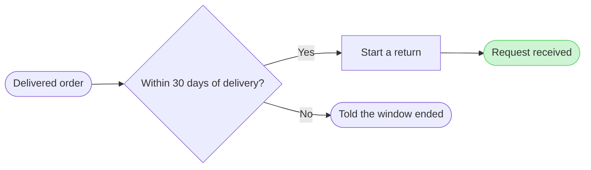

The model passed the pre-write check, and I read the file you named once. It has one empty page, so no section shares this board's title. Nothing is written yet.

Check result: 5 nodes, 4 connectors, 0 crossing pairs, and the board code composes within one `use_figma` call.

Question: which screens does a customer pass through to start a return from an order, and where do they choose?
Outcome: a reader can follow a return from the order to a received request and see where the `30 days` window ends it.
First glance: the received request, the goal the flow reaches.
Second glance: the `30 days` decision that leads to it.
Last glance: the window-ended exit.
File: the existing FigJam file `<draft-file-key>`, as a new section beside what it holds. The file is empty, so nothing already there changes.
Writes: one composed board titled "Self-serve return (proposed)", with 5 nodes and 4 connectors, a key and a source line, at the Laptop reading distance.
Extensions: none.
Calls: one `use_figma` and one `get_figjam` read-back. The read I just made also counts toward a Starter plan's six-call monthly allowance.
Rollback: delete the one board section the write returns, which I do only on its own yes.

Three things differ from the playback:
1. **Labels:** they name outcomes, not screens, because no screens were supplied. The source line says so.
2. **Proposed status:** the company context says no self-serve return exists today, so every step except the `30 days` window is a proposal. I carry that in the title and subtitle instead of in each label.
3. **CS handling:** it is left off the board. It is not a step the customer passes through, and the source line names it as left out.

Write it?