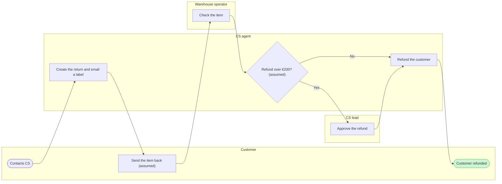

# FJ-039 turn 3 transcript

**User:** Yes, that reading is right.

**Tool call:** `ToolSearch` `{"query": "select:mcp__figma-remote__create_session,mcp__figma-remote__get_figjam,mcp__figma-remote__use_figma,mcp__figma-remote__whoami,mcp__figma-remote__create_new_file", "max_results": 5}`

**Tool result:** `ToolSearch`

```text
[{"type": "tool_reference", "tool_name": "mcp__figma-remote__create_session"}, {"type": "tool_reference", "tool_name": "mcp__figma-remote__get_figjam"}, {"type": "tool_reference", "tool_name": "mcp__figma-remote__use_figma"}, {"type": "tool_reference", "tool_name": "mcp__figma-remote__whoami"}, {"type": "tool_reference", "tool_name": "mcp__figma-remote__create_new_file"}]
```

**Tool call:** `Read` `{"file_path": "/private/var/folders/3c/zfqcqsts0kn19cgblj82gqhm0000gn/T/devin-compare-bench/FJ-039/sk-create-figjam/references/style-guide.md"}`

**Tool result:** `Read`

```text
"1\t---\n2\ttitle: \"FigJam Diagram Style Guide\"\n3\tdescription: \"The colour every composed FigJam board draws by kind in the shipped design, the type scale and the 8 pixel grid, the palette pairs the check accepts with their measured contrast, and the spacing bands, translated from sk-design-diagram's style guide and derivation record.\"\n4\tcontextType: implementation\n5\timportance_tier: important\n6\ttrigger_phrases:\n7\t  - \"figjam style guide\"\n8\t  - \"figjam palette\"\n9\t  - \"figjam colour by kind\"\n10\t  - \"figjam type scale\"\n11\t  - \"palette derivation record\"\n12\t  - \"figjam contrast\"\n13\tversion: 1.0.3.0\n14\t---\n15\t\n16\t# FigJam Diagram Style Guide\n17\t\n18\tThe rules for colour, type and spacing on a FigJam board. The composer in `assets/compose-board.js` draws every board in the design `assets/figjam-design.md` holds, which ships as the tables below record, and every hex a model, a design or a note extension uses comes from the palette in Section 3. `scripts/flow_check.py` refuses any other.\n19\t\n20\t**Loading Condition:** CONDITIONAL, before the gate on every Flow route, and when a model or a note extension uses colour\n21\t**Purpose:** Names the colour each kind draws in, the type scale, the grid, the palette pairs the check accepts and the measured contrast record\n22\t**Scope:** The composed board, Mermaid `style`, `classDef` and `linkStyle` colours, sticky and pin colours for notes, and the contrast record the self-test re-measures\n
```

**Tool call:** `Bash` `{"command": "grep -n -E \"Returns\\.|CS agent can refund|issues refunds\" context/fernhouse-context.md; python3 sk-create-figjam/scripts/flow_check.py --help 2>&1 | head -30; python3 sk-create-figjam/scripts/compose_board.py --help 2>&1 | head -30", "description": "Re-read inferred source lines and show script usage"}`

**Tool result:** `Bash`

```text
"29:| `CS agent` | Admin and the helpdesk | Answers contacts by email and chat, looks up orders, issues refunds and creates returns |\n33:Admin permissions follow the job. A CS agent can refund up to \u20ac200 per order, and a CS lead approves anything above that. Only merchandisers can create or change a promotion. Warehouse operators see orders and shipments but no payment details.\n145:6. **Returns.** Customers have `30 days` from delivery. There is no self-serve return today. The customer contacts CS, a CS agent creates the return in Admin and emails a return label, the warehouse checks the item, and the agent refunds. CS handles about `1,900` return requests a month, and a refund takes `6 days` on average from the first contact.\nmermaid_extract: --help: not a Mermaid file\nUNREADABLE --help: the extractor refused it\n\n  compose_board.py <model.md> [--diagram N] [--out path]  -> 0 the filled code is written, 1 the model fails\n                                                             the check, 2 unreadable or no such diagram\n  compose_board.py <model.md> --model                      -> print the MODEL as JSON instead of the code\n  compose_board.py --template                              -> print the compact code with its MODEL and THEME\n                                                             placeholders, the text the Project's composer\n                                                             Knowledge file carries\n  compose_board.py --design-check    
```

**Tool call:** `Bash` `{"command": "S=$(mktemp -d) && echo \"$S\" && cat > \"$S/model.md\" <<'EOF'\n```mermaid\n%% type: process\n%% title: Fernhouse return today\n%% subtitle: How a return runs today, from the customer's first contact to the refund. About 1,900 requests a month, 6 days on average to refund.\n%% source: Sources: Fernhouse company context, 2026-09-18. Left out: requests outside 30 days, failed item checks, return shipping, the refund email.\nflowchart LR\n    subgraph customer [\"Customer\"]\n        ask([Contacts CS])\n        sendBack[Send the item back]\n        done([Customer refunded])\n    end\`

**Tool result:** `Bash`

```text
"/var/folders/3c/zfqcqsts0kn19cgblj82gqhm0000gn/T/tmp.4yIR7dVhjf\n  diagram 1, process: the longest path runs 9 steps, at most 8: split the flow\nFAILED 1 of 1 diagram(s) in model.md\nexit 1"
```

**Tool call:** `Bash` `{"command": "S=/var/folders/3c/zfqcqsts0kn19cgblj82gqhm0000gn/T/tmp.4yIR7dVhjf && cat > \"$S/model.md\" <<'EOF'\n```mermaid\n%% type: process\n%% title: Fernhouse return today\n%% subtitle: How a return runs today, from the customer's first contact to the refund. About 1,900 requests a month, 6 days on average to refund.\n%% source: Sources: Fernhouse company context, 2026-09-18. Left out: requests outside 30 days, failed item checks, return shipping, the refund email.\nflowchart LR\n    subgraph customer [\"Customer\"]\n        ask([Contacts CS])\n        sendBack[Send the item back]\n       `

**Tool result:** `Bash`

```text
"  diagram 1, process: ok, 8 nodes and 8 connectors, widest rank 1 steps, longest path 8 steps, 1.0 connectors per step, labels average 19 characters, 0 crossing pairs\nPASSED 1 diagram(s) in model.md\nexit 0\nCOMPOSED diagram 1, 8 nodes and 8 connectors, widest rank 1 steps, longest path 8 steps, 1.0 connectors per step, labels average 19 characters, 0 crossing pairs: 8 nodes and 8 connectors to read back, 42251 characters in /var/folders/3c/zfqcqsts0kn19cgblj82gqhm0000gn/T/tmp.4yIR7dVhjf/code.js, drawn in the design FigJam default\nexit 0\n   42253 /var/folders/3c/zfqcqsts0kn19cgblj82gqhm0000gn/T/tmp.4yIR7dVhjf/code.js"
```

**Tool call:** `mcp__figma-remote__create_session` `{"fileKey": "<draft-file-key>", "description": "Draw the Fernhouse return process as a new board section in the existing FigJam file"}`

**Tool result:** `mcp__figma-remote__create_session`

```text
"{\"sessionId\":\"a9d8577e-e175-47cf-8ab6-13199a06a9ee\"}"
```

**Tool call:** `mcp__figma-remote__get_figjam` `{"fileKey": "<draft-file-key>", "nodeId": "0:1", "includeImagesOfNodes": false, "sessionId": "a9d8577e-e175-47cf-8ab6-13199a06a9ee"}`

**Tool result:** `mcp__figma-remote__get_figjam`

```text
[{"type": "text", "text": "<canvas id=\"0:1\" name=\"Page 1\" x=\"0\" y=\"0\" width=\"0\" height=\"0\">\n  <section id=\"1:3\" name=\"Loomlist block sync\" x=\"0\" y=\"0\" width=\"2832\" height=\"1432\">\n    <text id=\"1:4\" name=\"Loomlist block sync\" x=\"80\" y=\"80\" width=\"622\" height=\"77\" />\n    <text id=\"1:5\" name=\"The services that carry a block change from a Loomlist client to a woken iOS device, for engineers on sync\" x=\"80\" y=\"173\" width=\"1440\" height=\"34\" />\n    <section id=\"1:6\" name=\"Clients\" x=\"80\" y=\"272\" width=\"320\" height=\"592\">\n      <text id=\"1:7\" name=\"Clients\" x=\"32\" y=\"32\" width=\"82\" height=\"29\" />\n      <shape-with-text id=\"1:18\" x=\"48\" y=\"96\" width=\"224\" height=\"96\" name=\"ROUNDED_RECTANGLE\">Desktop client</shape-with-text>\n      <shape-with-text id=\"1:22\" x=\"48\" y=\"272\" width=\"224\" height=\"96\" name=\"ROUNDED_RECTANGLE\">Web client</shape-with-text>\n      <shape-with-text id=\"1:26\" x=\"48\" y=\"448\" width=\"224\" height=\"96\" name=\"ROUNDED_RECTANGLE\">iOS client</shape-with-text>\n    </section>\n    <section id=\"1:8\" name=\"Edge\" x=\"568\" y=\"448\" width=\"320\" height=\"240\">\n      <text id=\"1:9\" name=\"Edge\" x=\"32\" y=\"32\" width=\"59\" height=\"29\" />\n      <shape-with-text id=\"1:30\" x=\"48\" y=\"96\" width=\"224\" height=\"96\" name=\"ROUNDED_RECTANGLE\">API gateway</shape-with-text>\n    </section>\n    <connector id=\"1:69\" x=\"356.5\" y=\"572.5\" connector
```

**Tool call:** `Bash` `{"command": "S=/var/folders/3c/zfqcqsts0kn19cgblj82gqhm0000gn/T/tmp.4yIR7dVhjf && sed -i '' -e 's|sendBack\\[Send the item back\\]|sendBack[\"Send the item back (assumed)\"]|' -e 's|overLimit{Refund over €200?}|overLimit{\"Refund over €200? (assumed)\"}|' \"$S/model.md\" && grep -n -E \"sendBack\\[|overLimit\\{\" \"$S/model.md\" && python3 sk-create-figjam/scripts/flow_check.py \"$S/model.md\" && python3 sk-create-figjam/scripts/compose_board.py \"$S/model.md\" --diagram 1 --out \"$S/code.js\"; echo \"exit $?\"", "description": "Mark inferred labels, recheck and recompose"}`

**Tool result:** `Bash`

```text
"9:        sendBack[\"Send the item back (assumed)\"]\n14:        overLimit{\"Refund over \u20ac200? (assumed)\"}\n  diagram 1, process: ok, 8 nodes and 8 connectors, widest rank 1 steps, longest path 8 steps, 1.0 connectors per step, labels average 21 characters, 0 crossing pairs\nPASSED 1 diagram(s) in model.md\nCOMPOSED diagram 1, 8 nodes and 8 connectors, widest rank 1 steps, longest path 8 steps, 1.0 connectors per step, labels average 21 characters, 0 crossing pairs: 8 nodes and 8 connectors to read back, 42271 characters in /var/folders/3c/zfqcqsts0kn19cgblj82gqhm0000gn/T/tmp.4yIR7dVhjf/code.js, drawn in the design FigJam default\nexit 0"
```

**Assistant:**

The model passes the pre-write check and the board code is composed. Nothing is written yet. This is the write gate, and it asks about the write alone.

**Two changes since the playback**
- **Merged step.** The check allows a longest path of 8 steps, and the outline had 9. "Create the return in Admin" and "Email a return label" are one agent doing both in the same moment, so I merged them into one step: "Create the return and email a label". The board now has 8 nodes and 8 connectors.
- **Assumed marks.** Two labels now carry "(assumed)": "Send the item back" and "Refund over €200?". They are the two readings you confirmed that the source doesn't state, and the board shouldn't show them as sourced fact.

**The sketch**



**Glance lines**
- First glance: "Customer refunded", the green end with the pink outline
- Second glance: the "Refund over €200?" decision and the CS lead branch
- Last glance: the source line and the left-out items

**Critique answers**
- **Where the eye goes first:** The accented end. It is the outcome, but at the far right it is not the handoff the board most needs read. I'd keep it, since no source says which handoff is slowest.
- **Handoffs without crossings:** The check reports 0 crossing pairs. 7 of the 8 connectors cross a lane.
- **Two owners on one step:** None. The merged step belongs to the CS agent alone.
- **Greyscale:** Shapes carry the kinds, with stadiums for the ends and a diamond for the decision. The goal also has a heavier outline, and the key names every mark.

**The write**
- **File:** The existing FigJam file `<draft-file-key>`. The board lands as a new section, 400 pixels right of the two sections already there. An existing file needs no plan and no new file, so the Fernhouse Product plan and the Barter team plan don't come into it. The Barter drafts fallback only applies if this file turns out unreachable, and I'd ask you first.
- **Title clash:** None. The file holds "Loomlist block sync" and "Fernhouse damaged-item refund", and neither shares this board's title. Neither is touched.
- **Extensions:** None.
- **Calls:** One `use_figma` call to compose, then one `get_figjam` read-back. The file read before this gate was one more. If your seat is limited to six tool calls a month, this work spends four of them.
- **Rollback:** Delete the one new board section the write returns, through `use_figma`. I'd do that only on its own yes, naming the board "Fernhouse return today".

Should I write the "Fernhouse return today" board into `<draft-file-key>` as described?
