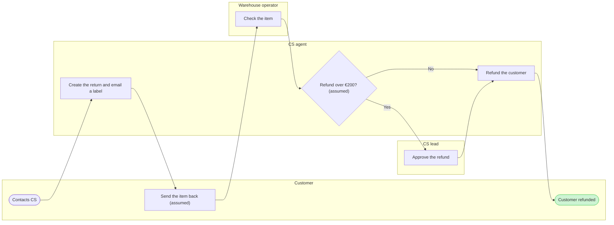

The model passes the pre-write check and the board code is composed. Nothing is written yet. This is the write gate, and it asks about the write alone.

**Two changes since the playback**
- **Merged step.** The check allows a longest path of 8 steps, and the outline had 9. "Create the return in Admin" and "Email a return label" are one agent doing both in the same moment, so I merged them into one step: "Create the return and email a label". The board now has 8 nodes and 8 connectors.
- **Assumed marks.** Two labels now carry "(assumed)": "Send the item back" and "Refund over €200?". They are the two readings you confirmed that the source doesn't state, and the board shouldn't show them as sourced fact.

**The sketch**

**Glance lines**
- First glance: "Customer refunded", the green end with the pink outline
- Second glance: the "Refund over €200?" decision and the CS lead branch
- Last glance: the source line and the left-out items

**Critique answers**
- **Where the eye goes first:** The accented end. It is the outcome, but at the far right it is not the handoff the board most needs read. I'd keep it, since no source says which handoff is slowest.
- **Handoffs without crossings:** The check reports 0 crossing pairs. 7 of the 8 connectors cross a lane.
- **Two owners on one step:** None. The merged step belongs to the CS agent alone.
- **Greyscale:** Shapes carry the kinds, with stadiums for the ends and a diamond for the decision. The goal also has a heavier outline, and the key names every mark.

**The write**
- **File:** The existing FigJam file `<draft-file-key>`. The board lands as a new section, 400 pixels right of the two sections already there. An existing file needs no plan and no new file, so the Fernhouse Product plan and the Barter team plan don't come into it. The Barter drafts fallback only applies if this file turns out unreachable, and I'd ask you first.
- **Title clash:** None. The file holds "Loomlist block sync" and "Fernhouse damaged-item refund", and neither shares this board's title. Neither is touched.
- **Extensions:** None.
- **Calls:** One `use_figma` call to compose, then one `get_figjam` read-back. The file read before this gate was one more. If your seat is limited to six tool calls a month, this work spends four of them.
- **Rollback:** Delete the one new board section the write returns, through `use_figma`. I'd do that only on its own yes, naming the board "Fernhouse return today".

Should I write the "Fernhouse return today" board into `<draft-file-key>` as described?