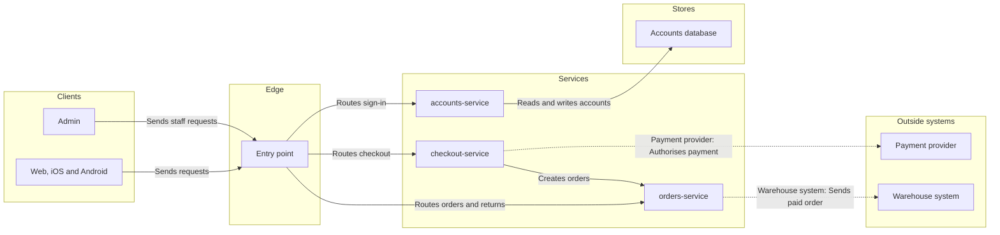

# FJ-040 turn 3 transcript

**User:** Yes, that reading is right.

**Tool call:** `ToolSearch` `{"query": "select:mcp__figma-remote__create_session,mcp__figma-remote__get_figjam,mcp__figma-remote__use_figma,mcp__figma-remote__whoami,mcp__figma-remote__get_screenshot", "max_results": 5}`

**Tool result:** `ToolSearch`

```text
[{"type": "tool_reference", "tool_name": "mcp__figma-remote__create_session"}, {"type": "tool_reference", "tool_name": "mcp__figma-remote__get_figjam"}, {"type": "tool_reference", "tool_name": "mcp__figma-remote__use_figma"}, {"type": "tool_reference", "tool_name": "mcp__figma-remote__whoami"}, {"type": "tool_reference", "tool_name": "mcp__figma-remote__get_screenshot"}]
```

**Tool call:** `Read` `{"file_path": "/private/var/folders/3c/zfqcqsts0kn19cgblj82gqhm0000gn/T/devin-compare-bench/FJ-040/sk-create-figjam/assets/examples/architecture-loomlist-sync.md"}`

**Tool result:** `Read`

```text
"1\t---\n2\ttitle: \"Example - Architecture - Loomlist Sync\"\n3\tdescription: \"A worked architecture on the fictional Loomlist workspace app: an engineering doc turned into the sync path through Figma's six lanes, cut to budget with the cut named, a playback, a gate message and the reply.\"\n4\tcontextType: general\n5\timportance_tier: normal\n6\ttrigger_phrases:\n7\t  - \"architecture example\"\n8\t  - \"loomlist sync architecture\"\n9\tversion: 1.0.1.0\n10\t---\n11\t\n12\t# Example - Architecture - Loomlist Sync\n13\t\n14\tLoomlist is a fictional workspace app used across the Product Owner fixtures. Every service and store here is invented for the example.\n15\t\n16\t---\n17\t\n18\t## 1. REQUEST\n19\t\n20\t```text\n21\t$figjam the architecture behind block sync, from the sync-service doc, for the offline mode kickoff\n22\t```\n23\t\n24\tThe doc names these deployable parts: the desktop, web and iOS clients, an API gateway, sync-service, a push worker, the blocks database, file storage, a change stream and Apple's push service. It says clients hold a live socket to the gateway, sync-service writes every block change and publishes it to the change stream, and the push worker reads the stream and wakes sleeping iOS devices.\n25\t\n26\t---\n27\t\n28\t## 2. TYPE AND DIALS\n29\t\n30\t- **Reader question:** which parts take part in sync and how do they connect? An architecture. A sequence would answer the order of one sync, which the kickoff did not ask for\n31\t- **Detail:** ba
```

**Tool call:** `Bash` `{"command": "mktemp -d /tmp/figjam-fernhouse.XXXXXX", "description": "Create scratch folder for model and composed code"}`

**Tool result:** `Bash`

```text
"/tmp/figjam-fernhouse.B87r2H"
```

**Tool call:** `Bash` `{"command": "S=/tmp/figjam-fernhouse.B87r2H && cat > $S/model.md <<'EOF'\n```mermaid\n%% type: architecture\nflowchart LR\n    %% title: Fernhouse product architecture\n    %% subtitle: Which services handle signup, returns and refunds, the warehouse handoff and billing, for anyone writing a ticket\n    %% source: Source: Fernhouse company context, updated 2026-09-18. Assumed: the Entry point, the Accounts database and the checkout to orders call. Left out: signup steps, invoices, the refund payout path, shipping-service, the carriers, the event queue and the other databases.\n    %% focus: or`

**Tool result:** `Bash`

```text
"  diagram 1, architecture: ok, 9 nodes and 9 connectors, widest rank 3 steps, longest path 5 steps, 1.0 connectors per step, labels average 15 characters, 1 crossing pairs\nPASSED 1 diagram(s) in model.md"
```

**Tool call:** `Bash` `{"command": "S=/tmp/figjam-fernhouse.B87r2H && cd /private/var/folders/3c/zfqcqsts0kn19cgblj82gqhm0000gn/T/devin-compare-bench/FJ-040 && python3 sk-create-figjam/scripts/compose_board.py $S/model.md --diagram 1 --out $S/board1.js 2>&1 | tail -15; wc -c $S/board1.js; grep -n \"crossing\" sk-create-figjam/scripts/figjam_checks/layout.py | head", "description": "Compose board code and check layout crossing budget"}`

**Tool result:** `Bash`

```text
"COMPOSED diagram 1, 9 nodes and 9 connectors, widest rank 3 steps, longest path 5 steps, 1.0 connectors per step, labels average 15 characters, 1 crossing pairs: 9 nodes and 9 connectors to read back, 42836 characters in /tmp/figjam-fernhouse.B87r2H/board1.js, drawn in the design FigJam default\n   42836 /tmp/figjam-fernhouse.B87r2H/board1.js\n15:ranks are read. The crossing count is an estimate: the layout reorders each rank\n100:def crossing_count(edges: list[Edge], ranks: dict[str, int], position: dict[str, int]) -> int:\n134:    crossings = crossing_count(inside, ranks, position)\n145:    if crossings > MAX_CROSSINGS:\n146:        problems.append(f\"{crossings} connector pairs swap sides, at most {MAX_CROSSINGS}: \"\n155:               f\"labels average {average} characters, {crossings} crossing pairs\")"
```

**Tool call:** `mcp__figma-remote__create_session` `{"fileKey": "<draft-file-key>", "description": "Add a Fernhouse product architecture board as a new section in the existing FigJam file, then read it back"}`

**Tool result:** `mcp__figma-remote__create_session`

```text
"{\"sessionId\":\"402a03c9-e03d-440e-bf73-56c9662fbfaa\"}"
```

**Tool call:** `mcp__figma-remote__get_figjam` `{"fileKey": "<draft-file-key>", "nodeId": "0:1", "sessionId": "402a03c9-e03d-440e-bf73-56c9662fbfaa", "includeImagesOfNodes": false}`

**Tool result:** `mcp__figma-remote__get_figjam`

```text
[{"type": "text", "text": "<canvas id=\"0:1\" name=\"Page 1\" x=\"0\" y=\"0\" width=\"0\" height=\"0\">\n  <section id=\"1:3\" name=\"Checkout payment, authorised card\" x=\"0\" y=\"0\" width=\"1344\" height=\"1456\">\n    <text id=\"1:4\" name=\"Checkout payment, authorised card\" x=\"80\" y=\"80\" width=\"1121\" height=\"77\" />\n    <text id=\"1:5\" name=\"The calls a Roamstay checkout makes, in order, when the card is authorised\" x=\"80\" y=\"173\" width=\"1184\" height=\"34\" />\n    <shape-with-text id=\"1:6\" x=\"80\" y=\"272\" width=\"224\" height=\"96\" name=\"ROUNDED_RECTANGLE\">GuestApp</shape-with-text>\n    <shape-with-text id=\"1:10\" x=\"80\" y=\"960\" width=\"224\" height=\"48\" name=\"ROUNDED_RECTANGLE\">GuestApp</shape-with-text>\n    <connector id=\"1:14\" x=\"192\" y=\"372.5\" connectorStart=\"1:6\" connectorStartCap=\"NONE\" connectorEnd=\"1:10\" connectorEndCap=\"NONE\">life:GuestApp</connector>\n    <shape-with-text id=\"1:18\" x=\"400\" y=\"272\" width=\"224\" height=\"96\" name=\"ROUNDED_RECTANGLE\">BookingApi</shape-with-text>\n    <shape-with-text id=\"1:22\" x=\"400\" y=\"960\" width=\"224\" height=\"48\" name=\"ROUNDED_RECTANGLE\">BookingApi</shape-with-text>\n    <connector id=\"1:26\" x=\"512\" y=\"372.5\" connectorStart=\"1:18\" connectorStartCap=\"NONE\" connectorEnd=\"1:22\" connectorEndCap=\"NONE\">life:BookingApi</connector>\n    <shape-with-text id=\"1:30\" x=\"720\" y=\"272\" width=\"224\" height=\"96\" name=\"ROUNDED_RECTANGLE\">Payment
```

**Assistant:**

The model passes the check and composes at 42,836 of 50,000 characters, and I've read the file once. The gate is next, and nothing is written yet.



Check: `PASSED`, 9 nodes and 9 connectors, longest path 5 steps, 1 crossing pair estimated, which is inside the layout band. The composer draws the real routes.

**Question:** Which part of Fernhouse handles signup, returns and refunds, the warehouse handoff and billing, and how do they connect?

**Outcome:** The reader can name the owning service and the outside system it calls.

**First glance:** orders-service, marked "Owns returns and refunds".

**Second glance:** the Payment provider and the Warehouse system, each with the call into it.

**Last glance:** the Entry point and the Accounts database, both assumed.

**File:** the existing FigJam file `<draft-file-key>`. It holds one section today, "Checkout payment, authorised card", a Roamstay board. Its title differs from this board's, so nothing clashes. The new board lands 400 pixels to the right of it, and the existing section stays as it is. A file you named needs no plan and no `create_new_file`, so I'm not using the Fernhouse Product plan or the Barter plan.

**Writes:** one composed board named "Fernhouse product architecture". It has 9 nodes, 9 connectors and 5 lanes, plus a title, a subtitle, a key and a source line, at Laptop distance.

**Extensions:** none.

**Calls:** one `use_figma` to compose the board and one `get_figjam` to read it back. If you're on a Starter plan or a View or Collab seat, the monthly limit is six tool calls, and reads count against it.

**Rollback:** delete the one new board section the write returns. I'd do that only on your yes to a question that names the board, and the Roamstay section would not be touched.

Write the board into that file?
