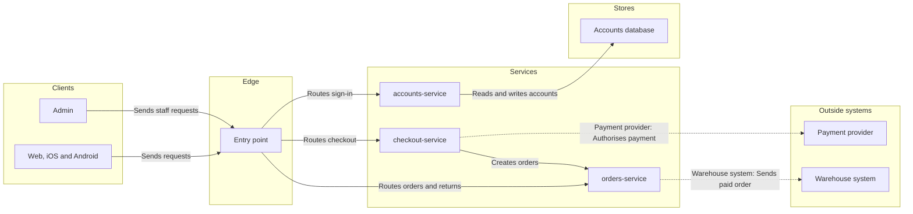

The model passes the check and composes at 42,836 of 50,000 characters, and I've read the file once. The gate is next, and nothing is written yet.

Check: `PASSED`, 9 nodes and 9 connectors, longest path 5 steps, 1 crossing pair estimated, which is inside the layout band. The composer draws the real routes.

**Question:** Which part of Fernhouse handles signup, returns and refunds, the warehouse handoff and billing, and how do they connect?

**Outcome:** The reader can name the owning service and the outside system it calls.

**First glance:** orders-service, marked "Owns returns and refunds".

**Second glance:** the Payment provider and the Warehouse system, each with the call into it.

**Last glance:** the Entry point and the Accounts database, both assumed.

**File:** the existing FigJam file `<draft-file-key>`. It holds one section today, "Checkout payment, authorised card", a Roamstay board. Its title differs from this board's, so nothing clashes. The new board lands 400 pixels to the right of it, and the existing section stays as it is. A file you named needs no plan and no `create_new_file`, so I'm not using the Fernhouse Product plan or the Barter plan.

**Writes:** one composed board named "Fernhouse product architecture". It has 9 nodes, 9 connectors and 5 lanes, plus a title, a subtitle, a key and a source line, at Laptop distance.

**Extensions:** none.

**Calls:** one `use_figma` to compose the board and one `get_figjam` to read it back. If you're on a Starter plan or a View or Collab seat, the monthly limit is six tool calls, and reads count against it.

**Rollback:** delete the one new board section the write returns. I'd do that only on your yes to a question that names the board, and the Roamstay section would not be touched.

Write the board into that file?