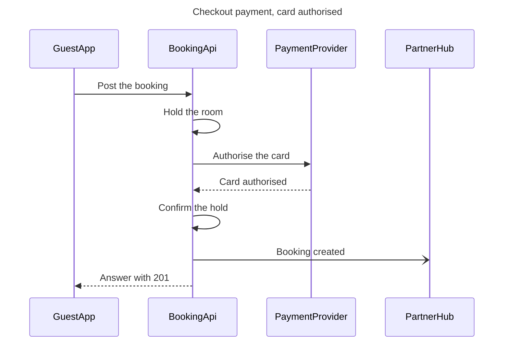

# FJ-001 turn 2 transcript

**User:** Yes, that reading is right.

**Tool call:** `Read` `{"file_path": "/private/var/folders/3c/zfqcqsts0kn19cgblj82gqhm0000gn/T/devin-compare-bench/FJ-001/sk-create-figjam/references/quality-rubric.md"}`

**Tool result:** `Read`

```text
"1\t---\n2\ttitle: \"FigJam Diagram Quality Rubric\"\n3\tdescription: \"The taste gate a FigJam model passes before the write gate, translated from sk-design-diagram's success criteria: type fit, the remove test, signal, the check, the board, the design rubric that scores a composed board and the reply.\"\n4\tcontextType: implementation\n5\timportance_tier: important\n6\ttrigger_phrases:\n7\t  - \"figjam quality rubric\"\n8\t  - \"diagram taste gate\"\n9\t  - \"remove test\"\n10\t  - \"figjam review checklist\"\n11\t  - \"figjam design rubric\"\n12\tversion: 1.0.2.0\n13\t---\n14\t\n15\t# FigJam Diagram Quality Rubric\n16\t\n17\tThe script checks what a script can see. This rubric is the rest: whether the diagram should exist, whether every node earns its place and whether the reader can trust what lands on the board. Walk it after the check passes and before the write gate.\n18\t\n19\t**Loading Condition:** CONDITIONAL, on every Flow route before the write gate\n20\t**Purpose:** The judgement pass between the pre-write check and the gate\n21\t**Scope:** The model, the provenance table, the planned extensions and, after the write, the board and the reply\n22\t\n23\t---\n24\t\n25\t## 1. TYPE FIT\n26\t\n27\t- [ ] The type answers the reader's question, as `references/flow-mode.md` Section 3 maps it\n28\t- [ ] A table, a list or a paragraph would not do the same job. If it would, say so and offer that instead\n29\t- [ ] The type's reference in `references/types/` was loaded and i
```

**Tool call:** `Read` `{"file_path": "/private/var/folders/3c/zfqcqsts0kn19cgblj82gqhm0000gn/T/devin-compare-bench/FJ-001/sk-create-figjam/references/style-guide.md"}`

**Tool result:** `Read`

```text
"1\t---\n2\ttitle: \"FigJam Diagram Style Guide\"\n3\tdescription: \"The colour every composed FigJam board draws by kind in the shipped design, the type scale and the 8 pixel grid, the palette pairs the check accepts with their measured contrast, and the spacing bands, translated from sk-design-diagram's style guide and derivation record.\"\n4\tcontextType: implementation\n5\timportance_tier: important\n6\ttrigger_phrases:\n7\t  - \"figjam style guide\"\n8\t  - \"figjam palette\"\n9\t  - \"figjam colour by kind\"\n10\t  - \"figjam type scale\"\n11\t  - \"palette derivation record\"\n12\t  - \"figjam contrast\"\n13\tversion: 1.0.2.0\n14\t---\n15\t\n16\t# FigJam Diagram Style Guide\n17\t\n18\tThe rules for colour, type and spacing on a FigJam board. The composer in `assets/compose-board.js` draws every board in the design `assets/figjam-design.md` holds, which ships as the tables below record, and every hex a model, a design or a note extension uses comes from the palette in Section 3. `scripts/flow_check.py` refuses any other.\n19\t\n20\t**Loading Condition:** CONDITIONAL, before the gate on every Flow route, and when a model or a note extension uses colour\n21\t**Purpose:** Names the colour each kind draws in, the type scale, the grid, the palette pairs the check accepts and the measured contrast record\n22\t**Scope:** The composed board, Mermaid `style`, `classDef` and `linkStyle` colours, sticky and pin colours for notes, and the contrast record the self-test re-measures\n
```

**Tool call:** `Bash` `{"command": "SCRATCH=$(mktemp -d /tmp/flowscratch.XXXXXX) && echo $SCRATCH > /tmp/flow_scratch_path && cat > $SCRATCH/model.md <<'EOF'\n```mermaid\nsequenceDiagram\n    title Checkout payment, card authorised\n    %% subtitle: The calls a Roamstay checkout makes when the card is authorised, for the payments and booking engineers\n    %% source: Source: the payments brief, as summarised by the requester. Left out: the declined-card path, a retry and any partner hub failure.\n    %% focus: 3\n    participant GuestApp\n    participant BookingApi\n    participant PaymentProvider\n    participant P`

**Tool result:** `Bash`

```text
"  diagram 1, sequence: ok, 4 participants and 7 messages\nPASSED 1 diagram(s) in model.md\nexit=0\nCOMPOSED diagram 1, 4 participants and 7 messages: 4 nodes and 7 connectors to read back, 17801 characters in /tmp/flowscratch.e2A3aU/code.js, drawn in the design FigJam default\nexit=0\n   17801 /tmp/flowscratch.e2A3aU/code.js"
```

**Assistant:**

The model passed the pre-write check and composed cleanly, so this is the write gate. Nothing has been written to Figma.



**Question:** in what order do the guest app, the booking API, the payment provider and the partner hub exchange messages at checkout?

**Outcome:** the payments and booking engineers can read the checkout calls in order, for a card that is authorised.

**First glance:** message 3, Authorise the card, the call to the payment provider that decides the checkout. It carries the pink accent.

**Second glance:** message 4, Card authorised, the answer that lets the booking API confirm the hold and answer the app.

**Last glance:** message 6, Booking created, the message to the partner hub that doesn't hold up the answer.

**File:** the existing FigJam file `<draft-file-key>`, which you described as sitting in the Roamstay Product plan. I haven't verified the plan. The board lands as a new section beside what the file holds, and nothing already on it changes. No new file is created, so the Barter team plan and drafts fallback isn't used.

**Writes:** one composed board with 4 participants and 7 numbered messages, plus a title, a subtitle, a key and a source line, at the Laptop reading distance.

**Extensions:** none.

**Calls:**
* `create_session` on the file
* `get_figjam` before the write, to record what is already there
* One `use_figma` call that composes the board
* `get_figjam` after the write, to read the board back and confirm the existing content is unchanged

On a Starter plan or a View or Collab seat, Figma caps tool calls at six a month, so this board would use four of them.

**Rollback:** delete the one board section the write returns. That runs through `use_figma`, only on your yes to a question that names the board by its title.

Write it?
