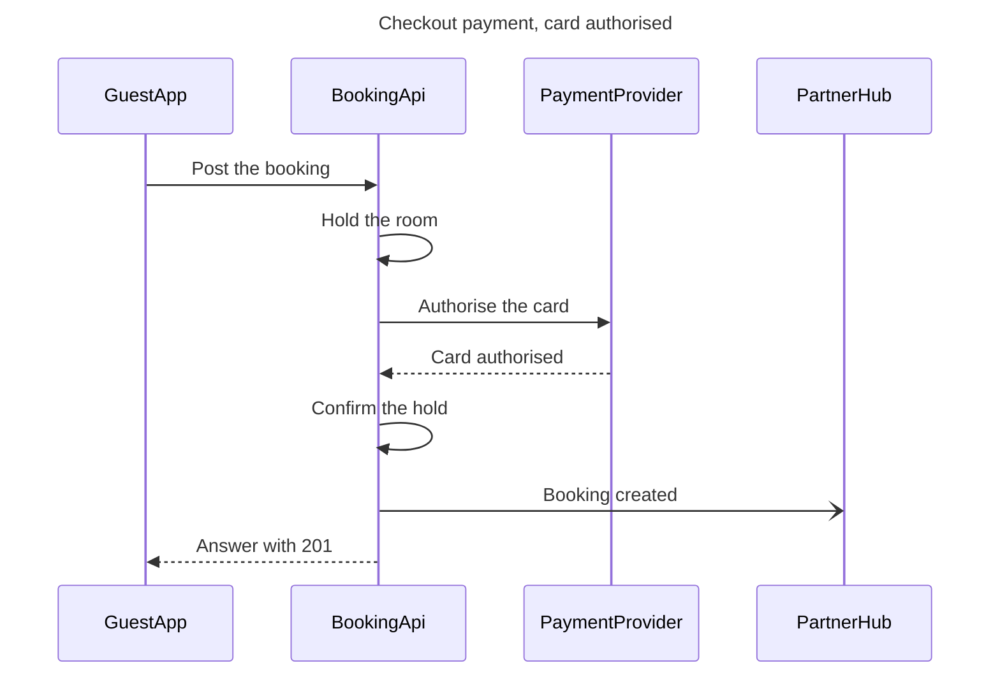

The model passed the pre-write check and composed cleanly, so this is the write gate. Nothing has been written to Figma.

**Question:** in what order do the guest app, the booking API, the payment provider and the partner hub exchange messages at checkout?

**Outcome:** the payments and booking engineers can read the checkout calls in order, for a card that is authorised.

**First glance:** message 3, Authorise the card, the call to the payment provider that decides the checkout. It carries the pink accent.

**Second glance:** message 4, Card authorised, the answer that lets the booking API confirm the hold and answer the app.

**Last glance:** message 6, Booking created, the message to the partner hub that doesn't hold up the answer.

**File:** the existing FigJam file `<draft-file-key>`, which you described as sitting in the Roamstay Product plan. I haven't verified the plan. The board lands as a new section beside what the file holds, and nothing already on it changes. No new file is created, so the Barter team plan and drafts fallback isn't used.

**Writes:** one composed board with 4 participants and 7 numbered messages, plus a title, a subtitle, a key and a source line, at the Laptop reading distance.

**Extensions:** none.

**Calls:**
* `create_session` on the file
* `get_figjam` before the write, to record what is already there
* One `use_figma` call that composes the board
* `get_figjam` after the write, to read the board back and confirm the existing content is unchanged

On a Starter plan or a View or Collab seat, Figma caps tool calls at six a month, so this board would use four of them.

**Rollback:** delete the one board section the write returns. That runs through `use_figma`, only on your yes to a question that names the board by its title.

Write it?