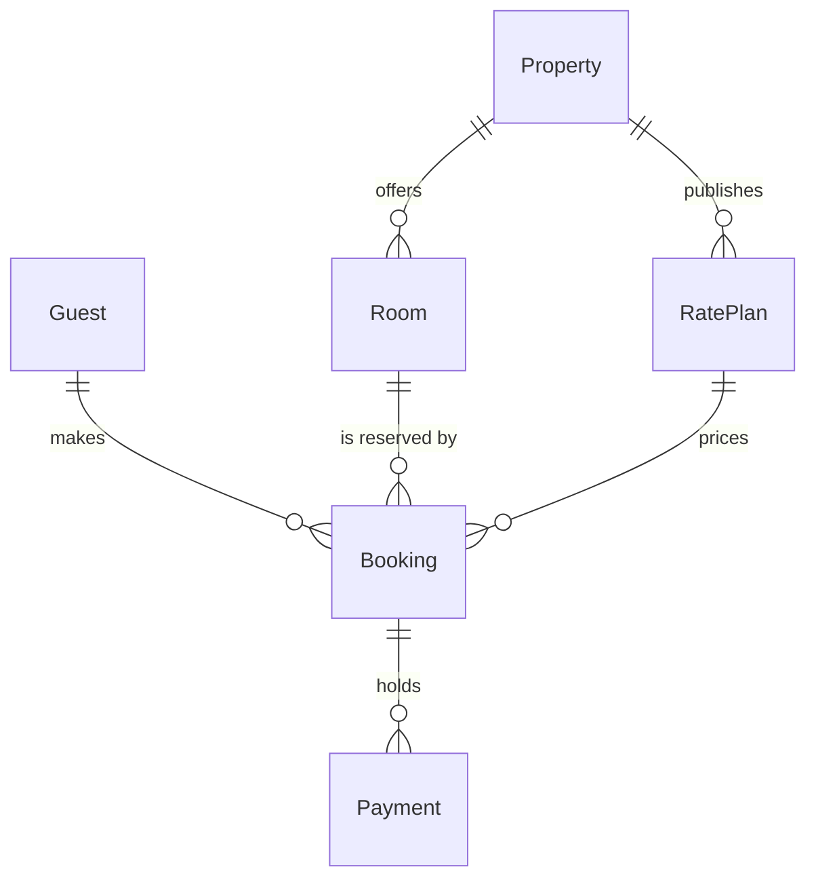

# FJ-008 turn 2 transcript

**User:** Yes, that reading is right.

**Tool call:** `Read` `{"file_path": "/private/var/folders/3c/zfqcqsts0kn19cgblj82gqhm0000gn/T/devin-compare-bench/FJ-008/sk-create-figjam/references/quality-rubric.md"}`

**Tool result:** `Read`

```text
"1\t---\n2\ttitle: \"FigJam Diagram Quality Rubric\"\n3\tdescription: \"The taste gate a FigJam model passes before the write gate, translated from sk-design-diagram's success criteria: type fit, the remove test, signal, the check, the board, the design rubric that scores a composed board and the reply.\"\n4\tcontextType: implementation\n5\timportance_tier: important\n6\ttrigger_phrases:\n7\t  - \"figjam quality rubric\"\n8\t  - \"diagram taste gate\"\n9\t  - \"remove test\"\n10\t  - \"figjam review checklist\"\n11\t  - \"figjam design rubric\"\n12\tversion: 1.0.2.0\n13\t---\n14\t\n15\t# FigJam Diagram Quality Rubric\n16\t\n17\tThe script checks what a script can see. This rubric is the rest: whether the diagram should exist, whether every node earns its place and whether the reader can trust what lands on the board. Walk it after the check passes and before the write gate.\n18\t\n19\t**Loading Condition:** CONDITIONAL, on every Flow route before the write gate\n20\t**Purpose:** The judgement pass between the pre-write check and the gate\n21\t**Scope:** The model, the provenance table, the planned extensions and, after the write, the board and the reply\n22\t\n23\t---\n24\t\n25\t## 1. TYPE FIT\n26\t\n27\t- [ ] The type answers the reader's question, as `references/flow-mode.md` Section 3 maps it\n28\t- [ ] A table, a list or a paragraph would not do the same job. If it would, say so and offer that instead\n29\t- [ ] The type's reference in `references/types/` was loaded and i
```

**Tool call:** `Bash` `{"command": "cd /private/var/folders/3c/zfqcqsts0kn19cgblj82gqhm0000gn/T/devin-compare-bench/FJ-008/sk-create-figjam && sed -n 1,80p references/style-guide.md; python3 scripts/flow_check.py --help 2>&1 | head -30"}`

**Tool result:** `Bash`

```text
"---\ntitle: \"FigJam Diagram Style Guide\"\ndescription: \"The colour every composed FigJam board draws by kind in the shipped design, the type scale and the 8 pixel grid, the palette pairs the check accepts with their measured contrast, and the spacing bands, translated from sk-design-diagram's style guide and derivation record.\"\ncontextType: implementation\nimportance_tier: important\ntrigger_phrases:\n  - \"figjam style guide\"\n  - \"figjam palette\"\n  - \"figjam colour by kind\"\n  - \"figjam type scale\"\n  - \"palette derivation record\"\n  - \"figjam contrast\"\nversion: 1.0.2.0\n---\n\n# FigJam Diagram Style Guide\n\nThe rules for colour, type and spacing on a FigJam board. The composer in `assets/compose-board.js` draws every board in the design `assets/figjam-design.md` holds, which ships as the tables below record, and every hex a model, a design or a note extension uses comes from the palette in Section 3. `scripts/flow_check.py` refuses any other.\n\n**Loading Condition:** CONDITIONAL, before the gate on every Flow route, and when a model or a note extension uses colour\n**Purpose:** Names the colour each kind draws in, the type scale, the grid, the palette pairs the check accepts and the measured contrast record\n**Scope:** The composed board, Mermaid `style`, `classDef` and `linkStyle` colours, sticky and pin colours for notes, and the contrast record the self-test re-measures\n\n---\n\n## 1. OVERVIEW\n\nsk-design-diagram owns a skinnable palette with sema
```

**Tool call:** `Bash` `{"command": "SCR=$(mktemp -d /tmp/figjam-stays.XXXXXX) && echo $SCR > /tmp/figjam-stays-path.txt && cat > $SCR/model.md <<'EOF'\n```mermaid\nerDiagram\n    %% title: Stays model\n    %% subtitle: The six Roamstay stay entities and the keys that join them, for the team working on stays\n    %% source: Source: the stays model request. Keys and cardinalities derived from it. Left out: every non-key column.\n    %% focus: Booking\n    Guest ||--o{ Booking : makes\n    Booking ||--o{ Payment : holds\n    Room ||--o{ Booking : \"is reserved by\"\n    RatePlan ||--o{ Booking : prices\n    Property ||`

**Tool result:** `Bash`

```text
"  diagram 1, ER: ok, 6 entities and 6 relationships\nPASSED 1 diagram(s) in model.md\nexit 0\nCOMPOSED diagram 1, 6 entities and 6 relationships: 6 nodes and 6 connectors to read back, 42082 characters in /tmp/figjam-stays.u27TlE/code.js, drawn in the design FigJam default\nexit 0\n   42082 /tmp/figjam-stays.u27TlE/code.js"
```

**Assistant:**

The model passes the pre-write check and composes cleanly, so this is the gate. Nothing has been written.

**Sketch (checked model)**

Each entity carries only its keys. Every entity has `id` as its primary key, and these carry foreign keys:
* Booking: `guestId`, `roomId`, `ratePlanId`
* Payment: `bookingId`
* Room: `propertyId`
* Rate Plan: `propertyId`

**Question:** which entities make up the Roamstay stays model, and which key on each one joins it to the next?

**Outcome:** a reader can see the six entities, the six relationships and the primary and foreign keys that carry them.

**First glance:** Booking, the entity three of the six relationships end on.

**Second glance:** the three foreign keys on Booking that tie it to the guest, the room and the rate plan.

**Last glance:** Property, which offers rooms and publishes rate plans but holds only its own `id`.

**File:** your existing FigJam file `<draft-file-key>`. The board goes in as a new section beside what is already there. I create no new file, so the Barter team plan and drafts instruction does not apply.

**Plan:** I can't confirm that this file sits in the Roamstay Product plan. `whoami` lists the plans you hold but doesn't say which plan owns a file. Your instruction to use the existing file stands either way.

**Writes:** one composed board with 6 entities, 6 relationships and 12 key attributes. It has a title, a subtitle, a key and a source line, and no zones. It is drawn at the Laptop reading distance.

**Extensions:** none.

**Calls:** `create_session` on that file, one `get_figjam` read before the write so I can confirm the existing content stays as it is, one `use_figma` to compose, and one `get_figjam` read-back. That is four tool calls. A Starter plan or a View or Collab seat is limited to six tool calls a month, and read tools count against that.

**Rollback:** I delete the one board section the write returns. That happens only after you answer a later question that names the board by its title, "Stays model".

**Left out:** every non-key column, because you asked for keys only.

**Finding that will travel with the reply:** the context file says a booking can hold up to 8 rooms, while the board follows your wording of one room per booking.

Write the "Stays model" board into file `<draft-file-key>` now?
