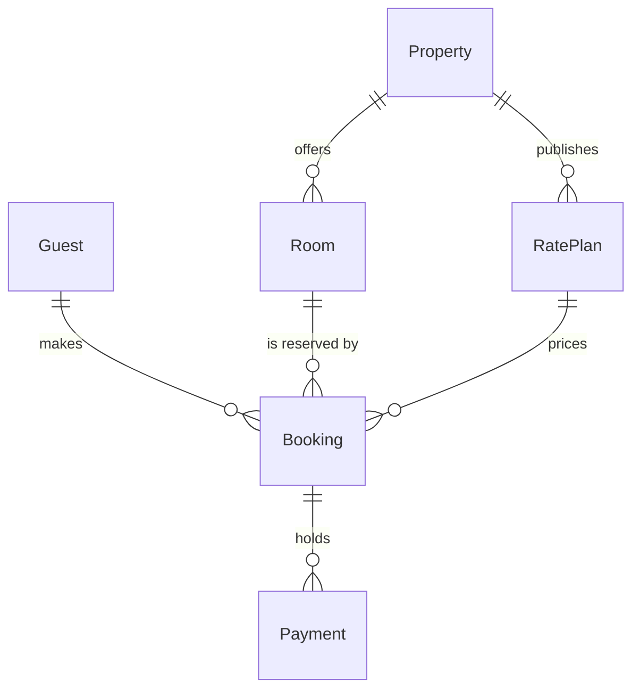

The model passes the pre-write check and composes cleanly, so this is the gate. Nothing has been written.

**Sketch (checked model)**

Each entity carries only its keys. Every entity has `id` as its primary key, and these carry foreign keys:
* Booking: `guestId`, `roomId`, `ratePlanId`
* Payment: `bookingId`
* Room: `propertyId`
* Rate Plan: `propertyId`

**Question:** which entities make up the Roamstay stays model, and which key on each one joins it to the next?

**Outcome:** a reader can see the six entities, the six relationships and the primary and foreign keys that carry them.

**First glance:** Booking, the entity three of the six relationships end on.

**Second glance:** the three foreign keys on Booking that tie it to the guest, the room and the rate plan.

**Last glance:** Property, which offers rooms and publishes rate plans but holds only its own `id`.

**File:** your existing FigJam file `<draft-file-key>`. The board goes in as a new section beside what is already there. I create no new file, so the Barter team plan and drafts instruction does not apply.

**Plan:** I can't confirm that this file sits in the Roamstay Product plan. `whoami` lists the plans you hold but doesn't say which plan owns a file. Your instruction to use the existing file stands either way.

**Writes:** one composed board with 6 entities, 6 relationships and 12 key attributes. It has a title, a subtitle, a key and a source line, and no zones. It is drawn at the Laptop reading distance.

**Extensions:** none.

**Calls:** `create_session` on that file, one `get_figjam` read before the write so I can confirm the existing content stays as it is, one `use_figma` to compose, and one `get_figjam` read-back. That is four tool calls. A Starter plan or a View or Collab seat is limited to six tool calls a month, and read tools count against that.

**Rollback:** I delete the one board section the write returns. That happens only after you answer a later question that names the board by its title, "Stays model".

**Left out:** every non-key column, because you asked for keys only.

**Finding that will travel with the reply:** the context file says a booking can hold up to 8 rooms, while the board follows your wording of one room per booking.

Write the "Stays model" board into file `<draft-file-key>` now?