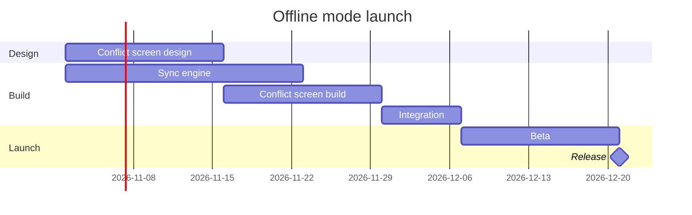

# FJ-009 turn 3 transcript

**User:** Yes, that reading is right.

**Tool call:** `Bash` `{"command": "cd /private/var/folders/3c/zfqcqsts0kn19cgblj82gqhm0000gn/T/devin-compare-bench/FJ-009/sk-create-figjam/scripts && python3 -I flow_check.py --help 2>&1 | head -30; python3 -I compose_board.py --help 2>&1 | head -30", "description": "Show check and composer usage"}`

**Tool result:** `Bash`

```text
"mermaid_extract: --help: not a Mermaid file\nUNREADABLE --help: the extractor refused it\n\n  compose_board.py <model.md> [--diagram N] [--out path]  -> 0 the filled code is written, 1 the model fails\n                                                             the check, 2 unreadable or no such diagram\n  compose_board.py <model.md> --model                      -> print the MODEL as JSON instead of the code\n  compose_board.py --template                              -> print the compact code with its MODEL and THEME\n                                                             placeholders, the text the Project's composer\n                                                             Knowledge file carries\n  compose_board.py --design-check                          -> print the design a board is drawn in, what it\n                                                             changes, its measures and the THEME it sends: 0 the\n                                                             design reads with no warning, 1 one or more warnings\n  compose_board.py --self-test                             -> prove every shipped model composes, its counts\n                                                             match the check, the code fits one use_figma call and\n                                                             the board it draws keeps its geometry and its design"
```

**Tool call:** `Read` `{"file_path": "/private/var/folders/3c/zfqcqsts0kn19cgblj82gqhm0000gn/T/devin-compare-bench/FJ-009/sk-create-figjam/references/style-guide.md"}`

**Tool result:** `Read`

```text
"1\t---\n2\ttitle: \"FigJam Diagram Style Guide\"\n3\tdescription: \"The colour every composed FigJam board draws by kind in the shipped design, the type scale and the 8 pixel grid, the palette pairs the check accepts with their measured contrast, and the spacing bands, translated from sk-design-diagram's style guide and derivation record.\"\n4\tcontextType: implementation\n5\timportance_tier: important\n6\ttrigger_phrases:\n7\t  - \"figjam style guide\"\n8\t  - \"figjam palette\"\n9\t  - \"figjam colour by kind\"\n10\t  - \"figjam type scale\"\n11\t  - \"palette derivation record\"\n12\t  - \"figjam contrast\"\n13\tversion: 1.0.2.0\n14\t---\n15\t\n16\t# FigJam Diagram Style Guide\n17\t\n18\tThe rules for colour, type and spacing on a FigJam board. The composer in `assets/compose-board.js` draws every board in the design `assets/figjam-design.md` holds, which ships as the tables below record, and every hex a model, a design or a note extension uses comes from the palette in Section 3. `scripts/flow_check.py` refuses any other.\n19\t\n20\t**Loading Condition:** CONDITIONAL, before the gate on every Flow route, and when a model or a note extension uses colour\n21\t**Purpose:** Names the colour each kind draws in, the type scale, the grid, the palette pairs the check accepts and the measured contrast record\n22\t**Scope:** The composed board, Mermaid `style`, `classDef` and `linkStyle` colours, sticky and pin colours for notes, and the contrast record the self-test re-measures\n
```

**Tool call:** `Bash` `{"command": "S=$(mktemp -d /tmp/figjam-scratch.XXXXXX) && echo \"$S\" > /tmp/figjam-scratch-path && cat > \"$S/model.md\" <<'EOF'\n```mermaid\ngantt\n    title Offline mode launch\n    %% subtitle: Which work runs when before the offline mode release, and what Integration waits on\n    %% source: Source: the Loomlist offline mode launch plan as given in the request. Left out: nothing.\n    %% focus: integrate\n    dateFormat YYYY-MM-DD\n    section Design\n    Conflict screen design :design, 2026-11-02, 2w\n    section Build\n    Sync engine :engine, 2026-11-02, 3w\n    Conflict screen build :`

**Tool result:** `Bash`

```text
"  diagram 1, gantt: ok, 6 tasks in 3 sections\nPASSED 1 diagram(s) in model.md\nexit 0\nCOMPOSED diagram 1, 6 tasks in 3 sections: 6 nodes and 5 connectors to read back, 17769 characters in /tmp/figjam-scratch.qPGhyF/board.js, drawn in the design FigJam default\nexit 0"
```

**Tool call:** `Bash` `{"command": "rm -rf \"$(cat /tmp/figjam-scratch-path)\" /tmp/figjam-scratch-path; ls /tmp | grep -c figjam-scratch", "description": "Delete scratch folder with model and composed code"}`

**Tool result (error):** `Bash`

```text
"Dangerous rm operation detected: the target is the output of a command substitution (`$(...)` or backticks) and cannot be checked before the command runs. This requires explicit approval and cannot be auto-allowed by permission rules.\n\nRun the substitution on its own first, then remove the literal paths it prints."
```

**Tool call:** `Bash` `{"command": "cat /tmp/figjam-scratch-path", "description": "Print scratch folder path"}`

**Tool result:** `Bash`

```text
"/tmp/figjam-scratch.qPGhyF"
```

**Tool call:** `Bash` `{"command": "rm -rf /tmp/figjam-scratch.qPGhyF /tmp/figjam-scratch-path; ls /tmp | grep -c figjam-scratch", "description": "Delete scratch folder with model and composed code"}`

**Tool result:** `Bash`

```text
"0"
```

**Assistant:**

The model passed the pre-write check and composes cleanly, and I've deleted the scratch files. This is the write gate, and nothing has been written to the board.



**Check:** `PASSED`, 1 gantt diagram with 6 tasks in 3 sections. The 6 counts the Release milestone, which the read-back counts apart from the tasks. The composer printed `COMPOSED` with 6 nodes and 5 connectors to read back.

**Question:** which work runs before the offline mode release, and what does Integration wait on?
**Outcome:** the product and engineering team can see the order of the work, the dates and where the release lands (21 Dec).
**First glance:** Integration, the task that waits on both builds.
**Second glance:** Sync engine and Conflict screen build, the two tasks Integration waits for.
**Last glance:** Beta and the Release milestone at the end.
**File:** the existing FigJam file `<draft-file-key>`, which you placed in the Loomlist Product plan. The board goes in as a new section beside what the file already holds, and nothing already on it changes. No new file is needed, so the Barter team plan drafts fallback stays unused.
**Writes:** one composed board with 3 sections, 5 tasks and 1 milestone on one axis, plus 5 dependency arrows, a title, a key and a source line, at the Laptop reading distance.
**Extensions:** none.
**Calls:** `create_session` on the file key, one `get_figjam` read before the write to record what the file holds, one `use_figma` and one `get_figjam` read-back. If the plan is on a Starter plan or a View or Collab seat, those four calls spend most of the six allowed per month.
**Rollback:** delete the one board section the write returns, and only on a separate yes to a question that names it.

**Blocker:** no Figma tool is connected in this session, so I can't write yet. I'll list the connected tools again when you answer. If they're still missing, I'll say so and write nothing.

Write it?
