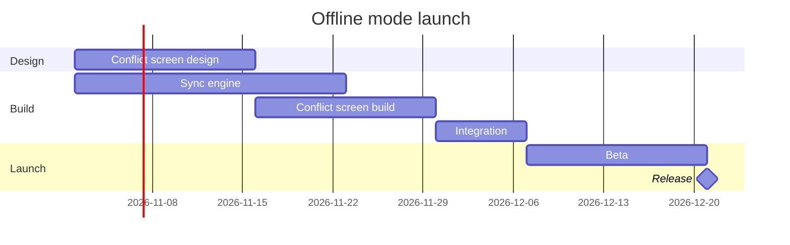

The model passed the pre-write check and composes cleanly, and I've deleted the scratch files. This is the write gate, and nothing has been written to the board.

**Check:** `PASSED`, 1 gantt diagram with 6 tasks in 3 sections. The 6 counts the Release milestone, which the read-back counts apart from the tasks. The composer printed `COMPOSED` with 6 nodes and 5 connectors to read back.

**Question:** which work runs before the offline mode release, and what does Integration wait on?
**Outcome:** the product and engineering team can see the order of the work, the dates and where the release lands (21 Dec).
**First glance:** Integration, the task that waits on both builds.
**Second glance:** Sync engine and Conflict screen build, the two tasks Integration waits for.
**Last glance:** Beta and the Release milestone at the end.
**File:** the existing FigJam file `<draft-file-key>`, which you placed in the Loomlist Product plan. The board goes in as a new section beside what the file already holds, and nothing already on it changes. No new file is needed, so the Barter team plan drafts fallback stays unused.
**Writes:** one composed board with 3 sections, 5 tasks and 1 milestone on one axis, plus 5 dependency arrows, a title, a key and a source line, at the Laptop reading distance.
**Extensions:** none.
**Calls:** `create_session` on the file key, one `get_figjam` read before the write to record what the file holds, one `use_figma` and one `get_figjam` read-back. If the plan is on a Starter plan or a View or Collab seat, those four calls spend most of the six allowed per month.
**Rollback:** delete the one board section the write returns, and only on a separate yes to a question that names it.

**Blocker:** no Figma tool is connected in this session, so I can't write yet. I'll list the connected tools again when you answer. If they're still missing, I'll say so and write nothing.

Write it?