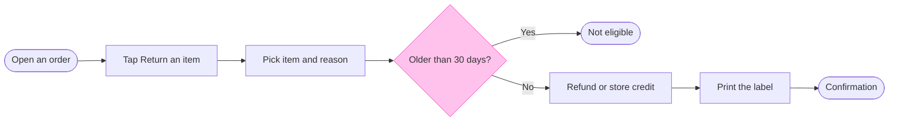

The model passes the pre-write check, and the composer drew all 8 nodes and 7 connectors.

* Question: which screens does a Fernhouse customer pass through to return an item, and where does the 30 day rule stop them?
* Outcome: a reader can follow a return from the order to the confirmation and see the rule end it at the not-eligible screen
* First glance: the Older than 30 days? decision, in the pink outline
* Second glance: its two exits, Not eligible in orange and the Confirmation in green
* Last glance: the Refund or store credit screen, which does not change the path
* File: the existing FigJam file <draft-file-key>, with the board as a new section beside what it holds
* Plan: you named Fernhouse Product, and the file keeps whatever plan it is in. No new file is created
* Writes: one composed board with 8 nodes and 7 connectors in three zones (Start the return, Check the order age, Finish the return), a title, a key and a source line, at laptop reading distance
* Extensions: none
* Calls: `create_session`, a `get_figjam` read of the file before the write, one `use_figma` and a `get_figjam` read-back. That is 4 calls, which all count against the 6 a month if the account is on a Starter plan or a View or Collab seat
* Rollback: delete the one board section the write returns, only after a yes that names it. Nothing already on the file is touched
* If the file can't be opened, I stop and tell you before creating anything. A new file would then go in the Barter team plan, in drafts, with no project

Write it?