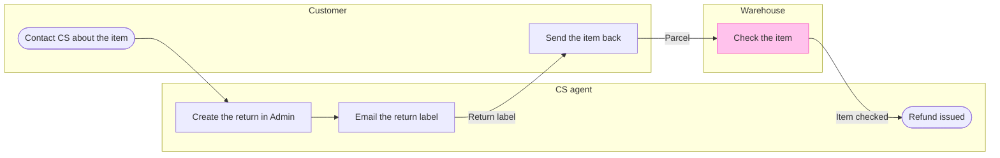

# FJ-011 turn 3 transcript

**User:** Yes, that reading is right.

**Tool call:** `Read` `{"file_path": "/private/var/folders/3c/zfqcqsts0kn19cgblj82gqhm0000gn/T/devin-compare-bench/FJ-011/sk-create-figjam/assets/templates/process.md"}`

**Tool result:** `Read`

```text
"1\t---\n2\ttitle: \"FigJam Process Templates\"\n3\tdescription: \"Process patterns that pass the pre-write check: a decision tree, a laned process with its handoff step in focus and a pipeline with a store and data in and out.\"\n4\tcontextType: general\n5\timportance_tier: important\n6\ttrigger_phrases:\n7\t  - \"process templates\"\n8\t  - \"laned process pattern\"\n9\t  - \"decision tree pattern\"\n10\tversion: 1.0.1.0\n11\t---\n12\t\n13\t# FigJam Process Templates\n14\t\n15\tCopy/apply patterns for a process model. Each pattern passes `scripts/flow_check.py`, and `references/types/process.md` holds the rules.\n16\t\n17\t**Loading Condition:** CONDITIONAL, with `references/types/process.md`\n18\t**Purpose:** Starting points for a process or decision flowchart\n19\t**Scope:** Three patterns. The provenance table and the reply shape are in `assets/flow-templates.md`\n20\t\n21\t---\n22\t\n23\t## 1. USAGE\n24\t\n25\t- Keep the `%% type: process` line first, or the check reads the block as a user flow\n26\t- Name a lane after the actor, `subgraph agent [\"CS agent\"]`, and keep its id short and camelCase\n27\t- A lane takes the neutral pair or no style, and the one accent goes on the focal step, such as the step that hands work to the next lane. The composer draws that step in focus. A `linkStyle` passes the check and changes nothing on a composed board\n28\t- `-.->` marks a step that is optional or happens later, such as a log write\n29\t- The patterns all run left to right, 
```

**Tool call:** `Read` `{"file_path": "/private/var/folders/3c/zfqcqsts0kn19cgblj82gqhm0000gn/T/devin-compare-bench/FJ-011/sk-create-figjam/references/quality-rubric.md"}`

**Tool result:** `Read`

```text
"1\t---\n2\ttitle: \"FigJam Diagram Quality Rubric\"\n3\tdescription: \"The taste gate a FigJam model passes before the write gate, translated from sk-design-diagram's success criteria: type fit, the remove test, signal, the check, the board, the design rubric that scores a composed board and the reply.\"\n4\tcontextType: implementation\n5\timportance_tier: important\n6\ttrigger_phrases:\n7\t  - \"figjam quality rubric\"\n8\t  - \"diagram taste gate\"\n9\t  - \"remove test\"\n10\t  - \"figjam review checklist\"\n11\t  - \"figjam design rubric\"\n12\tversion: 1.0.2.0\n13\t---\n14\t\n15\t# FigJam Diagram Quality Rubric\n16\t\n17\tThe script checks what a script can see. This rubric is the rest: whether the diagram should exist, whether every node earns its place and whether the reader can trust what lands on the board. Walk it after the check passes and before the write gate.\n18\t\n19\t**Loading Condition:** CONDITIONAL, on every Flow route before the write gate\n20\t**Purpose:** The judgement pass between the pre-write check and the gate\n21\t**Scope:** The model, the provenance table, the planned extensions and, after the write, the board and the reply\n22\t\n23\t---\n24\t\n25\t## 1. TYPE FIT\n26\t\n27\t- [ ] The type answers the reader's question, as `references/flow-mode.md` Section 3 maps it\n28\t- [ ] A table, a list or a paragraph would not do the same job. If it would, say so and offer that instead\n29\t- [ ] The type's reference in `references/types/` was loaded and i
```

**Tool call:** `Read` `{"file_path": "/private/var/folders/3c/zfqcqsts0kn19cgblj82gqhm0000gn/T/devin-compare-bench/FJ-011/sk-create-figjam/references/style-guide.md"}`

**Tool result:** `Read`

```text
"1\t---\n2\ttitle: \"FigJam Diagram Style Guide\"\n3\tdescription: \"The colour every composed FigJam board draws by kind in the shipped design, the type scale and the 8 pixel grid, the palette pairs the check accepts with their measured contrast, and the spacing bands, translated from sk-design-diagram's style guide and derivation record.\"\n4\tcontextType: implementation\n5\timportance_tier: important\n6\ttrigger_phrases:\n7\t  - \"figjam style guide\"\n8\t  - \"figjam palette\"\n9\t  - \"figjam colour by kind\"\n10\t  - \"figjam type scale\"\n11\t  - \"palette derivation record\"\n12\t  - \"figjam contrast\"\n13\tversion: 1.0.2.0\n14\t---\n15\t\n16\t# FigJam Diagram Style Guide\n17\t\n18\tThe rules for colour, type and spacing on a FigJam board. The composer in `assets/compose-board.js` draws every board in the design `assets/figjam-design.md` holds, which ships as the tables below record, and every hex a model, a design or a note extension uses comes from the palette in Section 3. `scripts/flow_check.py` refuses any other.\n19\t\n20\t**Loading Condition:** CONDITIONAL, before the gate on every Flow route, and when a model or a note extension uses colour\n21\t**Purpose:** Names the colour each kind draws in, the type scale, the grid, the palette pairs the check accepts and the measured contrast record\n22\t**Scope:** The composed board, Mermaid `style`, `classDef` and `linkStyle` colours, sticky and pin colours for notes, and the contrast record the self-test re-measures\n
```

**Tool call:** `Bash` `{"command": "cd /private/var/folders/3c/zfqcqsts0kn19cgblj82gqhm0000gn/T/devin-compare-bench/FJ-011/sk-create-figjam && python3 scripts/flow_check.py --help 2>&1 | head -30; python3 scripts/compose_board.py --help 2>&1 | head -30; sed -n 1,40p assets/examples/process-fernhouse-refund.md | head -5", "description": "Show check and composer usage"}`

**Tool result:** `Bash`

```text
"mermaid_extract: --help: not a Mermaid file\nUNREADABLE --help: the extractor refused it\n\n  compose_board.py <model.md> [--diagram N] [--out path]  -> 0 the filled code is written, 1 the model fails\n                                                             the check, 2 unreadable or no such diagram\n  compose_board.py <model.md> --model                      -> print the MODEL as JSON instead of the code\n  compose_board.py --template                              -> print the compact code with its MODEL and THEME\n                                                             placeholders, the text the Project's composer\n                                                             Knowledge file carries\n  compose_board.py --design-check                          -> print the design a board is drawn in, what it\n                                                             changes, its measures and the THEME it sends: 0 the\n                                                             design reads with no warning, 1 one or more warnings\n  compose_board.py --self-test                             -> prove every shipped model composes, its counts\n                                                             match the check, the code fits one use_figma call and\n                                                             the board it draws keeps its geometry and its design\n---\ntitle: \"Example - Process - Fernhouse Refund\"\ndescription: \"A worked laned process on the fic
```

**Tool call:** `Bash` `{"command": "SCR=$(mktemp -d /tmp/fj-model.XXXXXX) && echo $SCR > /tmp/fj-scratch-path && cat > $SCR/model.md <<'EOF'\n```mermaid\n%% type: process\n%% title: Damaged-item refund\n%% subtitle: Who does what from the customer's contact to the refund, and where the warehouse takes over\n%% source: Source: Fernhouse company context, 2026-09-18. Left out: the 30-day return window, the CS lead approval above 200 euros and the warehouse check result, because the source states no outcome for any of them.\nflowchart LR\n    subgraph customer [\"Customer\"]\n        contact([Contact CS about the item])`

**Tool result:** `Bash`

```text
"  diagram 1, process: ok, 6 nodes and 5 connectors, widest rank 1 steps, longest path 6 steps, 0.8 connectors per step, labels average 20 characters, 0 crossing pairs\nPASSED 1 diagram(s) in model.md\nexit=0"
```

**Tool call:** `Bash` `{"command": "SCR=$(cat /tmp/fj-scratch-path); cd /private/var/folders/3c/zfqcqsts0kn19cgblj82gqhm0000gn/T/devin-compare-bench/FJ-011/sk-create-figjam && python3 scripts/compose_board.py $SCR/model.md --diagram 1 --out $SCR/code.js; echo exit=$?; wc -c $SCR/code.js", "description": "Compose the board code to check counts"}`

**Tool result:** `Bash`

```text
"COMPOSED diagram 1, 6 nodes and 5 connectors, widest rank 1 steps, longest path 6 steps, 0.8 connectors per step, labels average 20 characters, 0 crossing pairs: 6 nodes and 5 connectors to read back, 41666 characters in /tmp/fj-model.xqTY7W/code.js, drawn in the design FigJam default\nexit=0\n   41666 /tmp/fj-model.xqTY7W/code.js"
```

**Tool call:** `ToolSearch` `{"query": "select:mcp__figma-remote__use_figma,mcp__figma-remote__get_figjam,mcp__figma-remote__create_session,mcp__figma-remote__get_screenshot", "max_results": 5}`

**Tool result:** `ToolSearch`

```text
[{"type": "tool_reference", "tool_name": "mcp__figma-remote__use_figma"}, {"type": "tool_reference", "tool_name": "mcp__figma-remote__get_figjam"}, {"type": "tool_reference", "tool_name": "mcp__figma-remote__create_session"}, {"type": "tool_reference", "tool_name": "mcp__figma-remote__get_screenshot"}]
```

**Assistant:**

The model passed the check and composed, so I'm cleaning up the scratch folder and then sending you the write gate.

**Tool call:** `Bash` `{"command": "SCR=$(cat /tmp/fj-scratch-path); rm -rf \"$SCR\" /tmp/fj-scratch-path; ls /tmp | grep -c '^fj-' ; cd /private/var/folders/3c/zfqcqsts0kn19cgblj82gqhm0000gn/T/devin-compare-bench/FJ-011 && git status --short | grep -i export", "description": "Delete scratch folder holding model and code"}`

**Tool result:** `Bash`

```text
"3"
```

**Tool call:** `Bash` `{"command": "ls -ld /tmp/fj-* 2>/dev/null", "description": "Check leftover fj scratch entries"}`

**Tool result:** `Bash`

```text
"drwxr-xr-x@ 21 michelkerkmeester  wheel   672 24 Oct 13:25 /tmp/fj-023\ndrwxr-xr-x@  4 michelkerkmeester  wheel   128 24 Oct 13:33 /tmp/fj-fernhouse-refund\n-rw-r--r--@  1 michelkerkmeester  wheel  9066 22 Oct 18:45 /tmp/fj-selftest.out"
```

**Assistant:**

**Write gate for the Damaged-item refund board**

The model passed `flow_check.py` as a process. It has 6 nodes, 5 connectors and 3 lanes, with 0 crossing pairs. The composer drew it with the same counts, and no file was written to Figma.



**What the eye should do**
- First glance: Check the item, the only pink-outlined step, sitting alone in the Warehouse lane
- Second glance: the "Parcel" connector into it, which is the handoff to the warehouse
- Last glance: the source line under the key, with the three left-out items

**Critique questions on the sketch**
- Where does the eye go first? To Check the item, because it is the only accented node
- Does the first glance match the node the board most needs read? Yes, because the handoff you asked to highlight ends on it
- Does any node repeat another? No, and each of the 6 steps and 5 connectors came from a row in the Brief
- Does any step read as a stated fact when it is inferred? "Send the item back" and the two edges around it are the assumed rows you confirmed, and the source line does not claim otherwise

I re-read the returns line in the company context for each inferred row. The order "emails a return label, the warehouse checks the item, and the agent refunds" supports the check-to-refund edge. It gives no step between the label and the check, which is why that step is marked assumed.

**What the write does**
- File: `<draft-file-key>`, in the Fernhouse Product plan as you said. The board lands as one new section to the right of what the file holds, and nothing already there changes
- Extensions: none planned
- Calls: `create_session`, one `use_figma` call that composes the board, and one `get_figjam` read-back, so 3 in all, plus one `get_screenshot` only if a node needs its own view. No `whoami` or `create_new_file`, because the file exists. Figma limits a Starter plan and a View or Collab seat to six tool calls a month, and I do not know which applies to you
- Rollback: delete the one board section the write returns, and only after a separate yes from you that names the board by its title

Write this board to file `<draft-file-key>` now?

HVR self-scan: 0 hard blockers. Fixed: none. Kept with reason: none.
