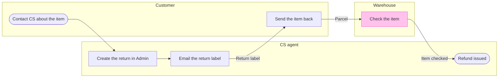

**Write gate for the Damaged-item refund board**

The model passed `flow_check.py` as a process. It has 6 nodes, 5 connectors and 3 lanes, with 0 crossing pairs. The composer drew it with the same counts, and no file was written to Figma.

**What the eye should do**
- First glance: Check the item, the only pink-outlined step, sitting alone in the Warehouse lane
- Second glance: the "Parcel" connector into it, which is the handoff to the warehouse
- Last glance: the source line under the key, with the three left-out items

**Critique questions on the sketch**
- Where does the eye go first? To Check the item, because it is the only accented node
- Does the first glance match the node the board most needs read? Yes, because the handoff you asked to highlight ends on it
- Does any node repeat another? No, and each of the 6 steps and 5 connectors came from a row in the Brief
- Does any step read as a stated fact when it is inferred? "Send the item back" and the two edges around it are the assumed rows you confirmed, and the source line does not claim otherwise

I re-read the returns line in the company context for each inferred row. The order "emails a return label, the warehouse checks the item, and the agent refunds" supports the check-to-refund edge. It gives no step between the label and the check, which is why that step is marked assumed.

**What the write does**
- File: `<draft-file-key>`, in the Fernhouse Product plan as you said. The board lands as one new section to the right of what the file holds, and nothing already there changes
- Extensions: none planned
- Calls: `create_session`, one `use_figma` call that composes the board, and one `get_figjam` read-back, so 3 in all, plus one `get_screenshot` only if a node needs its own view. No `whoami` or `create_new_file`, because the file exists. Figma limits a Starter plan and a View or Collab seat to six tool calls a month, and I do not know which applies to you
- Rollback: delete the one board section the write returns, and only after a separate yes from you that names the board by its title

Write this board to file `<draft-file-key>` now?

HVR self-scan: 0 hard blockers. Fixed: none. Kept with reason: none.