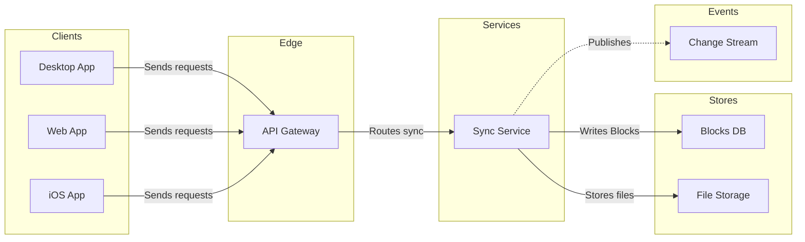
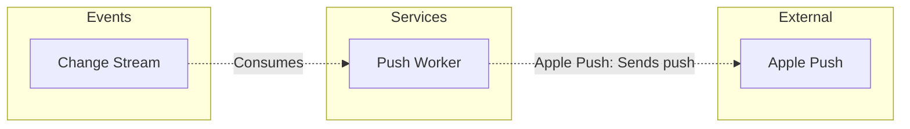

# FJ-012 turn 3 transcript

**User:** Use your recommended answers.

**Tool call:** `Read` `{"file_path": "/private/var/folders/3c/zfqcqsts0kn19cgblj82gqhm0000gn/T/devin-compare-bench/FJ-012/sk-create-figjam/references/quality-rubric.md"}`

**Tool result:** `Read`

```text
"1\t---\n2\ttitle: \"FigJam Diagram Quality Rubric\"\n3\tdescription: \"The taste gate a FigJam model passes before the write gate, translated from sk-design-diagram's success criteria: type fit, the remove test, signal, the check, the board, the design rubric that scores a composed board and the reply.\"\n4\tcontextType: implementation\n5\timportance_tier: important\n6\ttrigger_phrases:\n7\t  - \"figjam quality rubric\"\n8\t  - \"diagram taste gate\"\n9\t  - \"remove test\"\n10\t  - \"figjam review checklist\"\n11\t  - \"figjam design rubric\"\n12\tversion: 1.0.2.0\n13\t---\n14\t\n15\t# FigJam Diagram Quality Rubric\n16\t\n17\tThe script checks what a script can see. This rubric is the rest: whether the diagram should exist, whether every node earns its place and whether the reader can trust what lands on the board. Walk it after the check passes and before the write gate.\n18\t\n19\t**Loading Condition:** CONDITIONAL, on every Flow route before the write gate\n20\t**Purpose:** The judgement pass between the pre-write check and the gate\n21\t**Scope:** The model, the provenance table, the planned extensions and, after the write, the board and the reply\n22\t\n23\t---\n24\t\n25\t## 1. TYPE FIT\n26\t\n27\t- [ ] The type answers the reader's question, as `references/flow-mode.md` Section 3 maps it\n28\t- [ ] A table, a list or a paragraph would not do the same job. If it would, say so and offer that instead\n29\t- [ ] The type's reference in `references/types/` was loaded and i
```

**Tool call:** `Read` `{"file_path": "/private/var/folders/3c/zfqcqsts0kn19cgblj82gqhm0000gn/T/devin-compare-bench/FJ-012/sk-create-figjam/references/style-guide.md"}`

**Tool result:** `Read`

```text
"1\t---\n2\ttitle: \"FigJam Diagram Style Guide\"\n3\tdescription: \"The colour every composed FigJam board draws by kind in the shipped design, the type scale and the 8 pixel grid, the palette pairs the check accepts with their measured contrast, and the spacing bands, translated from sk-design-diagram's style guide and derivation record.\"\n4\tcontextType: implementation\n5\timportance_tier: important\n6\ttrigger_phrases:\n7\t  - \"figjam style guide\"\n8\t  - \"figjam palette\"\n9\t  - \"figjam colour by kind\"\n10\t  - \"figjam type scale\"\n11\t  - \"palette derivation record\"\n12\t  - \"figjam contrast\"\n13\tversion: 1.0.2.0\n14\t---\n15\t\n16\t# FigJam Diagram Style Guide\n17\t\n18\tThe rules for colour, type and spacing on a FigJam board. The composer in `assets/compose-board.js` draws every board in the design `assets/figjam-design.md` holds, which ships as the tables below record, and every hex a model, a design or a note extension uses comes from the palette in Section 3. `scripts/flow_check.py` refuses any other.\n19\t\n20\t**Loading Condition:** CONDITIONAL, before the gate on every Flow route, and when a model or a note extension uses colour\n21\t**Purpose:** Names the colour each kind draws in, the type scale, the grid, the palette pairs the check accepts and the measured contrast record\n22\t**Scope:** The composed board, Mermaid `style`, `classDef` and `linkStyle` colours, sticky and pin colours for notes, and the contrast record the self-test re-measures\n
```

**Tool call:** `Bash` `{"command": "SCR=$(mktemp -d -t flowscratch) && echo \"$SCR\" > /tmp/flow_scratch_path && cat > \"$SCR/model.md\" <<'EOF'\n# Loomlist block sync\n\n```mermaid\n%% type: architecture\nflowchart LR\n    %% title: 1. Block sync\n    %% subtitle: Which parts carry a block change from the clients to the stores and the change stream\n    %% source: Source: the request. Calls are proposed, not confirmed against code. Left out: Android and the push reaching the device. Continues in 2. Push delivery.\n    %% focus: sync\n    subgraph client [\"Clients\"]\n        desktop[Desktop App]\n        webClient`

**Tool result:** `Bash`

```text
"  diagram 1, architecture: ok, 8 nodes and 7 connectors, widest rank 3 steps, longest path 4 steps, 0.9 connectors per step, labels average 10 characters, 0 crossing pairs\n  diagram 2, architecture: ok, 3 nodes and 2 connectors, widest rank 1 steps, longest path 3 steps, 0.7 connectors per step, labels average 11 characters, 0 crossing pairs\nPASSED 2 diagram(s) in model.md\nexit 0"
```

**Assistant:**

Both diagrams pass the check. Next I'll compose each one to confirm the counts and that the code fits a single call.

**Tool call:** `Bash` `{"command": "SCR=$(cat /tmp/flow_scratch_path) && for n in 1 2; do python3 -I sk-create-figjam/scripts/compose_board.py \"$SCR/model.md\" --diagram $n --out \"$SCR/board$n.js\"; echo \"exit $?\"; done; wc -c \"$SCR\"/board*.js", "description": "Compose both diagrams to scratch code files"}`

**Tool result:** `Bash`

```text
"COMPOSED diagram 1, 8 nodes and 7 connectors, widest rank 3 steps, longest path 4 steps, 0.9 connectors per step, labels average 10 characters, 0 crossing pairs: 8 nodes and 7 connectors to read back, 41914 characters in /var/folders/3c/zfqcqsts0kn19cgblj82gqhm0000gn/T/flowscratch.0Agqu46j9F/board1.js, drawn in the design FigJam default\nexit 0\nCOMPOSED diagram 2, 3 nodes and 2 connectors, widest rank 1 steps, longest path 3 steps, 0.7 connectors per step, labels average 11 characters, 0 crossing pairs: 3 nodes and 2 connectors to read back, 41242 characters in /var/folders/3c/zfqcqsts0kn19cgblj82gqhm0000gn/T/flowscratch.0Agqu46j9F/board2.js, drawn in the design FigJam default\nexit 0\n   41914 /var/folders/3c/zfqcqsts0kn19cgblj82gqhm0000gn/T/flowscratch.0Agqu46j9F/board1.js\n   41242 /var/folders/3c/zfqcqsts0kn19cgblj82gqhm0000gn/T/flowscratch.0Agqu46j9F/board2.js\n   83156 total"
```

**Assistant:**

Both diagrams pass the check, and both compose within one `use_figma` call each. This is the write gate. Nothing is on the board yet.

**The sketch** is the checked model, with the board's title, subtitle and source lines left out:





**Question:** which parts take part in block sync and how do they connect?

**Outcome:** engineers and PMs on sync work can see where a block change travels and where a push leaves the system.

**First glance:** Sync Service on board 1, the one part every client request reaches before the stores and the stream branch off. On board 2 it is Push Worker. Both are marked with a `%% focus:` line.

**Second glance:** the dashed Publishes edge into Change Stream, which hands board 1 on to board 2.

**Last glance:** the three clients, which stay available without competing.

**Target:** the existing FigJam file `<test-file-key>`, with both boards added as new sections beside what it already holds. Nothing already on the file changes. There is no plan to name, because the file exists, so there is no `whoami` or `create_new_file`.

**Writes**
- Board 1 has 8 nodes and 7 connectors in 5 lanes
- Board 2 has 3 nodes and 2 connectors in 3 lanes
- Each board has a title, a key and a source line
- The dials are Laptop reading distance, balanced detail and a mixed audience

**Extensions:** none.

**Calls**
- `create_session`
- One `get_figjam` read of the file before the write, so the read-back can show the existing content was left as it was
- One `use_figma` call per board
- One `get_figjam` read-back after the write
- That is five calls. If the file's plan is Starter, or your seat is View or Collab, Figma caps tool calls at six a month, so this leaves one spare

**Rollback:** delete the two board sections the writes return, through `use_figma`, and only on a reply from you that names them.

**Changes since the playback**
- Board 2 is titled "2. Push delivery", not "Push wake-up". The "wake" wording came from the skill's fictional example and not from any source of yours
- Its edge to Apple Push reads "Sends push" for the same reason
- Both boards' source lines say the calls are proposed and not confirmed against code. A search of `context/` found nothing about a gateway, change stream, push worker or file storage that confirms or contradicts the seven proposed calls

Write both boards to that file?
