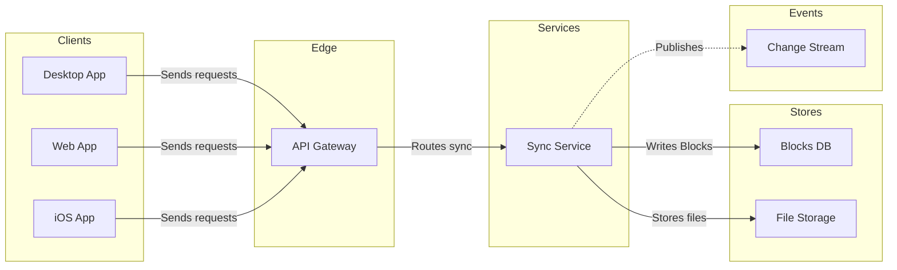
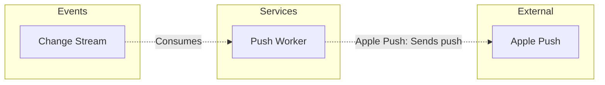

Both diagrams pass the check, and both compose within one `use_figma` call each. This is the write gate. Nothing is on the board yet.

**The sketch** is the checked model, with the board's title, subtitle and source lines left out:

**Question:** which parts take part in block sync and how do they connect?

**Outcome:** engineers and PMs on sync work can see where a block change travels and where a push leaves the system.

**First glance:** Sync Service on board 1, the one part every client request reaches before the stores and the stream branch off. On board 2 it is Push Worker. Both are marked with a `%% focus:` line.

**Second glance:** the dashed Publishes edge into Change Stream, which hands board 1 on to board 2.

**Last glance:** the three clients, which stay available without competing.

**Target:** the existing FigJam file `<test-file-key>`, with both boards added as new sections beside what it already holds. Nothing already on the file changes. There is no plan to name, because the file exists, so there is no `whoami` or `create_new_file`.

**Writes**
- Board 1 has 8 nodes and 7 connectors in 5 lanes
- Board 2 has 3 nodes and 2 connectors in 3 lanes
- Each board has a title, a key and a source line
- The dials are Laptop reading distance, balanced detail and a mixed audience

**Extensions:** none.

**Calls**
- `create_session`
- One `get_figjam` read of the file before the write, so the read-back can show the existing content was left as it was
- One `use_figma` call per board
- One `get_figjam` read-back after the write
- That is five calls. If the file's plan is Starter, or your seat is View or Collab, Figma caps tool calls at six a month, so this leaves one spare

**Rollback:** delete the two board sections the writes return, through `use_figma`, and only on a reply from you that names them.

**Changes since the playback**
- Board 2 is titled "2. Push delivery", not "Push wake-up". The "wake" wording came from the skill's fictional example and not from any source of yours
- Its edge to Apple Push reads "Sends push" for the same reason
- Both boards' source lines say the calls are proposed and not confirmed against code. A search of `context/` found nothing about a gateway, change stream, push worker or file storage that confirms or contradicts the seven proposed calls

Write both boards to that file?