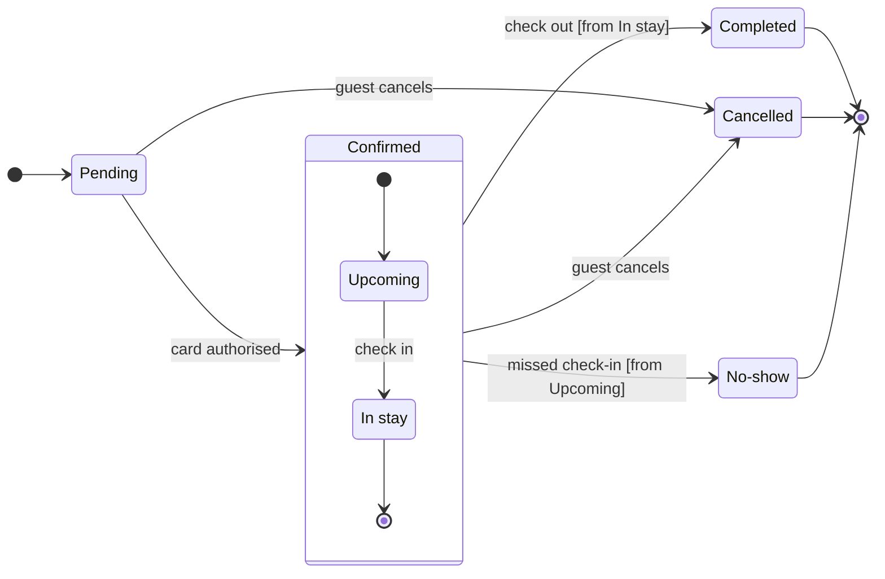

# FJ-017 turn 2 transcript

**User:** Yes, that reading is right.

**Tool call:** `Read` `{"file_path": "/private/var/folders/3c/zfqcqsts0kn19cgblj82gqhm0000gn/T/devin-compare-bench/FJ-017/sk-create-figjam/references/quality-rubric.md"}`

**Tool result:** `Read`

```text
"1\t---\n2\ttitle: \"FigJam Diagram Quality Rubric\"\n3\tdescription: \"The taste gate a FigJam model passes before the write gate, translated from sk-design-diagram's success criteria: type fit, the remove test, signal, the check, the board, the design rubric that scores a composed board and the reply.\"\n4\tcontextType: implementation\n5\timportance_tier: important\n6\ttrigger_phrases:\n7\t  - \"figjam quality rubric\"\n8\t  - \"diagram taste gate\"\n9\t  - \"remove test\"\n10\t  - \"figjam review checklist\"\n11\t  - \"figjam design rubric\"\n12\tversion: 1.0.2.0\n13\t---\n14\t\n15\t# FigJam Diagram Quality Rubric\n16\t\n17\tThe script checks what a script can see. This rubric is the rest: whether the diagram should exist, whether every node earns its place and whether the reader can trust what lands on the board. Walk it after the check passes and before the write gate.\n18\t\n19\t**Loading Condition:** CONDITIONAL, on every Flow route before the write gate\n20\t**Purpose:** The judgement pass between the pre-write check and the gate\n21\t**Scope:** The model, the provenance table, the planned extensions and, after the write, the board and the reply\n22\t\n23\t---\n24\t\n25\t## 1. TYPE FIT\n26\t\n27\t- [ ] The type answers the reader's question, as `references/flow-mode.md` Section 3 maps it\n28\t- [ ] A table, a list or a paragraph would not do the same job. If it would, say so and offer that instead\n29\t- [ ] The type's reference in `references/types/` was loaded and i
```

**Tool call:** `Read` `{"file_path": "/private/var/folders/3c/zfqcqsts0kn19cgblj82gqhm0000gn/T/devin-compare-bench/FJ-017/sk-create-figjam/references/style-guide.md"}`

**Tool result:** `Read`

```text
"1\t---\n2\ttitle: \"FigJam Diagram Style Guide\"\n3\tdescription: \"The colour every composed FigJam board draws by kind in the shipped design, the type scale and the 8 pixel grid, the palette pairs the check accepts with their measured contrast, and the spacing bands, translated from sk-design-diagram's style guide and derivation record.\"\n4\tcontextType: implementation\n5\timportance_tier: important\n6\ttrigger_phrases:\n7\t  - \"figjam style guide\"\n8\t  - \"figjam palette\"\n9\t  - \"figjam colour by kind\"\n10\t  - \"figjam type scale\"\n11\t  - \"palette derivation record\"\n12\t  - \"figjam contrast\"\n13\tversion: 1.0.2.0\n14\t---\n15\t\n16\t# FigJam Diagram Style Guide\n17\t\n18\tThe rules for colour, type and spacing on a FigJam board. The composer in `assets/compose-board.js` draws every board in the design `assets/figjam-design.md` holds, which ships as the tables below record, and every hex a model, a design or a note extension uses comes from the palette in Section 3. `scripts/flow_check.py` refuses any other.\n19\t\n20\t**Loading Condition:** CONDITIONAL, before the gate on every Flow route, and when a model or a note extension uses colour\n21\t**Purpose:** Names the colour each kind draws in, the type scale, the grid, the palette pairs the check accepts and the measured contrast record\n22\t**Scope:** The composed board, Mermaid `style`, `classDef` and `linkStyle` colours, sticky and pin colours for notes, and the contrast record the self-test re-measures\n
```

**Tool call:** `Bash` `{"command": "SCRATCH=$(mktemp -d /tmp/figjam-roamstay.XXXXXX) && echo $SCRATCH > /tmp/figjam-scratch-path && cat > $SCRATCH/model.md <<'EOF'\n```mermaid\nstateDiagram-v2\n    %% title: Booking status\n    %% subtitle: Every status a Roamstay booking passes through and what moves it on, for support\n    %% source: Source: the booking status description in the request. Left out: a failed card authorisation, because no source says where Pending goes then.\n    %% focus: Cancelled\n    direction LR\n    state \"In stay\" as InStay\n    state \"No-show\" as NoShow\n    [*] --> Pending\n    Pending `

**Tool result:** `Bash`

```text
"  diagram 1, state: ok, 7 states and 12 transitions\nPASSED 1 diagram(s) in model.md\nexit=0"
```

**Tool call:** `Bash` `{"command": "SCRATCH=$(cat /tmp/figjam-scratch-path) && python3 -I sk-create-figjam/scripts/compose_board.py $SCRATCH/model.md --diagram 1 --out $SCRATCH/compose.js; echo exit=$?; wc -c $SCRATCH/compose.js; git status --short | head -30", "description": "Compose board code and confirm repo is clean of new files"}`

**Tool result:** `Bash`

```text
"COMPOSED diagram 1, 7 states and 12 transitions: 12 nodes and 12 connectors to read back, 42087 characters in /tmp/figjam-roamstay.CMVJok/compose.js, drawn in the design FigJam default\nexit=0\n   42087 /tmp/figjam-roamstay.CMVJok/compose.js\n?? .devin/\n?? .env.example\n?? .gitignore\n?? AGENTS.md\n?? Favicon.jpg\n?? LICENSE\n?? README.md\n?? ROUTER.md\n?? SKILL.md\n?? SYNC.md\n?? USER-GUIDE.md\n?? context/\n?? description.json\n?? graph-metadata.json\n?? hub-router.json\n?? leaf-manifest.json\n?? mcp-click-up/\n?? mcp-code-mode/\n?? mcp-figma/\n?? mode-registry.json\n?? scripts/\n?? sk-create-figjam/\n?? sk-product-owner/\n?? vendor.json"
```

**Assistant:**

The model passes the check (7 states, 12 transitions) and composes into one `use_figma` call. Nothing is written yet.



**Question:** which statuses does a Roamstay booking pass through, and who sets Cancelled and No-show?
**Outcome:** support can follow a booking's status and knows who to ask about a Cancelled or a No-show.
**First glance:** Cancelled, marked with the pink outline. Two moves lead into it, so it is the exit support meets most.
**Second glance:** the two notes, "Set by the guest" and "Set by the hotel".
**Last glance:** Pending, where every booking starts.
**Assumed:** check in moves Upcoming to In stay, check out leaves from In stay and missed check-in leaves from Upcoming. I re-read your request for each and found nothing that contradicts them.
**Plan:** the file's own plan. You named Roamstay Product, but `whoami` lists the plans the account holds and cannot say which one owns this file, so that is unverified.
**File:** the existing file <draft-file-key>, with the board as a new section beside what it holds.
**Writes:** one composed board with a title, a key and a source line, at the Laptop reading distance. It has 7 states and 12 transitions, and Confirmed is drawn as a tinted section around Upcoming and In stay.
**Extensions:** two single stickies named `note:1` and `note:2`, one beside Cancelled and one beside No-show, placed clear of the connectors.
**Calls:** `create_session`, a `get_figjam` read of the file before the write, one `use_figma` for the board, one `use_figma` for the notes and a final `get_figjam` read-back. That is 5 calls. A Starter plan or a View or Collab seat is limited to six tool calls a month.
**Rollback:** delete the new board section, which holds both notes, or only the two stickies. Either runs only on your yes to a question that names it, and nothing already on the file is touched.

Write it?
