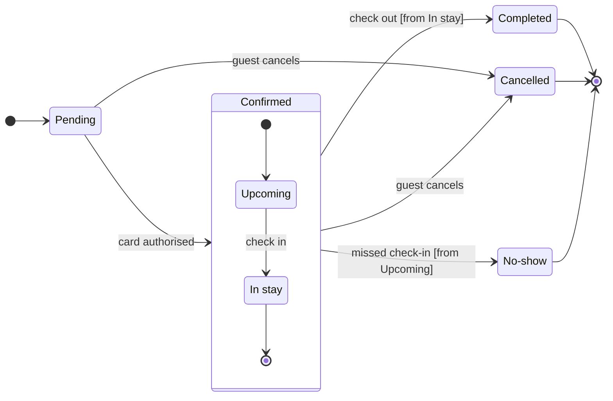

The model passes the check (7 states, 12 transitions) and composes into one `use_figma` call. Nothing is written yet.

**Question:** which statuses does a Roamstay booking pass through, and who sets Cancelled and No-show?
**Outcome:** support can follow a booking's status and knows who to ask about a Cancelled or a No-show.
**First glance:** Cancelled, marked with the pink outline. Two moves lead into it, so it is the exit support meets most.
**Second glance:** the two notes, "Set by the guest" and "Set by the hotel".
**Last glance:** Pending, where every booking starts.
**Assumed:** check in moves Upcoming to In stay, check out leaves from In stay and missed check-in leaves from Upcoming. I re-read your request for each and found nothing that contradicts them.
**Plan:** the file's own plan. You named Roamstay Product, but `whoami` lists the plans the account holds and cannot say which one owns this file, so that is unverified.
**File:** the existing file <draft-file-key>, with the board as a new section beside what it holds.
**Writes:** one composed board with a title, a key and a source line, at the Laptop reading distance. It has 7 states and 12 transitions, and Confirmed is drawn as a tinted section around Upcoming and In stay.
**Extensions:** two single stickies named `note:1` and `note:2`, one beside Cancelled and one beside No-show, placed clear of the connectors.
**Calls:** `create_session`, a `get_figjam` read of the file before the write, one `use_figma` for the board, one `use_figma` for the notes and a final `get_figjam` read-back. That is 5 calls. A Starter plan or a View or Collab seat is limited to six tool calls a month.
**Rollback:** delete the new board section, which holds both notes, or only the two stickies. Either runs only on your yes to a question that names it, and nothing already on the file is touched.

Write it?