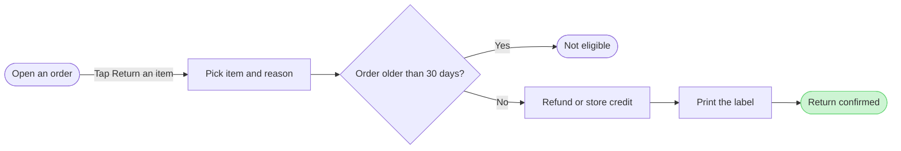

# FJ-018 turn 3 transcript

**User:** Yes, that reading is right.

**Tool call:** `Read` `{"file_path": "/private/var/folders/3c/zfqcqsts0kn19cgblj82gqhm0000gn/T/devin-compare-bench/FJ-018/sk-create-figjam/references/quality-rubric.md"}`

**Tool result:** `Read`

```text
"1\t---\n2\ttitle: \"FigJam Diagram Quality Rubric\"\n3\tdescription: \"The taste gate a FigJam model passes before the write gate, translated from sk-design-diagram's success criteria: type fit, the remove test, signal, the check, the board, the design rubric that scores a composed board and the reply.\"\n4\tcontextType: implementation\n5\timportance_tier: important\n6\ttrigger_phrases:\n7\t  - \"figjam quality rubric\"\n8\t  - \"diagram taste gate\"\n9\t  - \"remove test\"\n10\t  - \"figjam review checklist\"\n11\t  - \"figjam design rubric\"\n12\tversion: 1.0.2.0\n13\t---\n14\t\n15\t# FigJam Diagram Quality Rubric\n16\t\n17\tThe script checks what a script can see. This rubric is the rest: whether the diagram should exist, whether every node earns its place and whether the reader can trust what lands on the board. Walk it after the check passes and before the write gate.\n18\t\n19\t**Loading Condition:** CONDITIONAL, on every Flow route before the write gate\n20\t**Purpose:** The judgement pass between the pre-write check and the gate\n21\t**Scope:** The model, the provenance table, the planned extensions and, after the write, the board and the reply\n22\t\n23\t---\n24\t\n25\t## 1. TYPE FIT\n26\t\n27\t- [ ] The type answers the reader's question, as `references/flow-mode.md` Section 3 maps it\n28\t- [ ] A table, a list or a paragraph would not do the same job. If it would, say so and offer that instead\n29\t- [ ] The type's reference in `references/types/` was loaded and i
```

**Tool call:** `Read` `{"file_path": "/private/var/folders/3c/zfqcqsts0kn19cgblj82gqhm0000gn/T/devin-compare-bench/FJ-018/sk-create-figjam/references/style-guide.md"}`

**Tool result:** `Read`

```text
"1\t---\n2\ttitle: \"FigJam Diagram Style Guide\"\n3\tdescription: \"The colour every composed FigJam board draws by kind in the shipped design, the type scale and the 8 pixel grid, the palette pairs the check accepts with their measured contrast, and the spacing bands, translated from sk-design-diagram's style guide and derivation record.\"\n4\tcontextType: implementation\n5\timportance_tier: important\n6\ttrigger_phrases:\n7\t  - \"figjam style guide\"\n8\t  - \"figjam palette\"\n9\t  - \"figjam colour by kind\"\n10\t  - \"figjam type scale\"\n11\t  - \"palette derivation record\"\n12\t  - \"figjam contrast\"\n13\tversion: 1.0.2.0\n14\t---\n15\t\n16\t# FigJam Diagram Style Guide\n17\t\n18\tThe rules for colour, type and spacing on a FigJam board. The composer in `assets/compose-board.js` draws every board in the design `assets/figjam-design.md` holds, which ships as the tables below record, and every hex a model, a design or a note extension uses comes from the palette in Section 3. `scripts/flow_check.py` refuses any other.\n19\t\n20\t**Loading Condition:** CONDITIONAL, before the gate on every Flow route, and when a model or a note extension uses colour\n21\t**Purpose:** Names the colour each kind draws in, the type scale, the grid, the palette pairs the check accepts and the measured contrast record\n22\t**Scope:** The composed board, Mermaid `style`, `classDef` and `linkStyle` colours, sticky and pin colours for notes, and the contrast record the self-test re-measures\n
```

**Tool call:** `Bash` `{"command": "cd /private/var/folders/3c/zfqcqsts0kn19cgblj82gqhm0000gn/T/devin-compare-bench/FJ-018/sk-create-figjam && python3 scripts/flow_check.py --help 2>&1 | head -30; python3 scripts/compose_board.py --help 2>&1 | head -30", "description": "Show check and composer usage"}`

**Tool result:** `Bash`

```text
"mermaid_extract: --help: not a Mermaid file\nUNREADABLE --help: the extractor refused it\n\n  compose_board.py <model.md> [--diagram N] [--out path]  -> 0 the filled code is written, 1 the model fails\n                                                             the check, 2 unreadable or no such diagram\n  compose_board.py <model.md> --model                      -> print the MODEL as JSON instead of the code\n  compose_board.py --template                              -> print the compact code with its MODEL and THEME\n                                                             placeholders, the text the Project's composer\n                                                             Knowledge file carries\n  compose_board.py --design-check                          -> print the design a board is drawn in, what it\n                                                             changes, its measures and the THEME it sends: 0 the\n                                                             design reads with no warning, 1 one or more warnings\n  compose_board.py --self-test                             -> prove every shipped model composes, its counts\n                                                             match the check, the code fits one use_figma call and\n                                                             the board it draws keeps its geometry and its design"
```

**Tool call:** `Bash` `{"command": "SCR=$(mktemp -d /tmp/fj018-XXXXXX) && echo $SCR > /tmp/fj018-scratch-path && cat > $SCR/model.md <<'EOF'\n```mermaid\nflowchart LR\n    %% title: Return an item\n    %% subtitle: How a Fernhouse customer returns an item, from an opened order to a confirmed return\n    %% source: Source: returns doc as relayed in the request, status not confirmed. Left out: CS, Admin and warehouse steps, refund timing, anything after Not eligible.\n    openOrder([Open an order]) -->|Tap Return an item| pick[Pick item and reason]\n    pick --> window{Order older than 30 days?}\n    window -->|Yes| n`

**Tool result:** `Bash`

```text
"  diagram 1, user flow: ok, 7 nodes and 6 connectors, widest rank 2 steps, longest path 6 steps, 0.9 connectors per step, labels average 18 characters, 0 crossing pairs\nPASSED 1 diagram(s) in model.md\nexit 0\nCOMPOSED diagram 1, 7 nodes and 6 connectors, widest rank 2 steps, longest path 6 steps, 0.9 connectors per step, labels average 18 characters, 0 crossing pairs: 7 nodes and 6 connectors to read back, 41450 characters in /tmp/fj018-AT0zve/board.js, drawn in the design FigJam default\nexit 0\n   41450 /tmp/fj018-AT0zve/board.js"
```

**Assistant:**

The model passed the pre-write check, and the composer built it. Nothing is on the board yet.

```text
diagram 1, user flow: ok, 7 nodes and 6 connectors, widest rank 2 steps, longest path 6 steps, 0.9 connectors per step, labels average 18 characters, 0 crossing pairs
PASSED 1 diagram(s)
COMPOSED diagram 1: 7 nodes and 6 connectors to read back
```



I re-read the doc steps in your request against each node and connector. The sequence matches, and the doc's source class stays unknown.

**Question:** which screens does a customer pass through to return an item, and where does the 30 day check stop them?
**Outcome:** a reader can follow a return from an opened order to the confirmation and see where it ends early.
**First glance:** Return confirmed, the green goal with the pink outline.
**Second glance:** the "Order older than 30 days?" decision that sends a return on or stops it.
**Last glance:** Not eligible, the orange exit beside the main line, and the source line that says the status is not confirmed.
**File:** the existing FigJam file `<draft-file-key>`, with the board added as a new section beside what is already there. Nothing already on the file changes.
**Writes:** one composed board with a title, a subtitle, a key and a source line. It has 7 nodes and 6 connectors, no zones, at the Laptop reading distance.
**Extensions:** none.
**Calls:** `create_session`, a `get_figjam` read of the file before the write, one `use_figma` and a `get_figjam` read-back. That is 4 calls. If the account is on a Starter plan or a View or Collab seat, that is most of the 6 tool calls Figma allows a month.
**Rollback:** delete the one board section the write returns, through `use_figma`. That happens only if you say yes to a question that names the board.

Write it?
