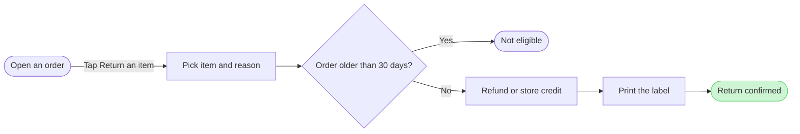

The model passed the pre-write check, and the composer built it. Nothing is on the board yet.

```text
diagram 1, user flow: ok, 7 nodes and 6 connectors, widest rank 2 steps, longest path 6 steps, 0.9 connectors per step, labels average 18 characters, 0 crossing pairs
PASSED 1 diagram(s)
COMPOSED diagram 1: 7 nodes and 6 connectors to read back
```



I re-read the doc steps in your request against each node and connector. The sequence matches, and the doc's source class stays unknown.

**Question:** which screens does a customer pass through to return an item, and where does the 30 day check stop them?
**Outcome:** a reader can follow a return from an opened order to the confirmation and see where it ends early.
**First glance:** Return confirmed, the green goal with the pink outline.
**Second glance:** the "Order older than 30 days?" decision that sends a return on or stops it.
**Last glance:** Not eligible, the orange exit beside the main line, and the source line that says the status is not confirmed.
**File:** the existing FigJam file `<draft-file-key>`, with the board added as a new section beside what is already there. Nothing already on the file changes.
**Writes:** one composed board with a title, a subtitle, a key and a source line. It has 7 nodes and 6 connectors, no zones, at the Laptop reading distance.
**Extensions:** none.
**Calls:** `create_session`, a `get_figjam` read of the file before the write, one `use_figma` and a `get_figjam` read-back. That is 4 calls. If the account is on a Starter plan or a View or Collab seat, that is most of the 6 tool calls Figma allows a month.
**Rollback:** delete the one board section the write returns, through `use_figma`. That happens only if you say yes to a question that names the board.

Write it?