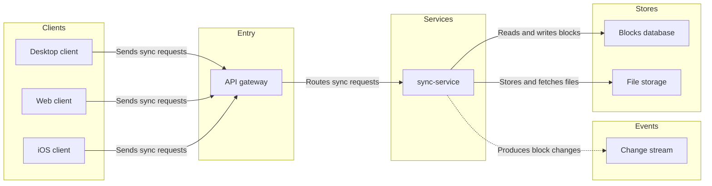
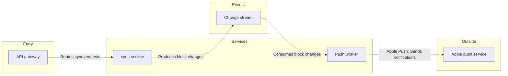

# FJ-019 turn 3 transcript

**User:** Use your recommended answers.

**Tool call:** `Read` `{"file_path": "/private/var/folders/3c/zfqcqsts0kn19cgblj82gqhm0000gn/T/devin-compare-bench/FJ-019/sk-create-figjam/references/quality-rubric.md"}`

**Tool result:** `Read`

```text
"1\t---\n2\ttitle: \"FigJam Diagram Quality Rubric\"\n3\tdescription: \"The taste gate a FigJam model passes before the write gate, translated from sk-design-diagram's success criteria: type fit, the remove test, signal, the check, the board, the design rubric that scores a composed board and the reply.\"\n4\tcontextType: implementation\n5\timportance_tier: important\n6\ttrigger_phrases:\n7\t  - \"figjam quality rubric\"\n8\t  - \"diagram taste gate\"\n9\t  - \"remove test\"\n10\t  - \"figjam review checklist\"\n11\t  - \"figjam design rubric\"\n12\tversion: 1.0.2.0\n13\t---\n14\t\n15\t# FigJam Diagram Quality Rubric\n16\t\n17\tThe script checks what a script can see. This rubric is the rest: whether the diagram should exist, whether every node earns its place and whether the reader can trust what lands on the board. Walk it after the check passes and before the write gate.\n18\t\n19\t**Loading Condition:** CONDITIONAL, on every Flow route before the write gate\n20\t**Purpose:** The judgement pass between the pre-write check and the gate\n21\t**Scope:** The model, the provenance table, the planned extensions and, after the write, the board and the reply\n22\t\n23\t---\n24\t\n25\t## 1. TYPE FIT\n26\t\n27\t- [ ] The type answers the reader's question, as `references/flow-mode.md` Section 3 maps it\n28\t- [ ] A table, a list or a paragraph would not do the same job. If it would, say so and offer that instead\n29\t- [ ] The type's reference in `references/types/` was loaded and i
```

**Tool call:** `Read` `{"file_path": "/private/var/folders/3c/zfqcqsts0kn19cgblj82gqhm0000gn/T/devin-compare-bench/FJ-019/sk-create-figjam/references/style-guide.md"}`

**Tool result:** `Read`

```text
"1\t---\n2\ttitle: \"FigJam Diagram Style Guide\"\n3\tdescription: \"The colour every composed FigJam board draws by kind in the shipped design, the type scale and the 8 pixel grid, the palette pairs the check accepts with their measured contrast, and the spacing bands, translated from sk-design-diagram's style guide and derivation record.\"\n4\tcontextType: implementation\n5\timportance_tier: important\n6\ttrigger_phrases:\n7\t  - \"figjam style guide\"\n8\t  - \"figjam palette\"\n9\t  - \"figjam colour by kind\"\n10\t  - \"figjam type scale\"\n11\t  - \"palette derivation record\"\n12\t  - \"figjam contrast\"\n13\tversion: 1.0.2.0\n14\t---\n15\t\n16\t# FigJam Diagram Style Guide\n17\t\n18\tThe rules for colour, type and spacing on a FigJam board. The composer in `assets/compose-board.js` draws every board in the design `assets/figjam-design.md` holds, which ships as the tables below record, and every hex a model, a design or a note extension uses comes from the palette in Section 3. `scripts/flow_check.py` refuses any other.\n19\t\n20\t**Loading Condition:** CONDITIONAL, before the gate on every Flow route, and when a model or a note extension uses colour\n21\t**Purpose:** Names the colour each kind draws in, the type scale, the grid, the palette pairs the check accepts and the measured contrast record\n22\t**Scope:** The composed board, Mermaid `style`, `classDef` and `linkStyle` colours, sticky and pin colours for notes, and the contrast record the self-test re-measures\n
```

**Tool call:** `Bash` `{"command": "cd /private/var/folders/3c/zfqcqsts0kn19cgblj82gqhm0000gn/T/devin-compare-bench/FJ-019/sk-create-figjam && python3 scripts/flow_check.py --help 2>&1 | head -40; python3 scripts/compose_board.py --help 2>&1 | head -40", "description": "Show check and composer usage"}`

**Tool result:** `Bash`

```text
"mermaid_extract: --help: not a Mermaid file\nUNREADABLE --help: the extractor refused it\n\n  compose_board.py <model.md> [--diagram N] [--out path]  -> 0 the filled code is written, 1 the model fails\n                                                             the check, 2 unreadable or no such diagram\n  compose_board.py <model.md> --model                      -> print the MODEL as JSON instead of the code\n  compose_board.py --template                              -> print the compact code with its MODEL and THEME\n                                                             placeholders, the text the Project's composer\n                                                             Knowledge file carries\n  compose_board.py --design-check                          -> print the design a board is drawn in, what it\n                                                             changes, its measures and the THEME it sends: 0 the\n                                                             design reads with no warning, 1 one or more warnings\n  compose_board.py --self-test                             -> prove every shipped model composes, its counts\n                                                             match the check, the code fits one use_figma call and\n                                                             the board it draws keeps its geometry and its design"
```

**Tool call:** `Bash` `{"command": "SCRATCH=$(mktemp -d /tmp/loomlist-figjam.XXXXXX) && echo \"$SCRATCH\" > /tmp/loomlist-scratch-path && cat > \"$SCRATCH/model.md\" <<'EOF'\n```mermaid\n%% type: architecture\n%% title: 1. Block sync\n%% subtitle: How a block change travels from the Desktop, Web and iOS clients through sync-service to the change stream, with the calls drawn from the team's description\n%% source: Sources: the team's description of Loomlist block sync, calls assumed. Left out: auth, retries, conflict handling, delivery from Apple's push service to the iOS device.\n%% focus: sync\nflowchart LR\n    su`

**Tool result:** `Bash`

```text
"  diagram 1, architecture: ok, 8 nodes and 7 connectors, widest rank 3 steps, longest path 4 steps, 0.9 connectors per step, labels average 12 characters, 0 crossing pairs\n  diagram 2, architecture: ok, 5 nodes and 4 connectors, widest rank 1 steps, longest path 5 steps, 0.8 connectors per step, labels average 13 characters, 0 crossing pairs\nPASSED 2 diagram(s) in model.md\nexit 0"
```

**Assistant:**

Both diagrams pass the check. Next I'll dry-compose them to get the counts the read-back will look for.

**Tool call:** `Bash` `{"command": "SCRATCH=$(cat /tmp/loomlist-scratch-path); cd /private/var/folders/3c/zfqcqsts0kn19cgblj82gqhm0000gn/T/devin-compare-bench/FJ-019/sk-create-figjam && for n in 1 2; do python3 scripts/compose_board.py \"$SCRATCH/model.md\" --diagram $n --out \"$SCRATCH/board$n.js\"; echo \"exit $?\"; done; wc -c \"$SCRATCH\"/board*.js", "description": "Compose both diagrams to scratch code files"}`

**Tool result:** `Bash`

```text
"COMPOSED diagram 1, 8 nodes and 7 connectors, widest rank 3 steps, longest path 4 steps, 0.9 connectors per step, labels average 12 characters, 0 crossing pairs: 8 nodes and 7 connectors to read back, 42067 characters in /tmp/loomlist-figjam.Ki7HTD/board1.js, drawn in the design FigJam default\nexit 0\nCOMPOSED diagram 2, 5 nodes and 4 connectors, widest rank 1 steps, longest path 5 steps, 0.8 connectors per step, labels average 13 characters, 0 crossing pairs: 5 nodes and 4 connectors to read back, 41687 characters in /tmp/loomlist-figjam.Ki7HTD/board2.js, drawn in the design FigJam default\nexit 0\n   42067 /tmp/loomlist-figjam.Ki7HTD/board1.js\n   41687 /tmp/loomlist-figjam.Ki7HTD/board2.js\n   83754 total"
```

**Assistant:**

The model passes the pre-write check and composes cleanly. Nothing has been written to FigJam yet.

**The checked sketch**

Board 1, "1. Block sync" (8 nodes, 7 connectors, 0 crossings):


Board 2, "2. Push delivery" (5 nodes, 4 connectors, 0 crossings):


**Glance lines**
- **Board 1:**
  - First glance is sync-service, marked with the pink outline.
  - Second glance is the gateway feeding it and the two stores and the change stream it writes to.
  - Last glance is the source line.
- **Board 2:**
  - First glance is the push worker, marked with the pink outline.
  - Second glance is the change stream feeding it and the dashed call to Apple's push service.
  - Last glance is the source line.

**Critique answers**
1. The eye lands on the marked node on each board, and that is the node each board most needs read.
2. Nothing can be cut. The gateway on board 2 stays only because the check needs a way into sync-service.
3. The board reads in greyscale. Stores are cylinders, the change stream is a queue shape, and the dashed lines mark the event and outside calls.
4. Every edge is labelled from the source's side, with a different label on each kind of call.

**Gate**
- **File:** `<draft-file-key>`, stated by you as in the Loomlist Engineering plan. I can't confirm the plan from here.
- **What is written:** the two boards as new sections, board 1 to the right of everything already on the page and board 2 400 pixels to the right of board 1. Nothing already on the file is moved or changed, and no new file is created.
- **Extensions:** none.
- **Calls:** about six. They are `create_session`, one `get_figjam` read of the file before the write, one `use_figma` call per board and one `get_figjam` read-back. On a Starter plan or a View or Collab seat, Figma limits tool calls to six a month, so this write could use that whole allowance.
- **Rollback:** I'd delete the two board sections the write returns, through `use_figma`. I'd do that only after a reply that names those boards, and the delete would be its own question, never covered by this yes.
- **Fallback:** if the file can't take the write, I stop and ask before creating anything in the Barter drafts.

Shall I write these two boards into file `<draft-file-key>` as described?
