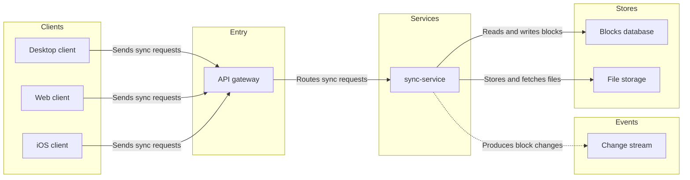
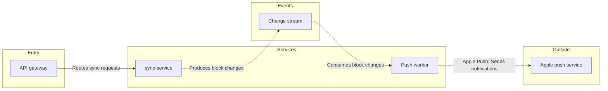

The model passes the pre-write check and composes cleanly. Nothing has been written to FigJam yet.

**The checked sketch**

Board 1, "1. Block sync" (8 nodes, 7 connectors, 0 crossings):

Board 2, "2. Push delivery" (5 nodes, 4 connectors, 0 crossings):

**Glance lines**
- **Board 1:**
  - First glance is sync-service, marked with the pink outline.
  - Second glance is the gateway feeding it and the two stores and the change stream it writes to.
  - Last glance is the source line.
- **Board 2:**
  - First glance is the push worker, marked with the pink outline.
  - Second glance is the change stream feeding it and the dashed call to Apple's push service.
  - Last glance is the source line.

**Critique answers**
1. The eye lands on the marked node on each board, and that is the node each board most needs read.
2. Nothing can be cut. The gateway on board 2 stays only because the check needs a way into sync-service.
3. The board reads in greyscale. Stores are cylinders, the change stream is a queue shape, and the dashed lines mark the event and outside calls.
4. Every edge is labelled from the source's side, with a different label on each kind of call.

**Gate**
- **File:** `<draft-file-key>`, stated by you as in the Loomlist Engineering plan. I can't confirm the plan from here.
- **What is written:** the two boards as new sections, board 1 to the right of everything already on the page and board 2 400 pixels to the right of board 1. Nothing already on the file is moved or changed, and no new file is created.
- **Extensions:** none.
- **Calls:** about six. They are `create_session`, one `get_figjam` read of the file before the write, one `use_figma` call per board and one `get_figjam` read-back. On a Starter plan or a View or Collab seat, Figma limits tool calls to six a month, so this write could use that whole allowance.
- **Rollback:** I'd delete the two board sections the write returns, through `use_figma`. I'd do that only after a reply that names those boards, and the delete would be its own question, never covered by this yes.
- **Fallback:** if the file can't take the write, I stop and ask before creating anything in the Barter drafts.

Shall I write these two boards into file `<draft-file-key>` as described?