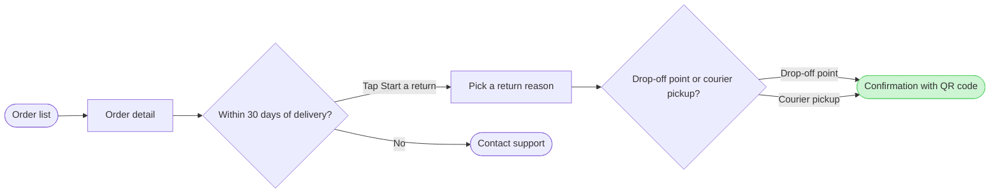

# FJ-022 turn 3 transcript

**User:** Yes, that reading is right.

**Assistant:**

Reading confirmed. Next I'll write the model to a scratch folder outside the repository and run the pre-write check.

**Tool call:** `Bash` `{"command": "S=$(mktemp -d /tmp/fj-return.XXXXXX) && echo \"$S\" > /tmp/fj-return.path && cat > \"$S/model.md\" <<'EOF'\n```mermaid\nflowchart LR\n    %% title: Start a return\n    %% subtitle: How a Fernhouse customer starts a return in the app, from the order list to a confirmed return\n    %% source: Sources: the app and the returns doc. Left out: free pickup for orders over 100 euros, a proposal under review.\n    %% zone: Find the order: orders, detail\n    %% zone: Request the return: window, support, reason, method\n    %% zone: Done: confirmed\n    orders([Order list]) --> detail[Order`

**Tool result:** `Bash`

```text
"  diagram 1, user flow: ok, 7 nodes and 7 connectors, widest rank 2 steps, longest path 6 steps, 1.0 connectors per step, labels average 20 characters, 0 crossing pairs\nPASSED 1 diagram(s) in model.md\nexit 0\n---\ntitle: \"FigJam Diagram Style Guide\"\ndescription: \"The colour every composed FigJam board draws by kind in the shipped design, the type scale and the 8 pixel grid, the palette pairs the check accepts with their measured contrast, and the spacing bands, translated from sk-design-diagram's style guide and derivation record.\"\ncontextType: implementation\nimportance_tier: important\ntrigger_phrases:\n  - \"figjam style guide\"\n  - \"figjam palette\"\n  - \"figjam colour by kind\"\n  - \"figjam type scale\"\n  - \"palette derivation record\"\n  - \"figjam contrast\"\nversion: 1.0.2.0\n---\n\n# FigJam Diagram Style Guide\n\nThe rules for colour, type and spacing on a FigJam board. The composer in `assets/compose-board.js` draws every board in the design `assets/figjam-design.md` holds, which ships as the tables below record, and every hex a model, a design or a note extension uses comes from the palette in Section 3. `scripts/flow_check.py` refuses any other.\n\n**Loading Condition:** CONDITIONAL, before the gate on every Flow route, and when a model or a note extension uses colour\n**Purpose:** Names the colour each kind draws in, the type scale, the grid, the palette pairs the check accepts and the measured contrast record\n**Scope:** The composed board, Mermai
```

**Assistant:**

The check passed. Now I'll compose the board code in scratch to confirm the counts the read-back will look for.

**Tool call:** `Bash` `{"command": "S=$(cat /tmp/fj-return.path) && python3 -I sk-create-figjam/scripts/compose_board.py \"$S/model.md\" --diagram 1 --out \"$S/board.js\"; echo \"exit $?\"; wc -c \"$S/board.js\"", "description": "Compose board code into scratch"}`

**Tool result:** `Bash`

```text
"COMPOSED diagram 1, 7 nodes and 7 connectors, widest rank 2 steps, longest path 6 steps, 1.0 connectors per step, labels average 20 characters, 0 crossing pairs: 7 nodes and 7 connectors to read back, 41813 characters in /tmp/fj-return.Lm8k2a/board.js, drawn in the design FigJam default\nexit 0\n   41813 /tmp/fj-return.Lm8k2a/board.js"
```

**Assistant:**

The model passed the check and composed cleanly. Here is the gate, and it covers the write alone.

Question: which screens does a Fernhouse customer pass through to start a return in the app, and where do they choose?
Outcome: a product or design reader can follow a return from the order list to a confirmed return and see where the 30-day window ends it.

Glance lines:
- First glance: the confirmation with QR code, the green goal under the pink outline
- Second glance: the drop-off point or courier pickup choice that leads to it
- Last glance: Contact support, the exit once the window has closed

The checked sketch is 7 nodes and 7 connectors, with 0 crossing pairs, in the Laptop reading distance:



- File: the existing FigJam file `<draft-file-key>`. No new file is created, so no plan is involved
- Writes: one composed board added as a new section beside what the file already holds. It has the title "Start a return", the subtitle, three zones ("Find the order", "Request the return" and "Done"), 7 nodes, 7 connectors, a key and the source line. Nothing already on the file changes
- Extensions: none
- Calls: `create_session`, a `get_figjam` read of the file before the write, one `use_figma` call to compose the board and a `get_figjam` read-back after it. That is four calls. If the file's plan or your seat is capped at six tool calls a month, this spends four of them
- Rollback: delete the one board section the write returns, found by its tag. That runs only on a reply that names it, and the rest of the file stays as it was
- If the file can't be written, I stop and tell you. A new file would need its own yes from you, naming the Barter team plan, drafts and no project

Write it?
