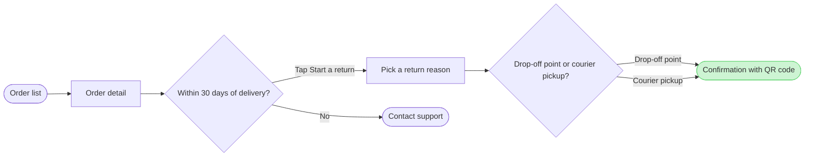

The model passed the check and composed cleanly. Here is the gate, and it covers the write alone.

Question: which screens does a Fernhouse customer pass through to start a return in the app, and where do they choose?
Outcome: a product or design reader can follow a return from the order list to a confirmed return and see where the 30-day window ends it.

Glance lines:
- First glance: the confirmation with QR code, the green goal under the pink outline
- Second glance: the drop-off point or courier pickup choice that leads to it
- Last glance: Contact support, the exit once the window has closed

The checked sketch is 7 nodes and 7 connectors, with 0 crossing pairs, in the Laptop reading distance:

- File: the existing FigJam file `<draft-file-key>`. No new file is created, so no plan is involved
- Writes: one composed board added as a new section beside what the file already holds. It has the title "Start a return", the subtitle, three zones ("Find the order", "Request the return" and "Done"), 7 nodes, 7 connectors, a key and the source line. Nothing already on the file changes
- Extensions: none
- Calls: `create_session`, a `get_figjam` read of the file before the write, one `use_figma` call to compose the board and a `get_figjam` read-back after it. That is four calls. If the file's plan or your seat is capped at six tool calls a month, this spends four of them
- Rollback: delete the one board section the write returns, found by its tag. That runs only on a reply that names it, and the rest of the file stays as it was
- If the file can't be written, I stop and tell you. A new file would need its own yes from you, naming the Barter team plan, drafts and no project

Write it?