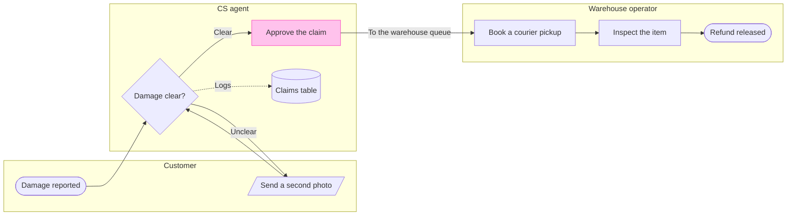

The model passed the pre-write check and composed cleanly. Nothing has been written to FigJam. This is the write gate.

Question: who handles a damaged-item claim from the customer's report to the released refund, and where does it move from CS to the warehouse?
Outcome: CS and warehouse leads can see which team owns each step and where the claim changes hands.

The sketch, as checked:

Check: `PASSED`, process, 8 nodes and 8 connectors, 0 crossing pairs, longest path 6 steps. The board draws in the shipped design.

Glance lines:
* First glance: "Approve the claim", the step on the CS to warehouse handoff, drawn light pink with the heavy pink outline
* Second glance: "Damage clear?", the check that decides whether the claim moves on
* Last glance: "Claims table", where the decision is logged

The four critique questions, answered on the sketch:
* Where does the eye go first? To "Approve the claim", which is the node the board most needs read
* Does anything compete with it? No. The decision is a yellow diamond with a 2 pixel line, and the goal is a plain green end
* Does the board read without the model beside it? Yes, the three lane names and the edge label "To the warehouse queue" state who owns each step and where the claim moves
* Does any node fail the remove test? No. Each one is a runbook step, and the claims table is the only store

Plan and file: the existing FigJam file `<draft-file-key>`, which takes the board as a new section beside what it holds. No plan is needed and no new file is created. Your message names the Fernhouse Product plan and, as the fallback, the Barter team plan. If this file cannot be written to, I stop and ask before creating anything, because those two plans conflict.
Writes: one composed board titled "Damaged-item refund", with 3 lanes, 8 nodes and 8 connectors, a key and a source line, at laptop reading distance.
Extensions: none.
Calls: `create_session`, one `get_figjam` read of the file before the write so I can show the existing content was left as it was, one `use_figma` and one `get_figjam` read-back. On a Starter plan or a View or Collab seat, Figma limits tool calls to six a month, so these four would use most of that allowance.
Rollback: delete the one "Damaged-item refund" section the write returns, and only after you say yes to a question that names it. Nothing already on the file changes.

Write the board into that file?