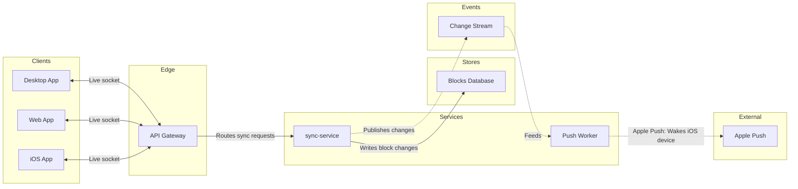

# FJ-024 turn 2 transcript

**User:** Yes, that reading is right.

**Assistant:**

The reading is settled, so I'm building the model and running the pre-write check on it.

**Tool call:** `Bash` `{"command": "SCR=$(mktemp -d /tmp/flow-loomlist-XXXXXX) && echo \"$SCR\" && cat > \"$SCR/model.md\" <<'EOF'\n```mermaid\n%% type: architecture\nflowchart LR\n    %% title: Block sync\n    %% subtitle: The parts that carry a block change from a Loomlist client to the others, for Loomlist engineers\n    %% source: Source: your request. Left out: file storage, no call to it is stated. The wake hop from Apple Push to the iOS app, not drawable.\n    %% focus: sync\n    subgraph client [\"Clients\"]\n        desktop[Desktop App]\n        webClient[Web App]\n        ios[iOS App]\n    end\n    subgrap`

**Tool result:** `Bash`

```text
"/tmp/flow-loomlist-Tv8tY6\n  diagram 1, architecture: ok, 9 nodes and 8 connectors, widest rank 3 steps, longest path 6 steps, 0.9 connectors per step, labels average 11 characters, 0 crossing pairs\nPASSED 1 diagram(s) in model.md"
```

**Tool call:** `Bash` `{"command": "python3 -I scripts/compose_board.py /tmp/flow-loomlist-Tv8tY6/model.md --diagram 1 --out /tmp/flow-loomlist-Tv8tY6/board1.js 2>&1 | tail -10; wc -c /tmp/flow-loomlist-Tv8tY6/board1.js", "description": "Compose the checked model into board code"}`

**Tool result:** `Bash`

```text
"COMPOSED diagram 1, 9 nodes and 8 connectors, widest rank 3 steps, longest path 6 steps, 0.9 connectors per step, labels average 11 characters, 0 crossing pairs: 9 nodes and 8 connectors to read back, 42170 characters in /tmp/flow-loomlist-Tv8tY6/board1.js, drawn in the design FigJam default\n   42170 /tmp/flow-loomlist-Tv8tY6/board1.js"
```

**Assistant:**

The model passed the pre-write check and composes cleanly. Nothing has been written yet.

```text
Check: diagram 1, architecture: ok, 9 nodes and 8 connectors, 6 lanes, 0 crossing pairs
```



```text
Question: which parts sit behind block sync and how do they connect?
Outcome: a reader can follow one block change from a client through the gateway and sync-service to the change stream, and on to the push that wakes a sleeping iOS device.
First glance: sync-service, where every block change is written and published.
Second glance: the Change Stream that carries each change on to the Push Worker.
Last glance: Apple Push, the external hop that wakes sleeping iOS devices.
Plan: Loomlist Engineering, as you named it. File: the existing FigJam file <draft-file-key>.
Writes: one composed board, 9 nodes and 8 connectors in 6 lanes, with a title, a key and a source line, at the Laptop reading distance. It lands as a new section beside what the file holds, and nothing already there changes.
Left out: file storage, because no call to it is stated. The wake hop from Apple Push to the iOS app, because the type cannot draw it.
Extensions: none.
Calls: create_session, a get_figjam read of the file before the write, one use_figma and a get_figjam read-back. That is four calls, and on a Starter plan or a View or Collab seat they count against the six tool calls Figma allows each month.
Rollback: delete the one board section the write returns, and only on a yes to a question that names it. If the file can't take the write, I stop and ask before creating anything in the Barter team plan.
Write it?
```
