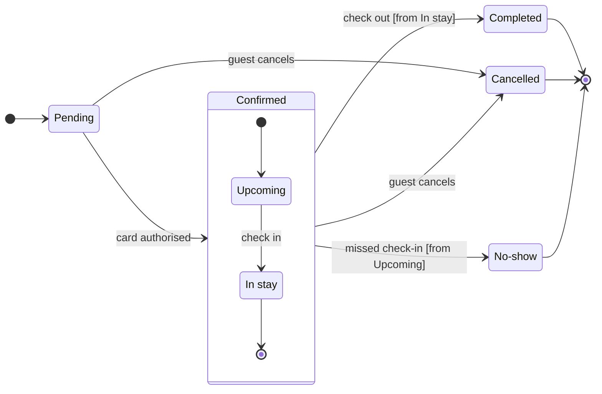

# FJ-026 turn 2 transcript

**User:** Yes, that reading is right.

**Tool call:** `Bash` `{"command": "S=$(mktemp -d /tmp/fj026-XXXXXX) && echo $S > /tmp/fj026-scratch-path && cat > $S/model.md <<'EOF'\n```mermaid\nstateDiagram-v2\n    %% title: Booking status\n    %% subtitle: Every status a Roamstay booking passes through, and what moves it on\n    %% source: Source: the request. Left out: nothing.\n    direction LR\n    state \"In stay\" as InStay\n    state \"No-show\" as NoShow\n    [*] --> Pending\n    Pending --> Confirmed: card authorised\n    state Confirmed {\n        [*] --> Upcoming\n        Upcoming --> InStay: check in\n        InStay --> [*]\n    }\n    Confirmed -->`

**Tool result:** `Bash`

```text
"  diagram 1, state: ok, 7 states and 12 transitions\nPASSED 1 diagram(s) in model.md\nexit 0\nCOMPOSED diagram 1, 7 states and 12 transitions: 12 nodes and 12 connectors to read back, 41959 characters in /tmp/fj026-e3xhdC/code.js, drawn in the design FigJam default\nexit 0\n   41959 /tmp/fj026-e3xhdC/code.js"
```

**Assistant:**

The model passed the pre-write check (7 states, 12 transitions) and composed cleanly. This is the sketch:



**Question:** which statuses does a Roamstay booking have, and what moves it between them?

**Outcome:** support can read every booking status and spot the three a booking ends in.

**First glance:** Pending, the light blue first state at the left edge. No accent is set, so the layout decides.

**Second glance:** Completed, Cancelled and No-show, the three light gray end states.

**Last glance:** the guards on the arrows, such as `[from Upcoming]`.

**File:** the existing FigJam file `<draft-file-key>`. The board goes in as a new section beside what is already there, and nothing already on the file changes.

**Plan:** none, because no new file is created. The Roamstay Product plan and the Barter drafts fallback are both unused. I haven't checked which plan holds this file.

**Writes:** one composed board named "Booking status", with 7 states and 12 transitions. The end states are light gray, and the board has a title, a subtitle, a key and a source line, at the Laptop reading distance.

**Extensions:** none.

**Calls:** `create_session` on the file key, one `get_figjam` read of what is already there, one `use_figma` call and one `get_figjam` read-back. If the file sits on a Starter plan or you have a View or Collab seat, Figma caps tool calls at six a month, and this uses most of that.

**Rollback:** delete the one board section the write returns. That deletion happens only on your yes to a question that names the board.

Write it?
