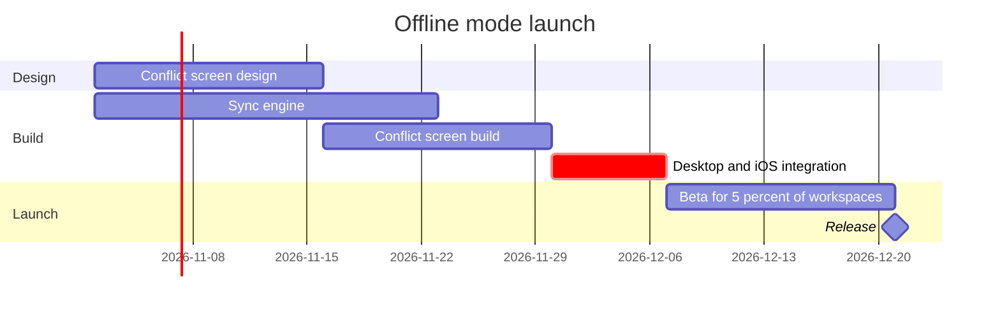

# FJ-028 turn 2 transcript

**User:** Yes, that reading is right.

**Assistant:**

The reading is confirmed, so next is the model, the pre-write check and the quality pass. First I'll read the style guide the rubric points to and check the script usage.

**Tool call:** `Read` `{"file_path": "/private/var/folders/3c/zfqcqsts0kn19cgblj82gqhm0000gn/T/devin-compare-bench/FJ-028/sk-create-figjam/references/style-guide.md"}`

**Tool result:** `Read`

```text
"1\t---\n2\ttitle: \"FigJam Diagram Style Guide\"\n3\tdescription: \"The colour every composed FigJam board draws by kind in the shipped design, the type scale and the 8 pixel grid, the palette pairs the check accepts with their measured contrast, and the spacing bands, translated from sk-design-diagram's style guide and derivation record.\"\n4\tcontextType: implementation\n5\timportance_tier: important\n6\ttrigger_phrases:\n7\t  - \"figjam style guide\"\n8\t  - \"figjam palette\"\n9\t  - \"figjam colour by kind\"\n10\t  - \"figjam type scale\"\n11\t  - \"palette derivation record\"\n12\t  - \"figjam contrast\"\n13\tversion: 1.0.2.0\n14\t---\n15\t\n16\t# FigJam Diagram Style Guide\n17\t\n18\tThe rules for colour, type and spacing on a FigJam board. The composer in `assets/compose-board.js` draws every board in the design `assets/figjam-design.md` holds, which ships as the tables below record, and every hex a model, a design or a note extension uses comes from the palette in Section 3. `scripts/flow_check.py` refuses any other.\n19\t\n20\t**Loading Condition:** CONDITIONAL, before the gate on every Flow route, and when a model or a note extension uses colour\n21\t**Purpose:** Names the colour each kind draws in, the type scale, the grid, the palette pairs the check accepts and the measured contrast record\n22\t**Scope:** The composed board, Mermaid `style`, `classDef` and `linkStyle` colours, sticky and pin colours for notes, and the contrast record the self-test re-measures\n
```

**Tool call:** `Bash` `{"command": "cd /private/var/folders/3c/zfqcqsts0kn19cgblj82gqhm0000gn/T/devin-compare-bench/FJ-028/sk-create-figjam/scripts && python3 -I flow_check.py --help 2>&1 | head -30; python3 -I compose_board.py --help 2>&1 | head -30; mktemp -d -t loomlist-gantt", "description": "Show script usage and make a scratch folder"}`

**Tool result:** `Bash`

```text
"mermaid_extract: --help: not a Mermaid file\nUNREADABLE --help: the extractor refused it\n\n  compose_board.py <model.md> [--diagram N] [--out path]  -> 0 the filled code is written, 1 the model fails\n                                                             the check, 2 unreadable or no such diagram\n  compose_board.py <model.md> --model                      -> print the MODEL as JSON instead of the code\n  compose_board.py --template                              -> print the compact code with its MODEL and THEME\n                                                             placeholders, the text the Project's composer\n                                                             Knowledge file carries\n  compose_board.py --design-check                          -> print the design a board is drawn in, what it\n                                                             changes, its measures and the THEME it sends: 0 the\n                                                             design reads with no warning, 1 one or more warnings\n  compose_board.py --self-test                             -> prove every shipped model composes, its counts\n                                                             match the check, the code fits one use_figma call and\n                                                             the board it draws keeps its geometry and its design\n/var/folders/3c/zfqcqsts0kn19cgblj82gqhm0000gn/T/loomlist-gantt.XolmqnSfBP"
```

**Tool call:** `Write` `{"file_path": "/var/folders/3c/zfqcqsts0kn19cgblj82gqhm0000gn/T/loomlist-gantt.XolmqnSfBP/model.md", "content": "```mermaid\ngantt\n    title Offline mode launch\n    %% subtitle: Which work runs when before the offline mode release, and what holds it\n    %% source: Source: the Loomlist offline mode launch plan. Left out: Android in the next quarter, not yet approved.\n    %% focus: integrate\n    dateFormat YYYY-MM-DD\n    section Design\n    Conflict screen design :design, 2026-11-02, 2w\n    section Build\n    Sync engine :engine, 2026-11-02, 3w\n    Conflict screen build :screen, after de`

**Tool result:** `Write`

```text
"File created successfully at: /var/folders/3c/zfqcqsts0kn19cgblj82gqhm0000gn/T/loomlist-gantt.XolmqnSfBP/model.md (file state is current in your context \u2014 no need to Read it back)"
```

**Tool call:** `Bash` `{"command": "python3 -I flow_check.py /var/folders/3c/zfqcqsts0kn19cgblj82gqhm0000gn/T/loomlist-gantt.XolmqnSfBP/model.md; echo \"exit $?\"; python3 -I compose_board.py /var/folders/3c/zfqcqsts0kn19cgblj82gqhm0000gn/T/loomlist-gantt.XolmqnSfBP/model.md --diagram 1 --out /var/folders/3c/zfqcqsts0kn19cgblj82gqhm0000gn/T/loomlist-gantt.XolmqnSfBP/compose.js; echo \"exit $?\"", "description": "Run the pre-write check and compose the gantt code"}`

**Tool result:** `Bash`

```text
"  diagram 1, gantt: ok, 6 tasks in 3 sections\nPASSED 1 diagram(s) in model.md\nexit 0\nCOMPOSED diagram 1, 6 tasks in 3 sections: 6 nodes and 5 connectors to read back, 17821 characters in /var/folders/3c/zfqcqsts0kn19cgblj82gqhm0000gn/T/loomlist-gantt.XolmqnSfBP/compose.js, drawn in the design FigJam default\nexit 0"
```

**Assistant:**

The model passes the pre-write check and I found nothing to change in the quality pass. This is the write gate, and nothing is on the board yet.

```text
diagram 1, gantt: ok, 6 tasks in 3 sections
PASSED 1 diagram(s) in model.md
COMPOSED diagram 1: 6 nodes and 5 connectors to read back, drawn in the design FigJam default
```



```text
Question: which work runs when, and what holds the release?
Outcome: a reader can see the order of the offline mode work, the critical path and where the release lands on 21 Dec 2026.
First glance: Desktop and iOS integration, the critical task, with the pink outline and ", critical" on its bar.
Second glance: Sync engine and Conflict screen build, the two bars integration waits for, with the arrows into it.
Last glance: Beta for 5 percent of workspaces and the Release milestone, plus the source line that names Android as left out.
Critique: the eye goes first to integration, which is the bar the board most needs read. Nothing else carries the accent. The sync engine's week of slack shows as the gap before the integration bar, not as a label. The board answers the question without the model beside it.
Plan and file: the existing FigJam file <draft-file-key>. The board lands as a new section beside what the file holds, so no plan or new file is needed. If that file can't take the board, I stop and ask before creating anything. The fallback you named is a new file in the Barter team plan, in drafts, with no project. That plan differs from Loomlist Product, so I won't create it on this yes alone.
Writes: one composed board with 3 sections, 5 tasks, 1 milestone and 5 dependency arrows on one axis. It has a title, a subtitle, a key and a source line, at balanced detail for a mixed audience at the Laptop reading distance. The composed code is 17,821 characters, inside the 50,000 one call takes. Nothing already on the file changes.
Extensions: none.
Calls: create_session, a get_figjam read before the write to record what the file holds, one use_figma, and a get_figjam read-back. Figma limits a Starter plan and a View or Collab seat to six tool calls a month, so tell me if this file's plan is one of those.
Rollback: delete the one board section the write returns, through use_figma, and only on a yes to a question that names it.
Write it?
```
