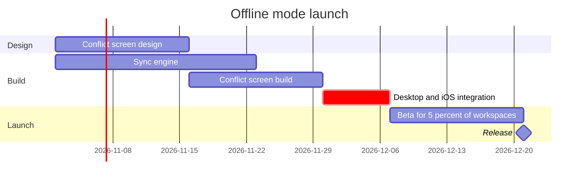

The model passes the pre-write check and I found nothing to change in the quality pass. This is the write gate, and nothing is on the board yet.

```text
diagram 1, gantt: ok, 6 tasks in 3 sections
PASSED 1 diagram(s) in model.md
COMPOSED diagram 1: 6 nodes and 5 connectors to read back, drawn in the design FigJam default
```



```text
Question: which work runs when, and what holds the release?
Outcome: a reader can see the order of the offline mode work, the critical path and where the release lands on 21 Dec 2026.
First glance: Desktop and iOS integration, the critical task, with the pink outline and ", critical" on its bar.
Second glance: Sync engine and Conflict screen build, the two bars integration waits for, with the arrows into it.
Last glance: Beta for 5 percent of workspaces and the Release milestone, plus the source line that names Android as left out.
Critique: the eye goes first to integration, which is the bar the board most needs read. Nothing else carries the accent. The sync engine's week of slack shows as the gap before the integration bar, not as a label. The board answers the question without the model beside it.
Plan and file: the existing FigJam file <draft-file-key>. The board lands as a new section beside what the file holds, so no plan or new file is needed. If that file can't take the board, I stop and ask before creating anything. The fallback you named is a new file in the Barter team plan, in drafts, with no project. That plan differs from Loomlist Product, so I won't create it on this yes alone.
Writes: one composed board with 3 sections, 5 tasks, 1 milestone and 5 dependency arrows on one axis. It has a title, a subtitle, a key and a source line, at balanced detail for a mixed audience at the Laptop reading distance. The composed code is 17,821 characters, inside the 50,000 one call takes. Nothing already on the file changes.
Extensions: none.
Calls: create_session, a get_figjam read before the write to record what the file holds, one use_figma, and a get_figjam read-back. Figma limits a Starter plan and a View or Collab seat to six tool calls a month, so tell me if this file's plan is one of those.
Rollback: delete the one board section the write returns, through use_figma, and only on a yes to a question that names it.
Write it?
```