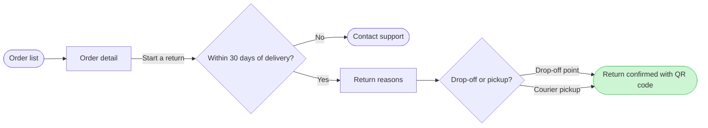

# FJ-031 turn 2 transcript

**User:** Yes, that reading is right.

**Tool call:** `Bash` `{"command": "cd /private/var/folders/3c/zfqcqsts0kn19cgblj82gqhm0000gn/T/devin-compare-bench/FJ-031/sk-create-figjam && ls scripts && python3 scripts/flow_check.py --help 2>&1 | head -20; python3 scripts/compose_board.py --help 2>&1 | head -20", "description": "Check usage of the flow check and composer scripts"}`

**Tool result:** `Bash`

```text
"compose_board.py\ncompose-trace.mjs\nfigjam_checks\nflow_check.py\nvendored\nmermaid_extract: --help: not a Mermaid file\nUNREADABLE --help: the extractor refused it\n\n  compose_board.py <model.md> [--diagram N] [--out path]  -> 0 the filled code is written, 1 the model fails\n                                                             the check, 2 unreadable or no such diagram\n  compose_board.py <model.md> --model                      -> print the MODEL as JSON instead of the code\n  compose_board.py --template                              -> print the compact code with its MODEL and THEME\n                                                             placeholders, the text the Project's composer\n                                                             Knowledge file carries\n  compose_board.py --design-check                          -> print the design a board is drawn in, what it\n                                                             changes, its measures and the THEME it sends: 0 the\n                                                             design reads with no warning, 1 one or more warnings\n  compose_board.py --self-test                             -> prove every shipped model composes, its counts\n                                                             match the check, the code fits one use_figma call and\n                                                             the board it draws keeps its geometry and its design"
```

**Tool call:** `Bash` `{"command": "SCR=$(mktemp -d /tmp/fj-return-XXXXXX) && echo $SCR > /tmp/fj-return-path && cat > $SCR/model.md <<'EOF'\n```mermaid\nflowchart LR\n    %% title: Start a return\n    %% subtitle: How a Fernhouse customer starts a return in the app, from the order list to a confirmed return\n    %% source: Sources: the app screens and the returns doc, as described by the requester. Left out: free pickup over 100 euros, a proposal under review.\n    %% zone: Find the order: orders, detail\n    %% zone: Request the return: window, support, reason, method\n    %% zone: Done: confirmed\n    orders([Ord`

**Tool result:** `Bash`

```text
"  diagram 1, user flow: ok, 7 nodes and 7 connectors, widest rank 2 steps, longest path 6 steps, 1.0 connectors per step, labels average 18 characters, 0 crossing pairs\nPASSED 1 diagram(s) in model.md\nexit 0\nCOMPOSED diagram 1, 7 nodes and 7 connectors, widest rank 2 steps, longest path 6 steps, 1.0 connectors per step, labels average 18 characters, 0 crossing pairs: 7 nodes and 7 connectors to read back, 41835 characters in /tmp/fj-return-7LXJF9/code.js, drawn in the design FigJam default\nexit 0"
```

**Assistant:**

The model passes the pre-write check: 7 nodes, 7 connectors, 0 crossings. The composer built the board code from it, and nothing is written yet. This is the sketch:



**Question:** which screens does a Fernhouse customer pass through to start a return in the app, and where do they choose?
**Outcome:** a reader can follow a return from the order list to the QR code confirmation and see where the 30 day window ends it.
**First glance:** the confirmed return, the goal the flow reaches.
**Second glance:** the drop-off or pickup choice that leads to it.
**Last glance:** Contact support, the exit after 30 days.
**File:** the existing FigJam file with key <test-file-key>. The board goes in as a new section beside what it holds, and nothing already there changes. No plan is needed, so nothing is created in the Fernhouse Product plan.
**If the file cannot take it:** I stop and ask rather than create a file. You said a new file would go in the Barter team plan, in drafts, with no project, and I would use that only after your yes.
**Writes:** one composed board in three zones (Find the order, Request the return and Done), with a title, a key and a source line, at laptop reading distance. The source line names the free pickup over 100 euros as left out.
**Extensions:** none.
**Calls:** `create_session` on that key, one `get_figjam` read before the write to record what the file already holds, one `use_figma` and one `get_figjam` read-back. That is four calls. If the file sits on a Starter plan or you have a View or Collab seat, Figma allows six tool calls a month, and this spends four.
**Rollback:** delete the one board section the write returns. I do that only after you reply naming it.

Write it?
