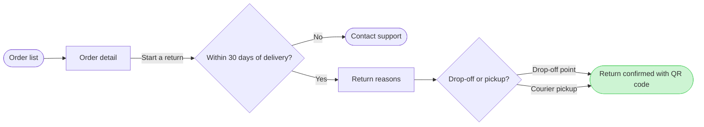

The model passes the pre-write check: 7 nodes, 7 connectors, 0 crossings. The composer built the board code from it, and nothing is written yet. This is the sketch:

**Question:** which screens does a Fernhouse customer pass through to start a return in the app, and where do they choose?
**Outcome:** a reader can follow a return from the order list to the QR code confirmation and see where the 30 day window ends it.
**First glance:** the confirmed return, the goal the flow reaches.
**Second glance:** the drop-off or pickup choice that leads to it.
**Last glance:** Contact support, the exit after 30 days.
**File:** the existing FigJam file with key <test-file-key>. The board goes in as a new section beside what it holds, and nothing already there changes. No plan is needed, so nothing is created in the Fernhouse Product plan.
**If the file cannot take it:** I stop and ask rather than create a file. You said a new file would go in the Barter team plan, in drafts, with no project, and I would use that only after your yes.
**Writes:** one composed board in three zones (Find the order, Request the return and Done), with a title, a key and a source line, at laptop reading distance. The source line names the free pickup over 100 euros as left out.
**Extensions:** none.
**Calls:** `create_session` on that key, one `get_figjam` read before the write to record what the file already holds, one `use_figma` and one `get_figjam` read-back. That is four calls. If the file sits on a Starter plan or you have a View or Collab seat, Figma allows six tool calls a month, and this spends four.
**Rollback:** delete the one board section the write returns. I do that only after you reply naming it.

Write it?