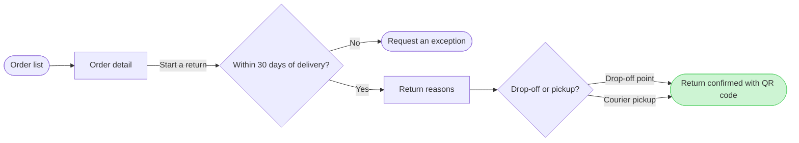

The revised model passes the check and the composer builds the board from it. Nothing is written yet.

**Question:** which screens does a Fernhouse customer pass through to start a return in the app, and where do they choose?
**Outcome:** a reader can follow a return from the order list to the QR code confirmation and see where the 30 day window ends it.
**First glance:** the confirmed return, the goal the flow reaches.
**Second glance:** the drop-off or pickup choice that leads to it.
**Last glance:** Request an exception, the exit after 30 days.
**Change:** one label, Contact support to Request an exception. It is still an exit, and the 7 nodes, 7 connectors and 3 zones are otherwise as before.
**File:** the existing FigJam file <test-file-key>. The revised board is composed as a new section beside the others, at laptop reading distance. Nothing already on the file is edited, including the board from last turn (187:7668).
**Extensions:** none.
**Calls:** `use_figma` to compose the board and `get_figjam` to read it back, which is two. I reuse the open session on that file.
**Rollback:** delete the one new section the write returns, only after you reply naming it.
**Old board:** it stays on the file until the new one is read back. I then ask you separately whether to delete it, naming it by title and id. Both carry the title "Start a return", and the file holds 14 other sections with that name, so the delete question names the id and no other board.
**Allowance:** I have spent four calls on this file already. If your seat is limited to six a month, these two use the rest and the later delete would be a seventh. I have not checked your plan.

Write it?