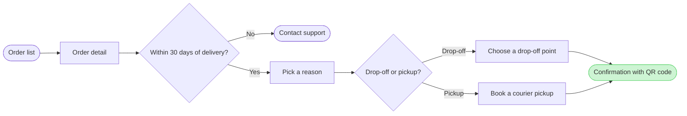

# FJ-035 turn 2 transcript

**User:** Yes, that reading is right.

**Tool call:** `Read` `{"file_path": "/private/var/folders/3c/zfqcqsts0kn19cgblj82gqhm0000gn/T/devin-compare-bench/FJ-035/sk-create-figjam/references/quality-rubric.md"}`

**Tool result:** `Read`

```text
"1\t---\n2\ttitle: \"FigJam Diagram Quality Rubric\"\n3\tdescription: \"The taste gate a FigJam model passes before the write gate, translated from sk-design-diagram's success criteria: type fit, the remove test, signal, the check, the board, the design rubric that scores a composed board and the reply.\"\n4\tcontextType: implementation\n5\timportance_tier: important\n6\ttrigger_phrases:\n7\t  - \"figjam quality rubric\"\n8\t  - \"diagram taste gate\"\n9\t  - \"remove test\"\n10\t  - \"figjam review checklist\"\n11\t  - \"figjam design rubric\"\n12\tversion: 1.0.2.0\n13\t---\n14\t\n15\t# FigJam Diagram Quality Rubric\n16\t\n17\tThe script checks what a script can see. This rubric is the rest: whether the diagram should exist, whether every node earns its place and whether the reader can trust what lands on the board. Walk it after the check passes and before the write gate.\n18\t\n19\t**Loading Condition:** CONDITIONAL, on every Flow route before the write gate\n20\t**Purpose:** The judgement pass between the pre-write check and the gate\n21\t**Scope:** The model, the provenance table, the planned extensions and, after the write, the board and the reply\n22\t\n23\t---\n24\t\n25\t## 1. TYPE FIT\n26\t\n27\t- [ ] The type answers the reader's question, as `references/flow-mode.md` Section 3 maps it\n28\t- [ ] A table, a list or a paragraph would not do the same job. If it would, say so and offer that instead\n29\t- [ ] The type's reference in `references/types/` was loaded and i
```

**Tool call:** `Read` `{"file_path": "/private/var/folders/3c/zfqcqsts0kn19cgblj82gqhm0000gn/T/devin-compare-bench/FJ-035/sk-create-figjam/references/style-guide.md"}`

**Tool result:** `Read`

```text
"1\t---\n2\ttitle: \"FigJam Diagram Style Guide\"\n3\tdescription: \"The colour every composed FigJam board draws by kind in the shipped design, the type scale and the 8 pixel grid, the palette pairs the check accepts with their measured contrast, and the spacing bands, translated from sk-design-diagram's style guide and derivation record.\"\n4\tcontextType: implementation\n5\timportance_tier: important\n6\ttrigger_phrases:\n7\t  - \"figjam style guide\"\n8\t  - \"figjam palette\"\n9\t  - \"figjam colour by kind\"\n10\t  - \"figjam type scale\"\n11\t  - \"palette derivation record\"\n12\t  - \"figjam contrast\"\n13\tversion: 1.0.2.0\n14\t---\n15\t\n16\t# FigJam Diagram Style Guide\n17\t\n18\tThe rules for colour, type and spacing on a FigJam board. The composer in `assets/compose-board.js` draws every board in the design `assets/figjam-design.md` holds, which ships as the tables below record, and every hex a model, a design or a note extension uses comes from the palette in Section 3. `scripts/flow_check.py` refuses any other.\n19\t\n20\t**Loading Condition:** CONDITIONAL, before the gate on every Flow route, and when a model or a note extension uses colour\n21\t**Purpose:** Names the colour each kind draws in, the type scale, the grid, the palette pairs the check accepts and the measured contrast record\n22\t**Scope:** The composed board, Mermaid `style`, `classDef` and `linkStyle` colours, sticky and pin colours for notes, and the contrast record the self-test re-measures\n
```

**Tool call:** `Bash` `{"command": "S=$(mktemp -d /tmp/fj-return.XXXXXX) && echo $S > /tmp/fj-return-dir.txt && cat > $S/model.md <<'EOF'\n```mermaid\nflowchart LR\n    %% title: Start a return\n    %% subtitle: How a Fernhouse customer starts a return in the app, from the order list to a confirmed return\n    %% source: Sources: the request's description of the app screens and the returns doc, neither attached. Status unconfirmed: the Fernhouse context of 2026-09-18 records no self-serve return.\n    %% zone: Find the order: orders, detail\n    %% zone: Request the return: window, support, reason, method, dropoff, `

**Tool result:** `Bash`

```text
"  diagram 1, user flow: ok, 9 nodes and 9 connectors, widest rank 2 steps, longest path 7 steps, 1.0 connectors per step, labels average 18 characters, 0 crossing pairs\nPASSED 1 diagram(s) in model.md\nexit 0"
```

**Tool call:** `Bash` `{"command": "S=$(cat /tmp/fj-return-dir.txt) && python3 -I sk-create-figjam/scripts/compose_board.py $S/model.md --diagram 1 --out $S/board.js; echo exit $?; wc -c $S/board.js"}`

**Tool result:** `Bash`

```text
"COMPOSED diagram 1, 9 nodes and 9 connectors, widest rank 2 steps, longest path 7 steps, 1.0 connectors per step, labels average 18 characters, 0 crossing pairs: 9 nodes and 9 connectors to read back, 42083 characters in /tmp/fj-return.OpXQxv/board.js, drawn in the design FigJam default\nexit 0\n   42083 /tmp/fj-return.OpXQxv/board.js"
```

**Assistant:**

The model passed the pre-write check, and the composer built it without error. It is 9 nodes, 9 connectors, 0 crossings and 4 labelled exits. Nothing is written yet.



**Question:** which screens does a Fernhouse customer pass through to start a return in the app, and where do they choose?
**Outcome:** a reader can follow a return from the order list to a confirmed return and see where the 30 day window ends it.
**First glance:** the confirmation with the QR code, the goal the flow reaches.
**Second glance:** the drop-off or pickup choice that leads to it.
**Last glance:** Contact support, the exit after 30 days.

**File:** the existing FigJam file `<draft-file-key>`, so no plan is needed and no new file is created.

**Writes:**
* One composed board with a title, a subtitle, three zones (Find the order, Request the return, Done), a key and a source line, at the laptop reading distance
* It lands as a new section 400 pixels to the right of the two Roamstay boards, which stay as they are
* The source line says the sources were your description, neither attached, and that the in-app flow is unconfirmed against the 2026-09-18 company context. I assumed this from your reply and did not ask again.

**Extensions:** none.

**Calls:** one `use_figma` and one `get_figjam` read-back. I already spent a session call and one read on the file. If your seat is on a Starter plan, the six tool calls a month cover these too.

**Rollback:** delete the one new board section the write returns, only on your yes to a question that names it. Nothing already in the file is deleted.

Write it?
