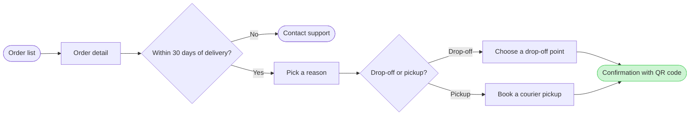

The model passed the pre-write check, and the composer built it without error. It is 9 nodes, 9 connectors, 0 crossings and 4 labelled exits. Nothing is written yet.

**Question:** which screens does a Fernhouse customer pass through to start a return in the app, and where do they choose?
**Outcome:** a reader can follow a return from the order list to a confirmed return and see where the 30 day window ends it.
**First glance:** the confirmation with the QR code, the goal the flow reaches.
**Second glance:** the drop-off or pickup choice that leads to it.
**Last glance:** Contact support, the exit after 30 days.

**File:** the existing FigJam file `<draft-file-key>`, so no plan is needed and no new file is created.

**Writes:**
* One composed board with a title, a subtitle, three zones (Find the order, Request the return, Done), a key and a source line, at the laptop reading distance
* It lands as a new section 400 pixels to the right of the two Roamstay boards, which stay as they are
* The source line says the sources were your description, neither attached, and that the in-app flow is unconfirmed against the 2026-09-18 company context. I assumed this from your reply and did not ask again.

**Extensions:** none.

**Calls:** one `use_figma` and one `get_figjam` read-back. I already spent a session call and one read on the file. If your seat is on a Starter plan, the six tool calls a month cover these too.

**Rollback:** delete the one new board section the write returns, only on your yes to a question that names it. Nothing already in the file is deleted.

Write it?