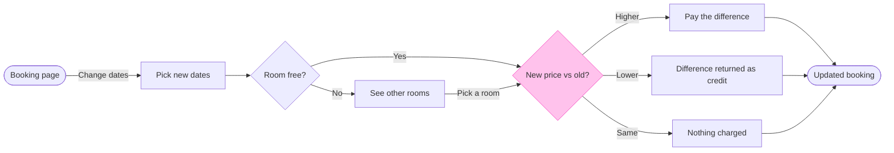

# FJ-036 turn 4 transcript

**User:** Yes, that reading is right.

**Tool call:** `Bash` `{"command": "cd /private/var/folders/3c/zfqcqsts0kn19cgblj82gqhm0000gn/T/devin-compare-bench/FJ-036/sk-create-figjam && sed -n 1,140p references/style-guide.md && python3 scripts/flow_check.py --help | head -30 && python3 scripts/compose_board.py --help | head -30"}`

**Tool result:** `Bash`

```text
"---\ntitle: \"FigJam Diagram Style Guide\"\ndescription: \"The colour every composed FigJam board draws by kind in the shipped design, the type scale and the 8 pixel grid, the palette pairs the check accepts with their measured contrast, and the spacing bands, translated from sk-design-diagram's style guide and derivation record.\"\ncontextType: implementation\nimportance_tier: important\ntrigger_phrases:\n  - \"figjam style guide\"\n  - \"figjam palette\"\n  - \"figjam colour by kind\"\n  - \"figjam type scale\"\n  - \"palette derivation record\"\n  - \"figjam contrast\"\nversion: 1.0.2.0\n---\n\n# FigJam Diagram Style Guide\n\nThe rules for colour, type and spacing on a FigJam board. The composer in `assets/compose-board.js` draws every board in the design `assets/figjam-design.md` holds, which ships as the tables below record, and every hex a model, a design or a note extension uses comes from the palette in Section 3. `scripts/flow_check.py` refuses any other.\n\n**Loading Condition:** CONDITIONAL, before the gate on every Flow route, and when a model or a note extension uses colour\n**Purpose:** Names the colour each kind draws in, the type scale, the grid, the palette pairs the check accepts and the measured contrast record\n**Scope:** The composed board, Mermaid `style`, `classDef` and `linkStyle` colours, sticky and pin colours for notes, and the contrast record the self-test re-measures\n\n---\n\n## 1. OVERVIEW\n\nsk-design-diagram owns a skinnable palette with sema
```

**Tool call:** `Bash` `{"command": "sed -n 1,80p assets/examples/user-flow-fernhouse-return.md"}`

**Tool result:** `Bash`

```text
"---\ntitle: \"Example - User Flow - Fernhouse Return\"\ndescription: \"A worked user flow on the fictional Fernhouse store: app screenshots and a returns doc turned into a checked model with its board lines and zones, a playback, a gate message and the reply.\"\ncontextType: general\nimportance_tier: normal\ntrigger_phrases:\n  - \"user flow example\"\n  - \"fernhouse return flow\"\nversion: 1.0.1.0\n---\n\n# Example - User Flow - Fernhouse Return\n\nFernhouse is a fictional store used across the Product Owner fixtures. Every name, screen and rule here is invented for the example.\n\n---\n\n## 1. REQUEST\n\n```text\n$flow how a customer starts a return in the app, from these screenshots and the returns doc\n```\n\nSources: five app screenshots and a returns doc.\n\n| Source | Says |\n|---|---|\n| `Orders - Tap_ Order row.png` | The order list, a row under the finger |\n| `Order detail - Tap_ Start a return.png` | The order page with a Start a return button |\n| `Return reason - Select_ Reason.png` | A list of reasons |\n| `Return method - Select_ Drop-off or pickup.png` | Two choices: a drop-off point or a courier pickup |\n| `Return confirmed.png` | A confirmation with a QR code |\n| Returns doc, Section 2 | Returns are open for 30 days after delivery. After that the app shows Contact support. Current behavior |\n| Returns doc, Section 4 | A free pickup for orders over \u20ac100. Proposal, under review |\n\n---\n\n## 2. TYPE AND DIALS\n\n- **Reader question:** which screens
```

**Tool call:** `Bash` `{"command": "SCR=$(mktemp -d /tmp/fj036-XXXX) && echo $SCR > /tmp/fj036-path && cat > $SCR/model.md <<'EOF'\n```mermaid\nflowchart LR\n    %% title: Change booking dates\n    %% subtitle: How a Roamstay guest changes the dates of a booking in the app, from the booking page to the updated booking\n    %% source: Sources: the product owner's description of the date-change flow, treated as current behavior. Assumed: after seeing other rooms the guest picks one. Left out: payment failure, change deadlines, fees and the host's side\n    bookingPage([Booking page]) -->|Change dates| pickDates[Pick n`

**Tool result:** `Bash`

```text
"  diagram 1, user flow: ok, 9 nodes and 11 connectors, widest rank 3 steps, longest path 7 steps, 1.2 connectors per step, labels average 16 characters, 0 crossing pairs\nPASSED 1 diagram(s) in model.md\nexit=0"
```

**Tool call:** `Bash` `{"command": "SCR=$(cat /tmp/fj036-path) && python3 scripts/compose_board.py $SCR/model.md --diagram 1 --out $SCR/code.js; echo exit=$?; wc -c $SCR/code.js"}`

**Tool result:** `Bash`

```text
"COMPOSED diagram 1, 9 nodes and 11 connectors, widest rank 3 steps, longest path 7 steps, 1.2 connectors per step, labels average 16 characters, 0 crossing pairs: 9 nodes and 11 connectors to read back, 41946 characters in /tmp/fj036-Wadg/code.js, drawn in the design FigJam default\nexit=0\n   41946 /tmp/fj036-Wadg/code.js"
```

**Tool call:** `ToolSearch` `{"query": "select:mcp__figma-remote__use_figma,mcp__figma-remote__get_figjam,mcp__figma-remote__create_session,mcp__figma-remote__whoami", "max_results": 4}`

**Tool result:** `ToolSearch`

```text
[{"type": "tool_reference", "tool_name": "mcp__figma-remote__use_figma"}, {"type": "tool_reference", "tool_name": "mcp__figma-remote__get_figjam"}, {"type": "tool_reference", "tool_name": "mcp__figma-remote__create_session"}, {"type": "tool_reference", "tool_name": "mcp__figma-remote__whoami"}]
```

**Assistant:**

I've checked the model and composed the board code, and I'm checking where the layout places the other-rooms step before I write the gate message.

**Tool call:** `Bash` `{"command": "SCR=$(cat /tmp/fj036-path) && python3 scripts/compose_board.py $SCR/model.md --diagram 1 --model | python3 -c \"\nimport json,sys\nm=json.load(sys.stdin)\ndef walk(o,p=''):\n    if isinstance(o,dict):\n        for k,v in o.items():\n            if k in ('nodes','layout','spine','ranks','positions'): print(p+k, json.dumps(v)[:900])\n            walk(v,p+k+'.')\n    elif isinstance(o,list):\n        for i,v in enumerate(o[:1]): walk(v,p)\nwalk(m)\nprint(list(m.keys()) if isinstance(m,dict) else type(m))\n\""}`

**Tool result:** `Bash`

```text
"COMPOSED diagram 1, 9 nodes and 11 connectors, widest rank 3 steps, longest path 7 steps, 1.2 connectors per step, labels average 16 characters, 0 crossing pairs: 9 nodes and 11 connectors to read back, 2313 characters, drawn in the design FigJam default\nnodes [{\"id\": \"bookingPage\", \"label\": \"Booking page\", \"kind\": \"start\", \"zone\": null}, {\"id\": \"pickDates\", \"label\": \"Pick new dates\", \"kind\": \"screen\", \"zone\": null}, {\"id\": \"roomFree\", \"label\": \"Room free?\", \"kind\": \"decision\", \"zone\": null}, {\"id\": \"priceCheck\", \"label\": \"New price vs old?\", \"kind\": \"decision\", \"zone\": null, \"accent\": true}, {\"id\": \"otherRooms\", \"label\": \"See other rooms\", \"kind\": \"screen\", \"zone\": null}, {\"id\": \"payDiff\", \"label\": \"Pay the difference\", \"kind\": \"screen\", \"zone\": null}, {\"id\": \"credit\", \"label\": \"Difference returned as credit\", \"kind\": \"screen\", \"zone\": null}, {\"id\": \"noCharge\", \"label\": \"Nothing charged\", \"kind\": \"screen\", \"zone\": null}, {\"id\": \"updated\", \"label\": \"Updated booking\", \"kind\": \"success\", \"zone\": null}]\nexpect.nodes 9\n['type', 'profile', 'direction', 'zoneMode', 'zones', 'nodes', 'edges', 'edgeStyles', 'expect', 'title', 'subtitle', 'source']"
```

**Assistant:**

The model passes the check and the board code is composed. Nothing is written to Figma yet, so this is the write gate.

**What the board answers:** what does a guest see and pay when they change their booking dates? The product and design team can then check each branch and its price outcome against the product.

**Glance lines**
- **First:** the New price vs old? decision, the one pink-outlined diamond
- **Second:** the three outcomes, Pay the difference, Difference returned as credit and Nothing charged
- **Last:** the See other rooms detour and the source line

**The checked sketch**



The check printed PASSED: 9 nodes, 11 connectors, 0 crossing pairs, longest path 7 steps. The board is drawn at laptop distance with Balanced detail for a mixed audience, with no zones.

**The four critique questions, answered on the sketch**
1. **Where the eye goes first:** the price check, because it is the only pink outline.
2. **Does the detour read as a side branch:** probably not. The longest route runs through See other rooms, so the composer puts that step on the main line and sends the Yes edge around it. The only way to change that is to cut the assumed Pick a room edge, which I do not recommend. I will check it on the board and report it as a finding if it reads badly.
3. **Do the three exits read as one choice:** yes. They are all labelled exits on one diamond.
4. **Does it answer the question alone:** yes. Nothing beside the board is needed.

**Extensions:** none.

**Target:** file `<draft-file-key>`. The board lands as a new section beside what the file holds, and nothing already there changes. You called this the Roamstay Product plan, but I cannot confirm from here which plan owns the file. If the file turns out not to be a writable FigJam board, I stop and ask before making a new file in the Barter team plan's drafts.

**Calls the write spends:** four. They are `create_session`, one `get_figjam` read of the file before the write, one `use_figma` call that draws the board and one `get_figjam` read-back. A Starter plan or a View or Collab seat is limited to six tool calls a month, and I cannot see yours, so this fits only if that allowance is mostly unspent.

**Rollback:** delete the one board section the write returns, titled "Change booking dates". I do that only on a reply that names it.

Do you want me to write this board to file `<draft-file-key>` as described?
