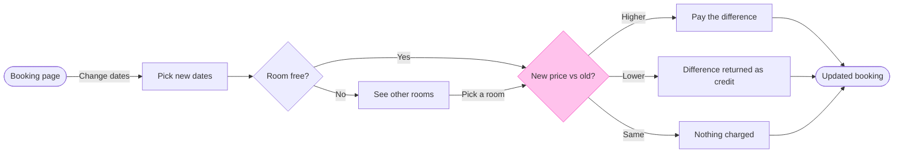

The model passes the check and the board code is composed. Nothing is written to Figma yet, so this is the write gate.

**What the board answers:** what does a guest see and pay when they change their booking dates? The product and design team can then check each branch and its price outcome against the product.

**Glance lines**
- **First:** the New price vs old? decision, the one pink-outlined diamond
- **Second:** the three outcomes, Pay the difference, Difference returned as credit and Nothing charged
- **Last:** the See other rooms detour and the source line

**The checked sketch**

The check printed PASSED: 9 nodes, 11 connectors, 0 crossing pairs, longest path 7 steps. The board is drawn at laptop distance with Balanced detail for a mixed audience, with no zones.

**The four critique questions, answered on the sketch**
1. **Where the eye goes first:** the price check, because it is the only pink outline.
2. **Does the detour read as a side branch:** probably not. The longest route runs through See other rooms, so the composer puts that step on the main line and sends the Yes edge around it. The only way to change that is to cut the assumed Pick a room edge, which I do not recommend. I will check it on the board and report it as a finding if it reads badly.
3. **Do the three exits read as one choice:** yes. They are all labelled exits on one diamond.
4. **Does it answer the question alone:** yes. Nothing beside the board is needed.

**Extensions:** none.

**Target:** file `<draft-file-key>`. The board lands as a new section beside what the file holds, and nothing already there changes. You called this the Roamstay Product plan, but I cannot confirm from here which plan owns the file. If the file turns out not to be a writable FigJam board, I stop and ask before making a new file in the Barter team plan's drafts.

**Calls the write spends:** four. They are `create_session`, one `get_figjam` read of the file before the write, one `use_figma` call that draws the board and one `get_figjam` read-back. A Starter plan or a View or Collab seat is limited to six tool calls a month, and I cannot see yours, so this fits only if that allowance is mostly unspent.

**Rollback:** delete the one board section the write returns, titled "Change booking dates". I do that only on a reply that names it.

Do you want me to write this board to file `<draft-file-key>` as described?