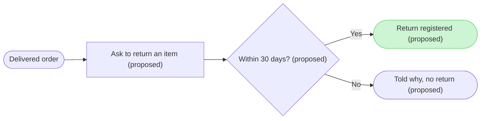

Here is the checked model and the write gate. Nothing has been written to FigJam yet.



```text
  diagram 1, user flow: ok, 5 nodes and 4 connectors, widest rank 2 steps, longest path 4 steps, 0.8 connectors per step, labels average 26 characters, 0 crossing pairs
PASSED 1 diagram(s) in model.md
COMPOSED diagram 1, 5 nodes and 4 connectors to read back, drawn in the design FigJam default
```

| Item | Source | Source class | Confidence | Rung |
|---|---|---|---|---|
| order | Story, criterion 1 Given | current behavior | high | stated |
| ask | Story, criterion 1 When | proposal | high | stated |
| window | Story, Requirements `Return window` and criterion 2 | proposal | high | stated |
| registered | Story, criterion 1 Then | proposal | high | stated |
| blocked | Story, criterion 2 Then and And | proposal | high | stated |
| all 4 edges | Story, criteria 1 and 2 | proposal | high | stated |

The Story is a draft nobody has approved, so the four steps it adds carry "proposed" in their labels and the title.

```text
Left out: the CS agent's return handling in Admin, out of scope in the Story
Left out: the screens, no screenshot, design link or screen list was supplied
```

```text
Question: which steps does a customer go through to start a return, and where does the return window stop them?
Outcome: a reader can follow a return from a delivered order to a registered return and see the exit for an order past its window.
First glance: Return registered, the goal the flow reaches.
Second glance: the 30 day decision that leads to it.
Last glance: Told why, no return, the exit after the window.
Plan: not needed, the file is one you named.
File: the existing FigJam file with key <draft-file-key>. The board lands as a new section beside what the file holds, and nothing already there changes.
Writes: one composed board, 5 nodes and 4 connectors, with a title, a subtitle, a key and a source line, at the Laptop reading distance.
Extensions: none.
Calls: create_session, one use_figma and one get_figjam read-back. Figma limits a Starter plan and a View or Collab seat to six tool calls a month, and read tools count against it.
If that file cannot be written: I stop and tell you. Only if you say the file is unusable do I create a new file in the Barter team plan, left in drafts with no project, and I ask again before that write.
Rollback: delete the one board section the write returns, which I do only on your yes to a question that names the board.
Write it?