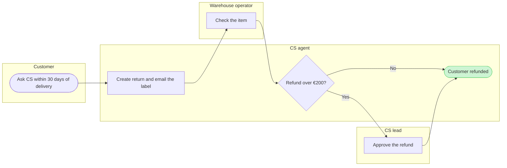

# FJ-039 turn 3 transcript

**User:** go with your recommendations

**Tool call:** `Bash` `{"command": "cd /private/var/folders/3c/zfqcqsts0kn19cgblj82gqhm0000gn/T/devin-compare-bench/FJ-039/sk-create-figjam && python3 scripts/flow_check.py --help 2>&1 | head -30; python3 scripts/compose_board.py --help 2>&1 | head -30; sed -n 60,140p assets/examples/process-fernhouse-refund.md", "description": "Read check and composer CLI usage and example model"}`

**Tool result:** `Bash`

```text
"mermaid_extract: --help: not a Mermaid file\nUNREADABLE --help: the extractor refused it\n\n  compose_board.py <model.md> [--diagram N] [--out path]  -> 0 the filled code is written, 1 the model fails\n                                                             the check, 2 unreadable or no such diagram\n  compose_board.py <model.md> --model                      -> print the MODEL as JSON instead of the code\n  compose_board.py --template                              -> print the compact code with its MODEL and THEME\n                                                             placeholders, the text the Project's composer\n                                                             Knowledge file carries\n  compose_board.py --design-check                          -> print the design a board is drawn in, what it\n                                                             changes, its measures and the THEME it sends: 0 the\n                                                             design reads with no warning, 1 one or more warnings\n  compose_board.py --self-test                             -> prove every shipped model composes, its counts\n                                                             match the check, the code fits one use_figma call and\n                                                             the board it draws keeps its geometry and its design\n## 4. MODEL\n\n```mermaid\n%% type: process\nflowchart LR\n    %% title: Damaged-item refund\n    %% s
```

**Tool call:** `Read` `{"file_path": "/private/var/folders/3c/zfqcqsts0kn19cgblj82gqhm0000gn/T/devin-compare-bench/FJ-039/sk-create-figjam/references/style-guide.md", "limit": 120}`

**Tool result:** `Read`

```text
"1\t---\n2\ttitle: \"FigJam Diagram Style Guide\"\n3\tdescription: \"The colour every composed FigJam board draws by kind in the shipped design, the type scale and the 8 pixel grid, the palette pairs the check accepts with their measured contrast, and the spacing bands, translated from sk-design-diagram's style guide and derivation record.\"\n4\tcontextType: implementation\n5\timportance_tier: important\n6\ttrigger_phrases:\n7\t  - \"figjam style guide\"\n8\t  - \"figjam palette\"\n9\t  - \"figjam colour by kind\"\n10\t  - \"figjam type scale\"\n11\t  - \"palette derivation record\"\n12\t  - \"figjam contrast\"\n13\tversion: 1.0.2.0\n14\t---\n15\t\n16\t# FigJam Diagram Style Guide\n17\t\n18\tThe rules for colour, type and spacing on a FigJam board. The composer in `assets/compose-board.js` draws every board in the design `assets/figjam-design.md` holds, which ships as the tables below record, and every hex a model, a design or a note extension uses comes from the palette in Section 3. `scripts/flow_check.py` refuses any other.\n19\t\n20\t**Loading Condition:** CONDITIONAL, before the gate on every Flow route, and when a model or a note extension uses colour\n21\t**Purpose:** Names the colour each kind draws in, the type scale, the grid, the palette pairs the check accepts and the measured contrast record\n22\t**Scope:** The composed board, Mermaid `style`, `classDef` and `linkStyle` colours, sticky and pin colours for notes, and the contrast record the self-test re-measures\n
```

**Tool call:** `Bash` `{"command": "S=$(mktemp -d /tmp/fernhouse-return.XXXXXX) && echo $S > /tmp/fernhouse-return.path && cat > $S/model.md <<'EOF'\n```mermaid\n%% type: process\nflowchart LR\n    %% title: How a Fernhouse return runs today\n    %% subtitle: Who does what from the customer's first contact to the refund, which takes 6 days on average\n    %% source: Sources: Fernhouse company context, Key flow 6 and Personas and roles. Left out: the customer sending the item back, a failed warehouse check, requests after 30 days and self-serve returns.\n    subgraph customer [\"Customer\"]\n        ask([Ask CS withi`

**Tool result:** `Bash`

```text
"  diagram 1, process: ok, 6 nodes and 6 connectors, widest rank 1 steps, longest path 6 steps, 1.0 connectors per step, labels average 22 characters, 0 crossing pairs\nPASSED 1 diagram(s) in model.md\nexit 0\nCOMPOSED diagram 1, 6 nodes and 6 connectors, widest rank 1 steps, longest path 6 steps, 1.0 connectors per step, labels average 22 characters, 0 crossing pairs: 6 nodes and 6 connectors to read back, 41660 characters in /tmp/fernhouse-return.1Oo0DK/code.js, drawn in the design FigJam default\nexit 0"
```

**Tool call:** `Bash` `{"command": "rm -rf \"$(cat /tmp/fernhouse-return.path)\" /tmp/fernhouse-return.path && ls /tmp | grep -c fernhouse-return", "description": "Delete scratch model and composed code"}`

**Tool result (error):** `Bash`

```text
"Dangerous rm operation detected: the target is the output of a command substitution (`$(...)` or backticks) and cannot be checked before the command runs. This requires explicit approval and cannot be auto-allowed by permission rules.\n\nRun the substitution on its own first, then remove the literal paths it prints."
```

**Tool call:** `Bash` `{"command": "cat /tmp/fernhouse-return.path", "description": "Print scratch folder path"}`

**Tool result:** `Bash`

```text
"/tmp/fernhouse-return.1Oo0DK"
```

**Tool call:** `Bash` `{"command": "rm -rf /tmp/fernhouse-return.1Oo0DK /tmp/fernhouse-return.path; ls /tmp | grep -c fernhouse-return", "description": "Delete scratch model and composed code"}`

**Tool result:** `Bash`

```text
"2"
```

**Assistant:**

Cleaning up the scratch folder: two other `fernhouse-return` entries are still in `/tmp`, so I'm checking what they are before the gate reply.

**Tool call:** `Bash` `{"command": "ls -la /tmp | grep fernhouse-return", "description": "List remaining fernhouse-return entries in tmp"}`

**Tool result:** `Bash`

```text
"(Bash completed with no output)"
```

**Assistant:**

The model passes the check, and the composer builds it into one `use_figma` call. This is the write gate. Nothing is written until you answer it.



Check result: `PASSED`, process, 6 nodes, 6 connectors, 0 crossing pairs, labels average 22 characters.

```text
Question: who does what in a Fernhouse return today, and where does it change hands between the customer, CS and the warehouse?
Outcome: a Post-purchase reader can see which role owns each step from the first contact to the refund, and where the CS lead steps in.
First glance: Customer refunded, the goal the process reaches.
Second glance: Check the item, the one step another team owns before the refund.
Last glance: Approve the refund, the CS lead's step above €200.
File: the existing FigJam file <draft-file-key>, which needs no plan and no new file. The board lands as a new section beside what the file holds, and nothing already on it changes.
Writes: one composed board titled "How a Fernhouse return runs today", with 4 lanes, 6 nodes and 6 connectors, a title, a subtitle, a key and a source line, at the Laptop reading distance.
Extensions: none.
Calls: create_session, one get_figjam read of the file before the write, one use_figma and one get_figjam read-back after it. That is four calls, and a Starter plan or a View or Collab seat has six a month.
Rollback: delete the one board section the write returns, which removes everything drawn inside it. That runs only on your separate yes to a question that names the board by its title.
Write it?
```
