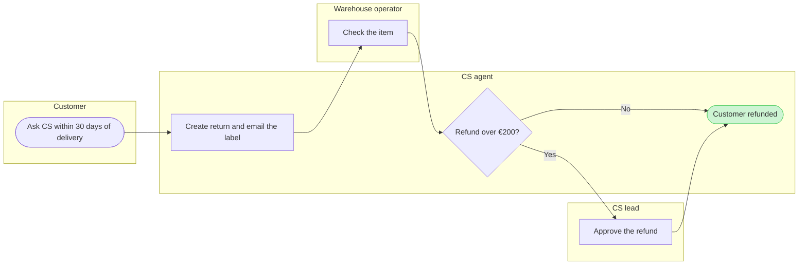

The model passes the check, and the composer builds it into one `use_figma` call. This is the write gate. Nothing is written until you answer it.



Check result: `PASSED`, process, 6 nodes, 6 connectors, 0 crossing pairs, labels average 22 characters.

```text
Question: who does what in a Fernhouse return today, and where does it change hands between the customer, CS and the warehouse?
Outcome: a Post-purchase reader can see which role owns each step from the first contact to the refund, and where the CS lead steps in.
First glance: Customer refunded, the goal the process reaches.
Second glance: Check the item, the one step another team owns before the refund.
Last glance: Approve the refund, the CS lead's step above €200.
File: the existing FigJam file <draft-file-key>, which needs no plan and no new file. The board lands as a new section beside what the file holds, and nothing already on it changes.
Writes: one composed board titled "How a Fernhouse return runs today", with 4 lanes, 6 nodes and 6 connectors, a title, a subtitle, a key and a source line, at the Laptop reading distance.
Extensions: none.
Calls: create_session, one get_figjam read of the file before the write, one use_figma and one get_figjam read-back after it. That is four calls, and a Starter plan or a View or Collab seat has six a month.
Rollback: delete the one board section the write returns, which removes everything drawn inside it. That runs only on your separate yes to a question that names the board by its title.
Write it?
```