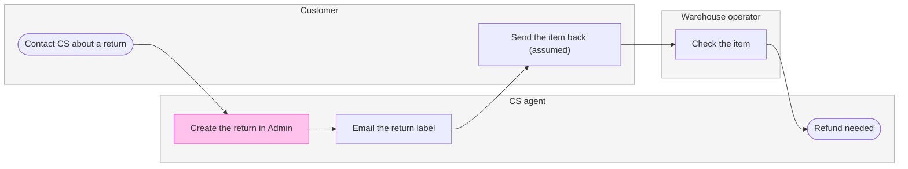
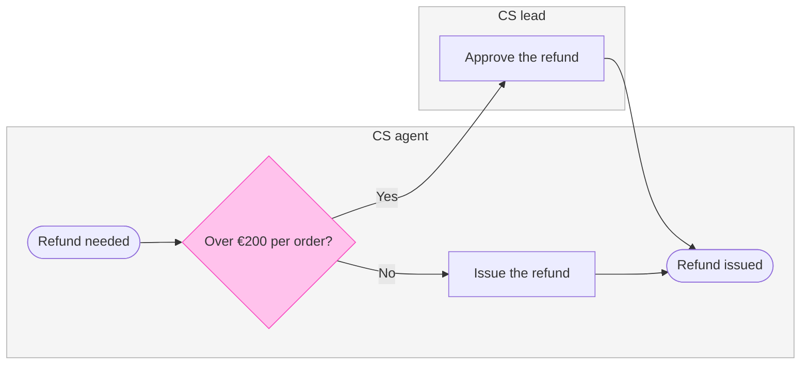
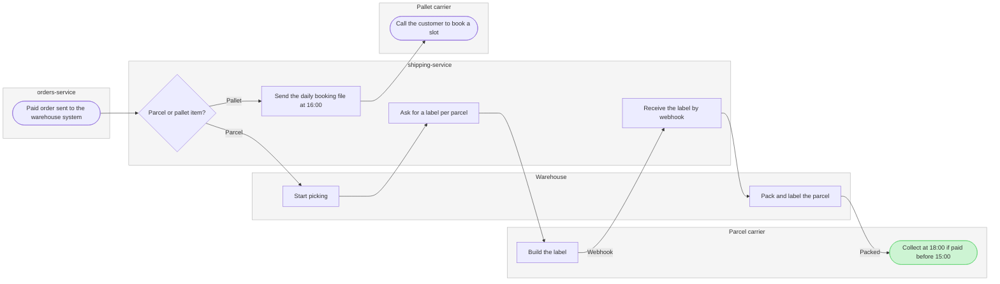

# FJ-040 turn 3 transcript

**User:** go ahead with that scope

**Tool call:** `Read` `{"file_path": "/private/var/folders/3c/zfqcqsts0kn19cgblj82gqhm0000gn/T/devin-compare-bench/FJ-040/sk-create-figjam/assets/templates/process.md"}`

**Tool result:** `Read`

```text
"1\t---\n2\ttitle: \"FigJam Process Templates\"\n3\tdescription: \"Process patterns that pass the pre-write check: a decision tree, a laned process with its handoff step in focus and a pipeline with a store and data in and out.\"\n4\tcontextType: general\n5\timportance_tier: important\n6\ttrigger_phrases:\n7\t  - \"process templates\"\n8\t  - \"laned process pattern\"\n9\t  - \"decision tree pattern\"\n10\tversion: 1.0.1.0\n11\t---\n12\t\n13\t# FigJam Process Templates\n14\t\n15\tCopy/apply patterns for a process model. Each pattern passes `scripts/flow_check.py`, and `references/types/process.md` holds the rules.\n16\t\n17\t**Loading Condition:** CONDITIONAL, with `references/types/process.md`\n18\t**Purpose:** Starting points for a process or decision flowchart\n19\t**Scope:** Three patterns. The provenance table and the reply shape are in `assets/flow-templates.md`\n20\t\n21\t---\n22\t\n23\t## 1. USAGE\n24\t\n25\t- Keep the `%% type: process` line first, or the check reads the block as a user flow\n26\t- Name a lane after the actor, `subgraph agent [\"CS agent\"]`, and keep its id short and camelCase\n27\t- A lane takes the neutral pair or no style, and the one accent goes on the focal step, such as the step that hands work to the next lane. The composer draws that step in focus. A `linkStyle` passes the check and changes nothing on a composed board\n28\t- `-.->` marks a step that is optional or happens later, such as a log write\n29\t- The patterns all run left to right, 
```

**Tool call:** `Read` `{"file_path": "/private/var/folders/3c/zfqcqsts0kn19cgblj82gqhm0000gn/T/devin-compare-bench/FJ-040/sk-create-figjam/references/quality-rubric.md"}`

**Tool result:** `Read`

```text
"1\t---\n2\ttitle: \"FigJam Diagram Quality Rubric\"\n3\tdescription: \"The taste gate a FigJam model passes before the write gate, translated from sk-design-diagram's success criteria: type fit, the remove test, signal, the check, the board, the design rubric that scores a composed board and the reply.\"\n4\tcontextType: implementation\n5\timportance_tier: important\n6\ttrigger_phrases:\n7\t  - \"figjam quality rubric\"\n8\t  - \"diagram taste gate\"\n9\t  - \"remove test\"\n10\t  - \"figjam review checklist\"\n11\t  - \"figjam design rubric\"\n12\tversion: 1.0.2.0\n13\t---\n14\t\n15\t# FigJam Diagram Quality Rubric\n16\t\n17\tThe script checks what a script can see. This rubric is the rest: whether the diagram should exist, whether every node earns its place and whether the reader can trust what lands on the board. Walk it after the check passes and before the write gate.\n18\t\n19\t**Loading Condition:** CONDITIONAL, on every Flow route before the write gate\n20\t**Purpose:** The judgement pass between the pre-write check and the gate\n21\t**Scope:** The model, the provenance table, the planned extensions and, after the write, the board and the reply\n22\t\n23\t---\n24\t\n25\t## 1. TYPE FIT\n26\t\n27\t- [ ] The type answers the reader's question, as `references/flow-mode.md` Section 3 maps it\n28\t- [ ] A table, a list or a paragraph would not do the same job. If it would, say so and offer that instead\n29\t- [ ] The type's reference in `references/types/` was loaded and i
```

**Tool call:** `Read` `{"file_path": "/private/var/folders/3c/zfqcqsts0kn19cgblj82gqhm0000gn/T/devin-compare-bench/FJ-040/sk-create-figjam/references/style-guide.md"}`

**Tool result:** `Read`

```text
"1\t---\n2\ttitle: \"FigJam Diagram Style Guide\"\n3\tdescription: \"The colour every composed FigJam board draws by kind in the shipped design, the type scale and the 8 pixel grid, the palette pairs the check accepts with their measured contrast, and the spacing bands, translated from sk-design-diagram's style guide and derivation record.\"\n4\tcontextType: implementation\n5\timportance_tier: important\n6\ttrigger_phrases:\n7\t  - \"figjam style guide\"\n8\t  - \"figjam palette\"\n9\t  - \"figjam colour by kind\"\n10\t  - \"figjam type scale\"\n11\t  - \"palette derivation record\"\n12\t  - \"figjam contrast\"\n13\tversion: 1.0.2.0\n14\t---\n15\t\n16\t# FigJam Diagram Style Guide\n17\t\n18\tThe rules for colour, type and spacing on a FigJam board. The composer in `assets/compose-board.js` draws every board in the design `assets/figjam-design.md` holds, which ships as the tables below record, and every hex a model, a design or a note extension uses comes from the palette in Section 3. `scripts/flow_check.py` refuses any other.\n19\t\n20\t**Loading Condition:** CONDITIONAL, before the gate on every Flow route, and when a model or a note extension uses colour\n21\t**Purpose:** Names the colour each kind draws in, the type scale, the grid, the palette pairs the check accepts and the measured contrast record\n22\t**Scope:** The composed board, Mermaid `style`, `classDef` and `linkStyle` colours, sticky and pin colours for notes, and the contrast record the self-test re-measures\n
```

**Tool call:** `Read` `{"file_path": "/private/var/folders/3c/zfqcqsts0kn19cgblj82gqhm0000gn/T/devin-compare-bench/FJ-040/sk-create-figjam/references/hybrid-workflow.md", "offset": 1, "limit": 40}`

**Tool result:** `Read`

```text
"1\t---\n2\ttitle: \"FigJam Hybrid Workflow\"\n3\tdescription: \"How to add notes the model cannot carry to a composed FigJam board: numbered pins with a sticky legend or a single sticky, each additive, gated and reversible, plus how a board of several diagrams is planned.\"\n4\tcontextType: implementation\n5\timportance_tier: important\n6\ttrigger_phrases:\n7\t  - \"figjam hybrid workflow\"\n8\t  - \"annotate figjam diagram\"\n9\t  - \"sticky legend\"\n10\t  - \"numbered pins\"\n11\t  - \"use_figma extension\"\n12\tversion: 1.0.1.0\n13\t---\n14\t\n15\t# FigJam Hybrid Workflow\n16\t\n17\tA model cannot put a note on a step. The composer draws everything else a model carries: the title, the zones, the colour of every kind, the sequence's step numbers and the key. So the hybrid workflow adds one thing, notes, with `use_figma` inside the board the write returned. Every note is a new node on top of the board. A composed node is never moved, resized or restyled.\n18\t\n19\t**Loading Condition:** ON_DEMAND, when the request asks for notes, callouts or data on specific nodes that the model cannot carry\n20\t**Purpose:** When to add notes to a composed board, the two recipes, their gate and their rollback, and how a board of several diagrams is planned\n21\t**Scope:** Additions through `use_figma` on the composed route. The generated and `fj` routes add nothing beyond the diagram\n22\t\n23\t---\n24\t\n25\t## 1. WHEN TO EXTEND\n26\t\n27\tNotes cost a second write, a read of the board 
```

**Tool call:** `Bash` `{"command": "cd /private/var/folders/3c/zfqcqsts0kn19cgblj82gqhm0000gn/T/devin-compare-bench/FJ-040/sk-create-figjam && grep -n \"^## \" references/hybrid-workflow.md; awk '/^## 8\\./{f=1} f' references/hybrid-workflow.md | head -60; python3 scripts/flow_check.py --help 2>&1 | head -20"}`

**Tool result:** `Bash`

```text
"25:## 1. WHEN TO EXTEND\n45:## 2. THE PATTERN\n58:## 3. RECIPES\n124:## 4. WHAT AN EXTENSION NEVER DOES\n136:## 5. GATE AND ROLLBACK\n144:## 6. READ-BACK\n157:## 7. WHEN AN EXTENSION FAILS\n163:## 8. A BOARD OF SEVERAL DIAGRAMS\n## 8. A BOARD OF SEVERAL DIAGRAMS\n\nWork that needs two or more diagrams is planned before the first write, so a reader knows where one ends and the next begins and where to start.\n\n- Each diagram is its own composed board, with its own title, key and tag, in the one file this work writes\n- The title carries the diagram's ordinal and then its name, such as `%% title: 2. Workspace setup`, so the boards read as one numbered set\n- The composer places each new board 400 pixels to the right of everything already on the page, its top level with the highest node, so the boards read left to right in the order they were written. Write them in reading order, because no later call moves one\n- A split flow ends one board on a named hand-off node and starts the next board from the same name, so the reader follows the hand-off from one board to the next\n- The reply names the board a reader opens first, by its ordinal and its name, and that first board is the one the reader's question starts in\nmermaid_extract: --help: not a Mermaid file\nUNREADABLE --help: the extractor refused it"
```

**Tool call:** `Bash` `{"command": "d=$(mktemp -d -t fernhouse-board) && echo \"$d\" && cat > \"$d/model.md\" <<'EOF'\n# Fernhouse boards\n\n```mermaid\n%% type: process\nflowchart LR\n    %% title: 1. Returns\n    %% subtitle: Who handles a return, from the customer's contact to the refund, with 30 days from delivery and 6 days on average to refund\n    %% source: Source: Fernhouse company context, key flow 6, updated 2026-09-18. Left out: outside the window, a failed item check, the self-serve return that does not exist yet.\n    subgraph customer [\"Customer\"]\n        ask([Contact CS about a return])\n        s`

**Tool result:** `Bash`

```text
"/var/folders/3c/zfqcqsts0kn19cgblj82gqhm0000gn/T/fernhouse-board.UW5XSBdOch\n  diagram 1, process: ok, 6 nodes and 5 connectors, widest rank 1 steps, longest path 6 steps, 0.8 connectors per step, labels average 21 characters, 0 crossing pairs\n  diagram 2, process: ok, 5 nodes and 5 connectors, widest rank 2 steps, longest path 4 steps, 1.0 connectors per step, labels average 16 characters, 0 crossing pairs\n  diagram 3, process: node book label holds a parenthesis, a colon or a slash: put it in double quotes\n  diagram 3, process: node collect label holds a parenthesis, a colon or a slash: put it in double quotes\n  diagram 3, process: the longest path runs 9 steps, at most 8: split the flow\nFAILED 1 of 3 diagram(s) in model.md\nexit 1"
```

**Tool call:** `Bash` `{"command": "d=/var/folders/3c/zfqcqsts0kn19cgblj82gqhm0000gn/T/fernhouse-board.UW5XSBdOch && python3 - \"$d/model.md\" <<'EOF'\nimport sys\np=sys.argv[1]; s=open(p).read()\ns=s.replace('        paid([Order paid])\\n        send[Send the order to the warehouse system]\\n','        paid([\"Paid order sent to the warehouse system\"])\\n')\ns=s.replace('    paid --> send\\n    send --> split\\n','    paid --> split\\n')\ns=s.replace('book[Send the daily booking file at 16:00]','book[\"Send the daily booking file at 16:00\"]')\ns=s.replace('collect([Collect at 18:00 if paid before 15:00])','collec`

**Tool result:** `Bash`

```text
"  diagram 1, process: ok, 6 nodes and 5 connectors, widest rank 1 steps, longest path 6 steps, 0.8 connectors per step, labels average 21 characters, 0 crossing pairs\n  diagram 2, process: ok, 5 nodes and 5 connectors, widest rank 2 steps, longest path 4 steps, 1.0 connectors per step, labels average 16 characters, 0 crossing pairs\n  diagram 3, process: ok, 10 nodes and 9 connectors, widest rank 2 steps, longest path 8 steps, 0.9 connectors per step, labels average 27 characters, 1 crossing pairs\nPASSED 3 diagram(s) in model.md\nexit 0"
```

**Tool call:** `Bash` `{"command": "grep -n -i -E \"crossing|CROSS\" scripts/figjam_checks/layout.py | head -20; d=/var/folders/3c/zfqcqsts0kn19cgblj82gqhm0000gn/T/fernhouse-board.UW5XSBdOch; python3 scripts/compose_board.py \"$d/model.md\" --diagram 3 --out \"$d/code3.js\" 2>&1 | tail -5"}`

**Tool result:** `Bash`

```text
"15:ranks are read. The crossing count is an estimate: the layout reorders each rank\n34:# A pair of connectors that swap sides has to be followed across the diagram to\n36:MAX_CROSSINGS = 2\n100:def crossing_count(edges: list[Edge], ranks: dict[str, int], position: dict[str, int]) -> int:\n134:    crossings = crossing_count(inside, ranks, position)\n145:    if crossings > MAX_CROSSINGS:\n146:        problems.append(f\"{crossings} connector pairs swap sides, at most {MAX_CROSSINGS}: \"\n155:               f\"labels average {average} characters, {crossings} crossing pairs\")\nCOMPOSED diagram 3, 10 nodes and 9 connectors, widest rank 2 steps, longest path 8 steps, 0.9 connectors per step, labels average 27 characters, 1 crossing pairs: 10 nodes and 9 connectors to read back, 42225 characters in /var/folders/3c/zfqcqsts0kn19cgblj82gqhm0000gn/T/fernhouse-board.UW5XSBdOch/code3.js, drawn in the design FigJam default"
```

**Tool call:** `Bash` `{"command": "d=/var/folders/3c/zfqcqsts0kn19cgblj82gqhm0000gn/T/fernhouse-board.UW5XSBdOch; for n in 1 2; do python3 scripts/compose_board.py \"$d/model.md\" --diagram $n --out \"$d/code$n.js\" 2>&1 | tail -3; done; cat \"$d/model.md\" | sed -n 1,5p >/dev/null; rm -rf \"$d\"; ls /var/folders/3c/zfqcqsts0kn19cgblj82gqhm0000gn/T | grep -c fernhouse-board; cd .. && git status --short | grep -i export"}`

**Tool result:** `Bash`

```text
"COMPOSED diagram 1, 6 nodes and 5 connectors, widest rank 1 steps, longest path 6 steps, 0.8 connectors per step, labels average 21 characters, 0 crossing pairs: 6 nodes and 5 connectors to read back, 41559 characters in /var/folders/3c/zfqcqsts0kn19cgblj82gqhm0000gn/T/fernhouse-board.UW5XSBdOch/code1.js, drawn in the design FigJam default\nCOMPOSED diagram 2, 5 nodes and 5 connectors, widest rank 2 steps, longest path 4 steps, 1.0 connectors per step, labels average 16 characters, 0 crossing pairs: 5 nodes and 5 connectors to read back, 41439 characters in /var/folders/3c/zfqcqsts0kn19cgblj82gqhm0000gn/T/fernhouse-board.UW5XSBdOch/code2.js, drawn in the design FigJam default\n0"
```

**Assistant:**

Nothing is written yet. All three diagrams pass `flow_check.py` and compose, and the write waits for your yes at this gate.

**Two changes from the playback**
- Warehouse now has 10 nodes, not 11. I merged "Order paid" and "send to the warehouse system" into one start node, because the longest path was 9 steps and the limit is 8.
- The lanes follow the order work first reaches them. On Warehouse that makes shipping-service sit before Warehouse.

**The checked model**







**Question:** who does what in each Fernhouse area, and which service owns each step?
**Outcome:** a reader can see who owns each step and where work changes hands before writing a ticket.

**Glances**
- Returns
  - First: Create the return in Admin, because every return waits on an agent today.
  - Second: Check the item, where the warehouse hands back to CS.
  - Last: the Refund needed end, which leads into board 2.
- Refunds
  - First: the "Over €200 per order?" decision.
  - Second: Approve the refund, the CS lead step.
  - Last: Refund issued.
- Warehouse
  - First: Collect at 18:00 if paid before 15:00.
  - Second: the "Parcel or pallet item?" split.
  - Last: Call the customer to book a slot, the pallet end, which no source gives tracking for.

**Target:** file `<draft-file-key>`, as three new sections placed 400 pixels right of what the file holds. Nothing already on it changes.
- A named file needs no `create_new_file` and no plan, so neither the Fernhouse Product plan nor the Barter team plan is used.
- If the file can't be opened, I stop and ask, because your two plan instructions conflict.

**Writes:** three composed boards in the order Returns, Refunds, Warehouse, at laptop distance with balanced detail.
- Returns has 6 nodes, 5 connectors and 3 lanes.
- Refunds has 5 nodes, 5 connectors, 2 lanes and 2 labelled exits.
- Warehouse has 10 nodes, 9 connectors, 5 lanes and 2 labelled exits.
- Each board has a title, a key and a source line.

**Extensions:** none.

**Calls:** `create_session`, one `get_figjam` read of the file before the write, three `use_figma` composes and one `get_figjam` read-back, six in all. On a Starter plan or a View or Collab seat, Figma allows six tool calls a month, and read tools count. This write would use the whole allowance.

**Rollback:** delete the three board sections the write returns, found by their tags. I do this only on a yes to a question that names them.

Do you want me to write these three boards to file `<draft-file-key>`?
