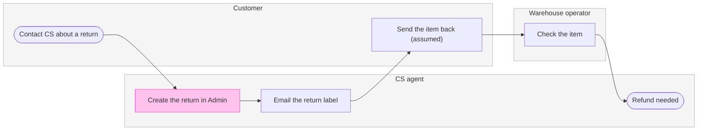
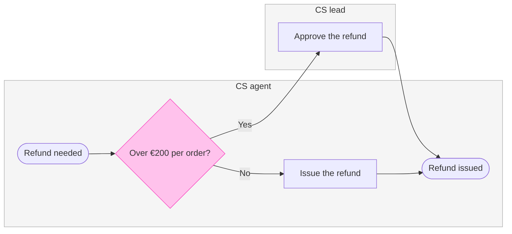
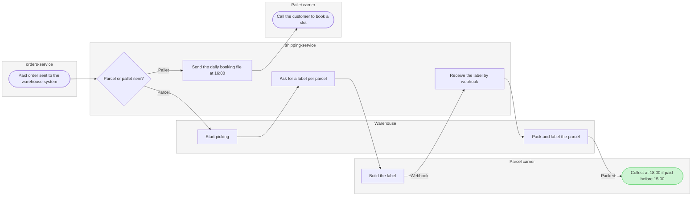

Nothing is written yet. All three diagrams pass `flow_check.py` and compose, and the write waits for your yes at this gate.

**Two changes from the playback**
- Warehouse now has 10 nodes, not 11. I merged "Order paid" and "send to the warehouse system" into one start node, because the longest path was 9 steps and the limit is 8.
- The lanes follow the order work first reaches them. On Warehouse that makes shipping-service sit before Warehouse.

**The checked model**

**Question:** who does what in each Fernhouse area, and which service owns each step?
**Outcome:** a reader can see who owns each step and where work changes hands before writing a ticket.

**Glances**
- Returns
  - First: Create the return in Admin, because every return waits on an agent today.
  - Second: Check the item, where the warehouse hands back to CS.
  - Last: the Refund needed end, which leads into board 2.
- Refunds
  - First: the "Over €200 per order?" decision.
  - Second: Approve the refund, the CS lead step.
  - Last: Refund issued.
- Warehouse
  - First: Collect at 18:00 if paid before 15:00.
  - Second: the "Parcel or pallet item?" split.
  - Last: Call the customer to book a slot, the pallet end, which no source gives tracking for.

**Target:** file `<draft-file-key>`, as three new sections placed 400 pixels right of what the file holds. Nothing already on it changes.
- A named file needs no `create_new_file` and no plan, so neither the Fernhouse Product plan nor the Barter team plan is used.
- If the file can't be opened, I stop and ask, because your two plan instructions conflict.

**Writes:** three composed boards in the order Returns, Refunds, Warehouse, at laptop distance with balanced detail.
- Returns has 6 nodes, 5 connectors and 3 lanes.
- Refunds has 5 nodes, 5 connectors, 2 lanes and 2 labelled exits.
- Warehouse has 10 nodes, 9 connectors, 5 lanes and 2 labelled exits.
- Each board has a title, a key and a source line.

**Extensions:** none.

**Calls:** `create_session`, one `get_figjam` read of the file before the write, three `use_figma` composes and one `get_figjam` read-back, six in all. On a Starter plan or a View or Collab seat, Figma allows six tool calls a month, and read tools count. This write would use the whole allowance.

**Rollback:** delete the three board sections the write returns, found by their tags. I do this only on a yes to a question that names them.

Do you want me to write these three boards to file `<draft-file-key>`?