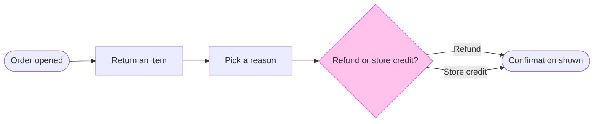

# FJ-041 turn 3 transcript

**User:** use your recommendation

**Tool call:** `Read` `{"file_path": "/private/var/folders/3c/zfqcqsts0kn19cgblj82gqhm0000gn/T/devin-compare-bench/FJ-041/sk-create-figjam/references/types/user-flow.md"}`

**Tool result:** `Read`

```text
"1\t---\n2\ttitle: \"FigJam Type - User Flow\"\n3\tdescription: \"A person's path through a product composed as a FigJam board: four shapes, labelled exits, colour by kind, optional zones and a nine-node budget.\"\n4\tcontextType: implementation\n5\timportance_tier: important\n6\ttrigger_phrases:\n7\t  - \"figjam user flow\"\n8\t  - \"user flow rules\"\n9\t  - \"screen flow figjam\"\n10\t  - \"merge dot\"\n11\tversion: 1.0.2.0\n12\t---\n13\t\n14\t# FigJam Type - User Flow\n15\t\n16\tA user flow is the screens and choices one person passes through to reach a goal. It is the default Flow type and the strictest, because it is drawn from screenshots and frames a reader will compare node by node.\n17\t\n18\t**Loading Condition:** CONDITIONAL, when the Flow route draws a user flow\n19\t**Purpose:** The grammar, rules, budget and read-back for a user flow\n20\t**Pairs With:** `assets/flow-templates.md`\n21\t\n22\t---\n23\t\n24\t## 1. WHEN TO USE\n25\t\n26\t**The reader's question:** which screens does a person pass through, and where do they choose?\n27\t\n28\t- A flow drawn from screenshots, from Figma frames or from a product doc that walks one person through the product\n29\t- A platform split, such as desktop and mobile, that rejoins on a later screen\n30\t- A journey, which Flow Mode does not draw as such, redrawn as the screens it visits\n31\t\n32\tUse another type when several people or teams hand work to each other (a process), when the subject is services and stores (an arc
```

**Tool call:** `ToolSearch` `{"query": "select:mcp__figma-remote__use_figma,mcp__figma-remote__get_figjam,mcp__figma-remote__create_session,mcp__figma-remote__get_screenshot,mcp__figma-remote__whoami", "max_results": 5}`

**Tool result:** `ToolSearch`

```text
[{"type": "tool_reference", "tool_name": "mcp__figma-remote__use_figma"}, {"type": "tool_reference", "tool_name": "mcp__figma-remote__get_figjam"}, {"type": "tool_reference", "tool_name": "mcp__figma-remote__create_session"}, {"type": "tool_reference", "tool_name": "mcp__figma-remote__get_screenshot"}, {"type": "tool_reference", "tool_name": "mcp__figma-remote__whoami"}]
```

**Tool call:** `Bash` `{"command": "cd /private/var/folders/3c/zfqcqsts0kn19cgblj82gqhm0000gn/T/devin-compare-bench/FJ-041/sk-create-figjam && python3 scripts/flow_check.py --help 2>&1 | head -30; python3 scripts/compose_board.py --help 2>&1 | head -30", "description": "Show check and composer usage"}`

**Tool result:** `Bash`

```text
"mermaid_extract: --help: not a Mermaid file\nUNREADABLE --help: the extractor refused it\n\n  compose_board.py <model.md> [--diagram N] [--out path]  -> 0 the filled code is written, 1 the model fails\n                                                             the check, 2 unreadable or no such diagram\n  compose_board.py <model.md> --model                      -> print the MODEL as JSON instead of the code\n  compose_board.py --template                              -> print the compact code with its MODEL and THEME\n                                                             placeholders, the text the Project's composer\n                                                             Knowledge file carries\n  compose_board.py --design-check                          -> print the design a board is drawn in, what it\n                                                             changes, its measures and the THEME it sends: 0 the\n                                                             design reads with no warning, 1 one or more warnings\n  compose_board.py --self-test                             -> prove every shipped model composes, its counts\n                                                             match the check, the code fits one use_figma call and\n                                                             the board it draws keeps its geometry and its design"
```

**Tool call:** `Bash` `{"command": "SCRATCH=$(mktemp -d /tmp/fernhouse-return.XXXXXX) && echo \"$SCRATCH\" > /tmp/fernhouse-scratch-path && cat > \"$SCRATCH/model.md\" <<'EOF'\n```mermaid\n%% title: Fernhouse return flow\n%% subtitle: How a customer starts a return from an order, picks a reason and chooses a refund or store credit\n%% source: Source: the request. Left out: failure paths and back-office steps.\nflowchart LR\n    start([Order opened]) --> returnItem[Return an item]\n    returnItem --> reason[Pick a reason]\n    reason --> choice{Refund or store credit?}\n    choice -->|Refund| done([Confirmation shown`

**Tool result:** `Bash`

```text
"  diagram 1, user flow: ok, 5 nodes and 5 connectors, widest rank 1 steps, longest path 5 steps, 1.0 connectors per step, labels average 16 characters, 0 crossing pairs\nPASSED 1 diagram(s) in model.md\nexit 0\nCOMPOSED diagram 1, 5 nodes and 5 connectors, widest rank 1 steps, longest path 5 steps, 1.0 connectors per step, labels average 16 characters, 0 crossing pairs: 5 nodes and 5 connectors to read back, 41200 characters in /tmp/fernhouse-return.XyZ8DD/code.js, drawn in the design FigJam default\nexit 0\n   41200 /tmp/fernhouse-return.XyZ8DD/code.js"
```

**Assistant:**

The model passes the pre-write check, and the composer built the board code. Nothing is on the board yet.

Check result: user flow, 5 nodes, 5 connectors, 0 crossing pairs, longest path 5 steps.

The model to be drawn:



What the reader should see:
- First glance: the "Refund or store credit?" decision, the only node with the pink outline
- Second glance: its two labelled exits, which both reach the one confirmation
- Last glance: the source line, which says failure paths and back-office steps are not drawn

The board is drawn at the defaults, laptop reading distance, balanced detail and a mixed audience, with no zones. Two assumptions stand, as marked: one confirmation covers both outcomes, and the flow is current behaviour.

Write plan
- File: the existing FigJam file `<draft-file-key>`. The board lands as a new section 400 pixels to the right of what is already there, and nothing already on the file changes. No new file is created.
- Plan: you named the Fernhouse Product plan. No tool I have reports which plan owns an existing file, so I haven't verified that this file sits in it.
- Extensions: none
- Calls: three. `create_session`, one `use_figma` call that draws the board and one `get_figjam` call that reads it back. If you're on a Starter plan or a View or Collab seat, Figma caps tool calls at six a month, and this uses half of that.
- Rollback: I'd delete the one board section the write returns, and only after you say yes to a question that names it. Nothing else on the file would be touched.

Should I write this board to file `<draft-file-key>` now?
