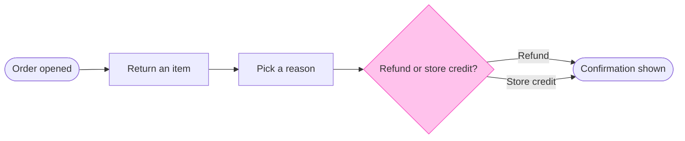

The model passes the pre-write check, and the composer built the board code. Nothing is on the board yet.

Check result: user flow, 5 nodes, 5 connectors, 0 crossing pairs, longest path 5 steps.

The model to be drawn:

What the reader should see:
- First glance: the "Refund or store credit?" decision, the only node with the pink outline
- Second glance: its two labelled exits, which both reach the one confirmation
- Last glance: the source line, which says failure paths and back-office steps are not drawn

The board is drawn at the defaults, laptop reading distance, balanced detail and a mixed audience, with no zones. Two assumptions stand, as marked: one confirmation covers both outcomes, and the flow is current behaviour.

Write plan
- File: the existing FigJam file `<draft-file-key>`. The board lands as a new section 400 pixels to the right of what is already there, and nothing already on the file changes. No new file is created.
- Plan: you named the Fernhouse Product plan. No tool I have reports which plan owns an existing file, so I haven't verified that this file sits in it.
- Extensions: none
- Calls: three. `create_session`, one `use_figma` call that draws the board and one `get_figjam` call that reads it back. If you're on a Starter plan or a View or Collab seat, Figma caps tool calls at six a month, and this uses half of that.
- Rollback: I'd delete the one board section the write returns, and only after you say yes to a question that names it. Nothing else on the file would be touched.

Should I write this board to file `<draft-file-key>` now?