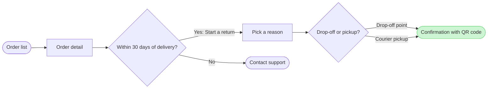

# FJ-045 turn 2 transcript

**User:** Yes, that reading is right.

**Tool call:** `Read` `{"file_path": "/private/var/folders/3c/zfqcqsts0kn19cgblj82gqhm0000gn/T/devin-compare-bench/FJ-045/sk-create-figjam/references/quality-rubric.md"}`

**Tool result:** `Read`

```text
"1\t---\n2\ttitle: \"FigJam Diagram Quality Rubric\"\n3\tdescription: \"The taste gate a FigJam model passes before the write gate, translated from sk-design-diagram's success criteria: type fit, the remove test, signal, the check, the board, the design rubric that scores a composed board and the reply.\"\n4\tcontextType: implementation\n5\timportance_tier: important\n6\ttrigger_phrases:\n7\t  - \"figjam quality rubric\"\n8\t  - \"diagram taste gate\"\n9\t  - \"remove test\"\n10\t  - \"figjam review checklist\"\n11\t  - \"figjam design rubric\"\n12\tversion: 1.0.2.0\n13\t---\n14\t\n15\t# FigJam Diagram Quality Rubric\n16\t\n17\tThe script checks what a script can see. This rubric is the rest: whether the diagram should exist, whether every node earns its place and whether the reader can trust what lands on the board. Walk it after the check passes and before the write gate.\n18\t\n19\t**Loading Condition:** CONDITIONAL, on every Flow route before the write gate\n20\t**Purpose:** The judgement pass between the pre-write check and the gate\n21\t**Scope:** The model, the provenance table, the planned extensions and, after the write, the board and the reply\n22\t\n23\t---\n24\t\n25\t## 1. TYPE FIT\n26\t\n27\t- [ ] The type answers the reader's question, as `references/flow-mode.md` Section 3 maps it\n28\t- [ ] A table, a list or a paragraph would not do the same job. If it would, say so and offer that instead\n29\t- [ ] The type's reference in `references/types/` was loaded and i
```

**Tool call:** `Read` `{"file_path": "/private/var/folders/3c/zfqcqsts0kn19cgblj82gqhm0000gn/T/devin-compare-bench/FJ-045/sk-create-figjam/references/style-guide.md"}`

**Tool result:** `Read`

```text
"1\t---\n2\ttitle: \"FigJam Diagram Style Guide\"\n3\tdescription: \"The colour every composed FigJam board draws by kind in the shipped design, the type scale and the 8 pixel grid, the palette pairs the check accepts with their measured contrast, and the spacing bands, translated from sk-design-diagram's style guide and derivation record.\"\n4\tcontextType: implementation\n5\timportance_tier: important\n6\ttrigger_phrases:\n7\t  - \"figjam style guide\"\n8\t  - \"figjam palette\"\n9\t  - \"figjam colour by kind\"\n10\t  - \"figjam type scale\"\n11\t  - \"palette derivation record\"\n12\t  - \"figjam contrast\"\n13\tversion: 1.0.2.0\n14\t---\n15\t\n16\t# FigJam Diagram Style Guide\n17\t\n18\tThe rules for colour, type and spacing on a FigJam board. The composer in `assets/compose-board.js` draws every board in the design `assets/figjam-design.md` holds, which ships as the tables below record, and every hex a model, a design or a note extension uses comes from the palette in Section 3. `scripts/flow_check.py` refuses any other.\n19\t\n20\t**Loading Condition:** CONDITIONAL, before the gate on every Flow route, and when a model or a note extension uses colour\n21\t**Purpose:** Names the colour each kind draws in, the type scale, the grid, the palette pairs the check accepts and the measured contrast record\n22\t**Scope:** The composed board, Mermaid `style`, `classDef` and `linkStyle` colours, sticky and pin colours for notes, and the contrast record the self-test re-measures\n
```

**Tool call:** `Bash` `{"command": "S=$(mktemp -d /tmp/figjam-FJ045.XXXXXX) && echo $S > /tmp/figjam-FJ045.path && cat > $S/model.md <<'EOF'\n```mermaid\nflowchart LR\n    %% title: Start a return\n    %% subtitle: How a Fernhouse customer starts a return in the app, from the order list to a confirmed return\n    %% source: Sources: the app and the returns doc, as described in the request. Left out: screens for picking a drop-off point or booking a pickup slot. Clash: the Fernhouse context of 2026-09-18 says there is no self-serve return today, and the app and returns doc govern here.\n    %% zone: Find the order: o`

**Tool result:** `Bash`

```text
"  diagram 1, user flow: ok, 7 nodes and 7 connectors, widest rank 2 steps, longest path 6 steps, 1.0 connectors per step, labels average 17 characters, 0 crossing pairs\nPASSED 1 diagram(s) in model.md\nexit 0"
```

**Tool call:** `Bash` `{"command": "S=$(cat /tmp/figjam-FJ045.path) && python3 sk-create-figjam/scripts/compose_board.py $S/model.md --diagram 1 --out $S/board.js; echo exit $?; wc -c $S/board.js", "description": "Compose the model into board code in scratch"}`

**Tool result:** `Bash`

```text
"COMPOSED diagram 1, 7 nodes and 7 connectors, widest rank 2 steps, longest path 6 steps, 1.0 connectors per step, labels average 17 characters, 0 crossing pairs: 7 nodes and 7 connectors to read back, 41947 characters in /tmp/figjam-FJ045.kyWwpW/board.js, drawn in the design FigJam default\nexit 0\n   41947 /tmp/figjam-FJ045.kyWwpW/board.js"
```

**Assistant:**

The model passes the check: 7 nodes, 7 connectors and 0 crossing pairs. It composes cleanly, so this is the write gate.



The Mermaid above is the working model. The board also gets a title, a subtitle, three zones and a source line that names the clash with the company context.

**Question:** which screens does a customer pass through to start a return in the app, and where do they choose?

**Outcome:** a reader can follow a return from the order list to the confirmation with its QR code. They can also see where the 30-day window ends it with Contact support.

**First glance:** the confirmation with QR code, the goal, drawn green with the pink outline.

**Second glance:** the drop-off or pickup choice that leads to it.

**Last glance:** Contact support, the exit after 30 days.

**File:** the existing FigJam file <draft-file-key>. It takes the board as a new section, and nothing already on it changes. No plan is involved, and no new file is created.

**Writes:** one composed board, with these parts:
- 7 nodes and 7 connectors in the three zones Find the order, Request the return and Done
- 4 labelled decision exits
- a title, a key and a source line at laptop reading distance

**Extensions:** none.

**Calls:** four. They are `create_session`, one `get_figjam` read of the file before the write, one `use_figma` and one `get_figjam` read-back. On a Starter plan or a View or Collab seat, Figma allows six tool calls a month and reads count, so this would use most of that.

**Rollback:** delete the one board section the write returns, only on your yes to a question that names it.

The "Within 30 days of delivery?" decision after Order detail is the placement you accepted from the recommendation. It is drawn as current behavior, and the source line names the clash with the company context.

Write it?
