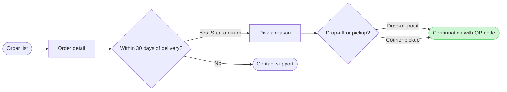

The model passes the check: 7 nodes, 7 connectors and 0 crossing pairs. It composes cleanly, so this is the write gate.

The Mermaid above is the working model. The board also gets a title, a subtitle, three zones and a source line that names the clash with the company context.

**Question:** which screens does a customer pass through to start a return in the app, and where do they choose?

**Outcome:** a reader can follow a return from the order list to the confirmation with its QR code. They can also see where the 30-day window ends it with Contact support.

**First glance:** the confirmation with QR code, the goal, drawn green with the pink outline.

**Second glance:** the drop-off or pickup choice that leads to it.

**Last glance:** Contact support, the exit after 30 days.

**File:** the existing FigJam file <draft-file-key>. It takes the board as a new section, and nothing already on it changes. No plan is involved, and no new file is created.

**Writes:** one composed board, with these parts:
- 7 nodes and 7 connectors in the three zones Find the order, Request the return and Done
- 4 labelled decision exits
- a title, a key and a source line at laptop reading distance

**Extensions:** none.

**Calls:** four. They are `create_session`, one `get_figjam` read of the file before the write, one `use_figma` and one `get_figjam` read-back. On a Starter plan or a View or Collab seat, Figma allows six tool calls a month and reads count, so this would use most of that.

**Rollback:** delete the one board section the write returns, only on your yes to a question that names it.

The "Within 30 days of delivery?" decision after Order detail is the placement you accepted from the recommendation. It is drawn as current behavior, and the source line names the clash with the company context.

Write it?