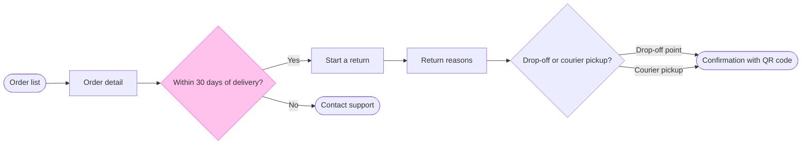

# FJ-022 turn 4 transcript

**User:** Yes, go ahead.

**Tool call:** `Read` `{"file_path": "/private/var/folders/3c/zfqcqsts0kn19cgblj82gqhm0000gn/T/devin-compare-bench/FJ-022/sk-create-figjam/references/types/user-flow.md"}`

**Tool result:** `Read`

```text
"1\t---\n2\ttitle: \"FigJam Type - User Flow\"\n3\tdescription: \"A person's path through a product composed as a FigJam board: four shapes, labelled exits, colour by kind, optional zones and a nine-node budget.\"\n4\tcontextType: implementation\n5\timportance_tier: important\n6\ttrigger_phrases:\n7\t  - \"figjam user flow\"\n8\t  - \"user flow rules\"\n9\t  - \"screen flow figjam\"\n10\t  - \"merge dot\"\n11\tversion: 1.0.5.0\n12\t---\n13\t\n14\t# FigJam Type - User Flow\n15\t\n16\tA user flow is the screens and choices one person passes through to reach a goal. It is the default Flow type and the strictest, because it is drawn from screenshots and frames a reader will compare node by node.\n17\t\n18\t**Loading Condition:** CONDITIONAL, when the Flow route draws a user flow\n19\t**Purpose:** The grammar, rules, budget and read-back for a user flow\n20\t**Pairs With:** `assets/flow-templates.md`\n21\t\n22\t---\n23\t\n24\t## 1. WHEN TO USE\n25\t\n26\t**The reader's question:** which screens does a person pass through, and where do they choose?\n27\t\n28\t- A flow drawn from screenshots, from Figma frames or from a product doc that walks one person through the product\n29\t- A platform split, such as desktop and mobile, that rejoins on a later screen\n30\t- A journey, which Flow Mode does not draw as such, redrawn as the screens it visits\n31\t\n32\tUse another type when several people or teams hand work to each other (a process), when the subject is services and stores (an arc
```

**Tool call:** `Read` `{"file_path": "/private/var/folders/3c/zfqcqsts0kn19cgblj82gqhm0000gn/T/devin-compare-bench/FJ-022/sk-create-figjam/references/quality-rubric.md"}`

**Tool result:** `Read`

```text
"1\t---\n2\ttitle: \"FigJam Diagram Quality Rubric\"\n3\tdescription: \"The taste gate a FigJam model passes before the write gate, translated from sk-design-diagram's success criteria: type fit, the remove test, signal, the check, the board, the design rubric that scores a composed board and the reply.\"\n4\tcontextType: implementation\n5\timportance_tier: important\n6\ttrigger_phrases:\n7\t  - \"figjam quality rubric\"\n8\t  - \"diagram taste gate\"\n9\t  - \"remove test\"\n10\t  - \"figjam review checklist\"\n11\t  - \"figjam design rubric\"\n12\tversion: 1.0.13.0\n13\t---\n14\t\n15\t# FigJam Diagram Quality Rubric\n16\t\n17\tThe script checks what a script can see. This rubric is the rest: whether the diagram should exist, whether every node earns its place and whether the reader can trust what lands on the board. Walk it after the check passes and before the write gate.\n18\t\n19\t**Loading Condition:** CONDITIONAL, on every Flow route before the write gate\n20\t**Purpose:** The judgement pass between the pre-write check and the gate\n21\t**Scope:** The model, the provenance table, the planned extensions and, after the write, the board and the reply\n22\t\n23\t---\n24\t\n25\t## 1. TYPE FIT\n26\t\n27\t- [ ] The type answers the reader's question, as `references/flow-mode.md` Section 3 maps it\n28\t- [ ] A table, a list or a paragraph would not do the same job. If it would, say so and offer that instead\n29\t- [ ] The type's reference in `references/types/` was loaded and 
```

**Tool call:** `ToolSearch` `{"query": "select:mcp__figma-remote__get_figjam,mcp__figma-remote__create_session,mcp__figma-remote__whoami,mcp__figma-remote__use_figma", "max_results": 4}`

**Tool result:** `ToolSearch`

```text
[{"type": "tool_reference", "tool_name": "mcp__figma-remote__get_figjam"}, {"type": "tool_reference", "tool_name": "mcp__figma-remote__create_session"}, {"type": "tool_reference", "tool_name": "mcp__figma-remote__whoami"}, {"type": "tool_reference", "tool_name": "mcp__figma-remote__use_figma"}]
```

**Tool call:** `Bash` `{"command": "mktemp -d", "description": "Create scratch folder for model"}`

**Tool result:** `Bash`

```text
"/var/folders/3c/zfqcqsts0kn19cgblj82gqhm0000gn/T/tmp.Xa0Wr4KvAd"
```

**Tool call:** `Write` `{"file_path": "/var/folders/3c/zfqcqsts0kn19cgblj82gqhm0000gn/T/tmp.Xa0Wr4KvAd/model.md", "content": "```mermaid\nflowchart LR\n    %% title: Start a return\n    %% subtitle: How a Fernhouse customer starts a return in the app, from the order list to a confirmation with a QR code\n    %% source: Sources: the app and the returns doc. Left out: free pickup over 100 euros, a proposal under review.\n    %% goal: confirmation\n    orderList([Order list]) --> orderDetail[Order detail]\n    orderDetail --> window{Within 30 days of delivery?}\n    window -->|Yes| startReturn[Start a return button]\n  `

**Tool result:** `Write`

```text
"File created successfully at: /var/folders/3c/zfqcqsts0kn19cgblj82gqhm0000gn/T/tmp.Xa0Wr4KvAd/model.md (file state is current in your context \u2014 no need to Read it back)"
```

**Tool call:** `mcp__figma-remote__create_session` `{"fileKey": "<test-file-key>", "description": "Add a user flow board \"Start a return\" as a new section in the existing FigJam file"}`

**Tool result:** `mcp__figma-remote__create_session`

```text
"{\"sessionId\":\"5c414d0c-ab2e-487a-9778-3e52de206a05\"}"
```

**Tool call:** `Bash` `{"command": "python3 sk-create-figjam/scripts/flow_check.py /var/folders/3c/zfqcqsts0kn19cgblj82gqhm0000gn/T/tmp.Xa0Wr4KvAd/model.md", "description": "Run the pre-write check on the model"}`

**Tool result:** `Bash`

```text
"  diagram 1, user flow: ok, 8 nodes and 8 connectors, widest rank 2 steps, longest path 7 steps, 1.0 connectors per step, labels average 19 characters, 0 crossing pairs\nLabel: Start a return button leaves 'button' alone on its last line, so shorten it, or reword it in the source's words, when that keeps the meaning\nGlance: Within 30 days of delivery? (accent) > Order list > Order detail > Start a return button > Contact support > Return reasons > Drop-off or courier pickup? > Confirmation with QR code (goal)\nPASSED 1 diagram(s) in model.md"
```

**Tool call:** `mcp__figma-remote__get_figjam` `{"fileKey": "<test-file-key>", "nodeId": "0:1", "includeImagesOfNodes": false, "sessionId": "5c414d0c-ab2e-487a-9778-3e52de206a05"}`

**Tool result:** `mcp__figma-remote__get_figjam`

```text
[{"type": "text", "text": "<canvas id=\"0:1\" name=\"Page 1\" x=\"0\" y=\"0\" width=\"0\" height=\"0\" />"}]
```

**Tool call:** `Bash` `{"command": "M=/var/folders/3c/zfqcqsts0kn19cgblj82gqhm0000gn/T/tmp.Xa0Wr4KvAd && sed -i '' 's/Start a return button\\]/Start a return]/' $M/model.md && python3 sk-create-figjam/scripts/flow_check.py $M/model.md && python3 sk-create-figjam/scripts/compose_board.py $M/model.md --diagram 1 --out $M/board.js | cut -c1-400; wc -c $M/board.js; cat $M/model.md", "description": "Reword label, recheck and compose the board code"}`

**Tool result:** `Bash`

```text
"  diagram 1, user flow: ok, 8 nodes and 8 connectors, widest rank 2 steps, longest path 7 steps, 1.0 connectors per step, labels average 18 characters, 0 crossing pairs\nGlance: Within 30 days of delivery? (accent) > Order list > Order detail > Start a return > Contact support > Return reasons > Drop-off or courier pickup? > Confirmation with QR code (goal)\nPASSED 1 diagram(s) in model.md\nCOMPOSED diagram 1, 8 nodes and 8 connectors, widest rank 2 steps, longest path 7 steps, 1.0 connectors per step, labels average 18 characters, 0 crossing pairs: 8 nodes and 8 connectors to read back, 41902 characters in /var/folders/3c/zfqcqsts0kn19cgblj82gqhm0000gn/T/tmp.Xa0Wr4KvAd/board.js, drawn in the design FigJam default\n   41902 /var/folders/3c/zfqcqsts0kn19cgblj82gqhm0000gn/T/tmp.Xa0Wr4KvAd/board.js\n```mermaid\nflowchart LR\n    %% title: Start a return\n    %% subtitle: How a Fernhouse customer starts a return in the app, from the order list to a confirmation with a QR code\n    %% source: Sources: the app and the returns doc. Left out: free pickup over 100 euros, a proposal under review.\n    %% goal: confirmation\n    orderList([Order list]) --> orderDetail[Order detail]\n    orderDetail --> window{Within 30 days of delivery?}\n    window -->|Yes| startReturn[Start a return]\n    window -->|No| contactSupport([Contact support])\n    startReturn --> reasons[Return reasons]\n    reasons --> method{Drop-off or courier pickup?}\n    method -->|Drop-off point| confirmation([Confi
```

**Assistant:**

**Gate: the write**

**Purpose:** The board answers how a Fernhouse customer starts a return in the app. The product and support team should be able to see each step and where the 30-day window sends a customer to Contact support.

**The glance lines**
- **First glance:** the "Within 30 days of delivery?" decision.
- **Second glance:** the main row, in the order the check printed it: Order list, Order detail, Start a return, Contact support, Return reasons, "Drop-off or courier pickup?", then the Confirmation with QR code, which is the goal.
- **Last glance:** the key and the source line.

**The sketch, as the check read it**

`PASSED 1 diagram(s) in model.md`

The first check flagged that "button" would sit alone on a line in "Start a return button". I reworded the label to the button's own name, "Start a return", and the check now passes.

**The four critique questions**
- **Where the eye goes first:** the 30-day decision, which is the node the board most needs read, because it's where a customer is sent to support.
- **What it reads second:** the main row from the Order list to the Confirmation, which advances the decision by showing what Yes leads to.
- **What a reader could miss:** the Contact support end sits beside the row. Missing it hides the 30-day rule, so the accent on the decision points to it.
- **What the remove test would cut next:** the Order list. It stays because it's the entry you named.

**What the write does**
- **Target:** a new section in the existing file `<test-file-key>`, in the Fernhouse Product plan as you stated it. I haven't confirmed that plan myself and haven't called `whoami`, since you named the file.
- **File state:** I read the file and it's empty, so nothing is on it to clash with the title or to leave unchanged.
- **Board:** 8 nodes, 8 connectors and 3 labelled exits, with the key and the source line.
- **Extensions:** none.
- **Calls:** one `use_figma` call to compose the board, then one `get_figjam` read-back. That is two more calls, after the one read and the session already made. If the Fernhouse seat is on a Starter plan or is a View or Collab seat, Figma limits it to six tool calls a month, so the read-back may be refused and I'd say so.
- **Rollback:** I delete the one board section the write returns, with nothing else on the file touched. I only do that on a yes to a question that names it.

**Left out:** free pickup over 100 euros (a proposal under review) and everything after the confirmation.

Write this board to the file?
