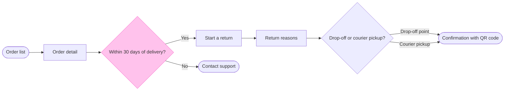

**Gate: the write**

**Purpose:** The board answers how a Fernhouse customer starts a return in the app. The product and support team should be able to see each step and where the 30-day window sends a customer to Contact support.

**The glance lines**
- **First glance:** the "Within 30 days of delivery?" decision.
- **Second glance:** the main row, in the order the check printed it: Order list, Order detail, Start a return, Contact support, Return reasons, "Drop-off or courier pickup?", then the Confirmation with QR code, which is the goal.
- **Last glance:** the key and the source line.

**The sketch, as the check read it**

`PASSED 1 diagram(s) in model.md`

The first check flagged that "button" would sit alone on a line in "Start a return button". I reworded the label to the button's own name, "Start a return", and the check now passes.

**The four critique questions**
- **Where the eye goes first:** the 30-day decision, which is the node the board most needs read, because it's where a customer is sent to support.
- **What it reads second:** the main row from the Order list to the Confirmation, which advances the decision by showing what Yes leads to.
- **What a reader could miss:** the Contact support end sits beside the row. Missing it hides the 30-day rule, so the accent on the decision points to it.
- **What the remove test would cut next:** the Order list. It stays because it's the entry you named.

**What the write does**
- **Target:** a new section in the existing file `<test-file-key>`, in the Fernhouse Product plan as you stated it. I haven't confirmed that plan myself and haven't called `whoami`, since you named the file.
- **File state:** I read the file and it's empty, so nothing is on it to clash with the title or to leave unchanged.
- **Board:** 8 nodes, 8 connectors and 3 labelled exits, with the key and the source line.
- **Extensions:** none.
- **Calls:** one `use_figma` call to compose the board, then one `get_figjam` read-back. That is two more calls, after the one read and the session already made. If the Fernhouse seat is on a Starter plan or is a View or Collab seat, Figma limits it to six tool calls a month, so the read-back may be refused and I'd say so.
- **Rollback:** I delete the one board section the write returns, with nothing else on the file touched. I only do that on a yes to a question that names it.

**Left out:** free pickup over 100 euros (a proposal under review) and everything after the confirmation.

Write this board to the file?