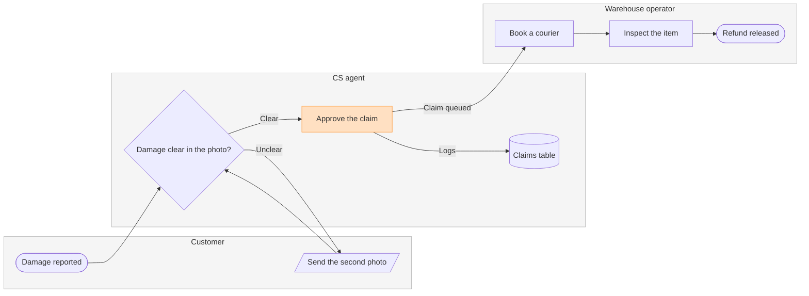

# FJ-023 turn 3 transcript

**User:** Yes, that reading is right.

**Tool call:** `Bash` `{"command": "d=$(mktemp -d) && echo \"$d\" && cat > \"$d/model.md\" <<'EOF'\n```mermaid\n%% type: process\nflowchart LR\n    %% title: Damaged-item refund\n    %% subtitle: Who handles a damaged-item claim, from the customer's report to the released refund\n    %% source: Source: the support runbook. Every decision is logged in the claims table. Left out: pickup skipped under 20 euros, a pilot that is not live.\n    subgraph customer [\"Customer\"]\n        report([Damage reported])\n        photo[/Send the second photo/]\n    end\n    subgraph cs [\"CS agent\"]\n        check{Damage clear in `

**Tool result:** `Bash`

```text
"/var/folders/3c/zfqcqsts0kn19cgblj82gqhm0000gn/T/tmp.rNciUsGleF\n  diagram 1, process: ok, 8 nodes and 8 connectors, widest rank 2 steps, longest path 6 steps, 1.0 connectors per step, labels average 17 characters, 0 crossing pairs\nGlance: Approve the claim (accent) > Damage reported > Damage clear in the photo? > Send the second photo > Claims table > Book a courier > Inspect the item > Refund released (goal)\nPASSED 1 diagram(s) in model.md"
```

**Tool call:** `ToolSearch` `{"query": "select:mcp__figma-remote__create_session,mcp__figma-remote__get_figjam,mcp__figma-remote__use_figma,mcp__figma-remote__whoami", "max_results": 4}`

**Tool result:** `ToolSearch`

```text
[{"type": "tool_reference", "tool_name": "mcp__figma-remote__create_session"}, {"type": "tool_reference", "tool_name": "mcp__figma-remote__get_figjam"}, {"type": "tool_reference", "tool_name": "mcp__figma-remote__use_figma"}, {"type": "tool_reference", "tool_name": "mcp__figma-remote__whoami"}]
```

**Tool call:** `mcp__figma-remote__create_session` `{"fileKey": "<test-file-key>", "description": "Read the FigJam file once before the write gate for a damaged-item refund process board"}`

**Tool result:** `mcp__figma-remote__create_session`

```text
"{\"sessionId\":\"98707a39-f352-4a0e-8902-45cd6603b949\"}"
```

**Tool call:** `mcp__figma-remote__get_figjam` `{"fileKey": "<test-file-key>", "nodeId": "0:1", "includeImagesOfNodes": false, "sessionId": "98707a39-f352-4a0e-8902-45cd6603b949"}`

**Tool result:** `mcp__figma-remote__get_figjam`

```text
[{"type": "text", "text": "<canvas id=\"0:1\" name=\"Page 1\" x=\"0\" y=\"0\" width=\"0\" height=\"0\" />"}]
```

**Assistant:**

Question: who does what, and where does the claim change hands?
Outcome: a CS or warehouse lead can see which team owns each step of a damaged-item refund and where the claim moves from CS to the warehouse.
First glance: Approve the claim, the handoff from CS to the warehouse, drawn in the one accent colour.
Second glance: Damage reported, where the claim starts, then Damage clear in the photo?, the decision the claim turns on, then Send the second photo, the loop back to the customer, then the claims table, where every decision is logged, then Book a courier, Inspect the item and Refund released, the goal. This is the order the check's Glance line prints.
Last glance: the key and the source line, since the goal comes last.

Sketch, the checked model exactly as the check read it:



```text
  diagram 1, process: ok, 8 nodes and 8 connectors, widest rank 2 steps, longest path 6 steps, 1.0 connectors per step, labels average 17 characters, 0 crossing pairs
Glance: Approve the claim (accent) > Damage reported > Damage clear in the photo? > Send the second photo > Claims table > Book a courier > Inspect the item > Refund released (goal)
PASSED 1 diagram(s) in model.md
```

Eye first: Approve the claim, the handoff to the warehouse you asked to highlight, and it is the node the board most needs read.
Reads second: Damage reported, then Damage clear in the photo?, then the claim on to Refund released, lane by lane across the board, which shows who holds the claim at each step.
Could miss: Send the second photo, the loop back to the customer, which would hide why some claims stall.
Remove next: the claims table, which stays because the runbook logs every decision there.

Plan: Fernhouse Product, as you named it.
File: the existing FigJam file <test-file-key>, not a new file. I read it once and it is empty, so no section shares the title "Damaged-item refund".
Writes: one composed board in that file, 3 lanes, 8 nodes and 8 connectors, with a title, a key and a source line, at the Laptop reading distance.
Left out: pickup skipped under 20 euros, a pilot that is not live. The runbook has no decline path, so the board shows none.
Extensions: none.
Calls: one `use_figma` to compose the board and one `get_figjam` read-back. The session and the first read are already spent.
Rollback: delete the one board section the write returns, which I'd do only on your yes to a question naming it.

Write it?
