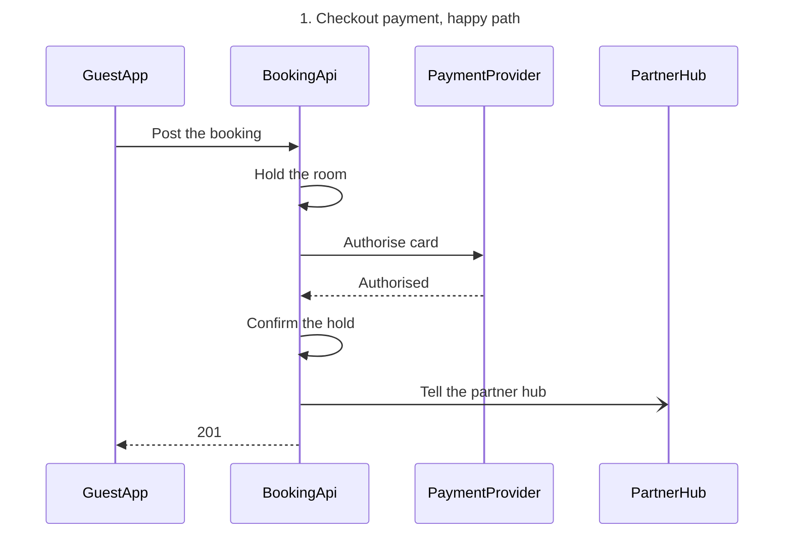
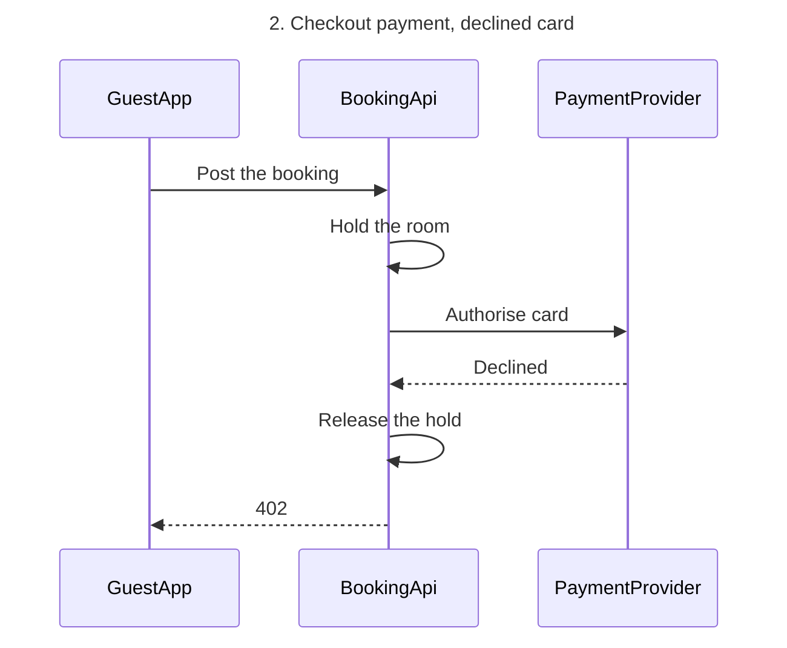

# FJ-025 turn 3 transcript

**User:** Yes, that reading is right.

**Tool call:** `ToolSearch` `{"query": "select:mcp__figma-remote__create_session,mcp__figma-remote__get_figjam,mcp__figma-remote__use_figma,mcp__figma-remote__get_screenshot", "max_results": 4}`

**Tool result:** `ToolSearch`

```text
[{"type": "tool_reference", "tool_name": "mcp__figma-remote__create_session"}, {"type": "tool_reference", "tool_name": "mcp__figma-remote__get_figjam"}, {"type": "tool_reference", "tool_name": "mcp__figma-remote__use_figma"}, {"type": "tool_reference", "tool_name": "mcp__figma-remote__get_screenshot"}]
```

**Tool call:** `Read` `{"file_path": "/private/var/folders/3c/zfqcqsts0kn19cgblj82gqhm0000gn/T/devin-compare-bench/FJ-025/sk-create-figjam/references/quality-rubric.md"}`

**Tool result:** `Read`

```text
"1\t---\n2\ttitle: \"FigJam Diagram Quality Rubric\"\n3\tdescription: \"The taste gate a FigJam model passes before the write gate, translated from sk-design-diagram's success criteria: type fit, the remove test, signal, the check, the board, the design rubric that scores a composed board and the reply.\"\n4\tcontextType: implementation\n5\timportance_tier: important\n6\ttrigger_phrases:\n7\t  - \"figjam quality rubric\"\n8\t  - \"diagram taste gate\"\n9\t  - \"remove test\"\n10\t  - \"figjam review checklist\"\n11\t  - \"figjam design rubric\"\n12\tversion: 1.0.13.0\n13\t---\n14\t\n15\t# FigJam Diagram Quality Rubric\n16\t\n17\tThe script checks what a script can see. This rubric is the rest: whether the diagram should exist, whether every node earns its place and whether the reader can trust what lands on the board. Walk it after the check passes and before the write gate.\n18\t\n19\t**Loading Condition:** CONDITIONAL, on every Flow route before the write gate\n20\t**Purpose:** The judgement pass between the pre-write check and the gate\n21\t**Scope:** The model, the provenance table, the planned extensions and, after the write, the board and the reply\n22\t\n23\t---\n24\t\n25\t## 1. TYPE FIT\n26\t\n27\t- [ ] The type answers the reader's question, as `references/flow-mode.md` Section 3 maps it\n28\t- [ ] A table, a list or a paragraph would not do the same job. If it would, say so and offer that instead\n29\t- [ ] The type's reference in `references/types/` was loaded and 
```

**Tool call:** `Bash` `{"command": "mktemp -d", "description": "Create scratch folder for the model"}`

**Tool result:** `Bash`

```text
"/var/folders/3c/zfqcqsts0kn19cgblj82gqhm0000gn/T/tmp.oSzrV7Jsxv"
```

**Tool call:** `Write` `{"file_path": "/var/folders/3c/zfqcqsts0kn19cgblj82gqhm0000gn/T/tmp.oSzrV7Jsxv/model.md", "content": "```mermaid\nsequenceDiagram\n    title 1. Checkout payment, happy path\n    %% subtitle: The calls a Roamstay checkout makes, from the booking request to the 201, for the payments team\n    %% source: Source: the payments brief, as summarised in the request. Left out: retries, timeouts and partner hub failures, which the brief does not state. The declined card is diagram 2.\n    %% focus: 3\n    participant GuestApp\n    participant BookingApi\n    participant PaymentProvider\n    participant `

**Tool result:** `Write`

```text
"File created successfully at: /var/folders/3c/zfqcqsts0kn19cgblj82gqhm0000gn/T/tmp.oSzrV7Jsxv/model.md (file state is current in your context \u2014 no need to Read it back)"
```

**Tool call:** `Bash` `{"command": "cd /private/var/folders/3c/zfqcqsts0kn19cgblj82gqhm0000gn/T/devin-compare-bench/FJ-025/sk-create-figjam && python3 scripts/flow_check.py /var/folders/3c/zfqcqsts0kn19cgblj82gqhm0000gn/T/tmp.oSzrV7Jsxv/model.md", "description": "Run the pre-write check on the model"}`

**Tool result:** `Bash`

```text
"  diagram 1, sequence: ok, 4 participants and 7 messages\n  diagram 2, sequence: ok, 3 participants and 6 messages\nPASSED 2 diagram(s) in model.md"
```

**Tool call:** `Bash` `{"command": "S=/var/folders/3c/zfqcqsts0kn19cgblj82gqhm0000gn/T/tmp.oSzrV7Jsxv && python3 scripts/compose_board.py $S/model.md --diagram 1 --out $S/d1.js; python3 scripts/compose_board.py $S/model.md --diagram 2 --out $S/d2.js", "description": "Compose both diagrams into board code"}`

**Tool result:** `Bash`

```text
"COMPOSED diagram 1, 4 participants and 7 messages: 4 nodes and 7 connectors to read back, 17915 characters in /var/folders/3c/zfqcqsts0kn19cgblj82gqhm0000gn/T/tmp.oSzrV7Jsxv/d1.js, drawn in the design FigJam default\nCOMPOSED diagram 2, 3 participants and 6 messages: 3 nodes and 6 connectors to read back, 17816 characters in /var/folders/3c/zfqcqsts0kn19cgblj82gqhm0000gn/T/tmp.oSzrV7Jsxv/d2.js, drawn in the design FigJam default"
```

**Tool call:** `mcp__figma-remote__create_session` `{"fileKey": "<test-file-key>", "description": "Add two Roamstay checkout payment sequence diagrams as new sections on an existing FigJam file"}`

**Tool result:** `mcp__figma-remote__create_session`

```text
"{\"sessionId\":\"ee6abdce-5960-4347-a51a-fec7849b90cd\"}"
```

**Tool call:** `mcp__figma-remote__get_figjam` `{"fileKey": "<test-file-key>", "nodeId": "0:1", "includeImagesOfNodes": false, "sessionId": "ee6abdce-5960-4347-a51a-fec7849b90cd"}`

**Tool result:** `mcp__figma-remote__get_figjam`

```text
[{"type": "text", "text": "<canvas id=\"0:1\" name=\"Page 1\" x=\"0\" y=\"0\" width=\"0\" height=\"0\" />"}]
```

**Assistant:**

The check passed, and the file is empty, so no section shares either title and nothing already on it can change.

**Question:** in what order do the guest app, the booking API, the payment provider and the partner hub exchange messages when a guest pays at checkout?
**Outcome:** the payments team can read the checkout calls in order, with the status codes, for an authorised card and for a declined one.
**First glance:** Authorise card on both diagrams, the call that decides the checkout.
**Second glance:** Authorised on diagram 1 and Declined on diagram 2, the answers that send the booking API to confirm or release the hold.
**Last glance:** Tell the partner hub, which does not hold up the answer to the app, and the 201 and 402 replies that close each path.

**Sketch:** the checked model exactly as the check read it.





```text
  diagram 1, sequence: ok, 4 participants and 7 messages
  diagram 2, sequence: ok, 3 participants and 6 messages
PASSED 2 diagram(s) in model.md
```

Both diagrams also composed cleanly in the shipped FigJam default design, with 4 nodes and 7 connectors to read back on diagram 1 and 3 nodes and 6 connectors on diagram 2.

**The four critique questions**
* Where the eye goes first: Authorise card, and that is the message the board most needs read
* What it reads second: Authorised or Declined, which advances the first by showing what the call returned
* What a reader could miss: Tell the partner hub, which would hide that the hub hears of the booking without holding up the 201
* What the remove test would cut next: Hold the room, which stays because the hold is what Confirm the hold and Release the hold act on

**Plan:** Roamstay Product, as you named it. I did not call `whoami`, so the plan is your statement and not something I verified.
**File:** the existing FigJam file `<test-file-key>`, with no new file created.
**Writes:** two composed boards added as new sections, "1. Checkout payment, happy path" with 4 participants and 7 numbered messages, and "2. Checkout payment, declined card" with 3 participants and 6 numbered messages. Each has a title, subtitle, key and source line, at the Laptop reading distance. The labels use plain verbs plus 201 and 402, because the brief gives no paths.
**Left out:** the declined card, split into 2. Checkout payment, declined card. Retries, timeouts and partner hub failures, because the brief states none of them.
**Extensions:** none.
**Calls:** two `use_figma` calls, one per diagram, and one `get_figjam` read-back of the file. I already spent one `get_figjam` read and the `create_session` call. If the plan is Starter, or your seat is View or Collab, Figma caps tool calls at six a month, and the read-back could be refused. The reply would then say `Read-back: not possible` with that limit named.
**Rollback:** delete the two board sections the write returns, through `use_figma`, and only on a yes that names them.

Write both boards to this file?
